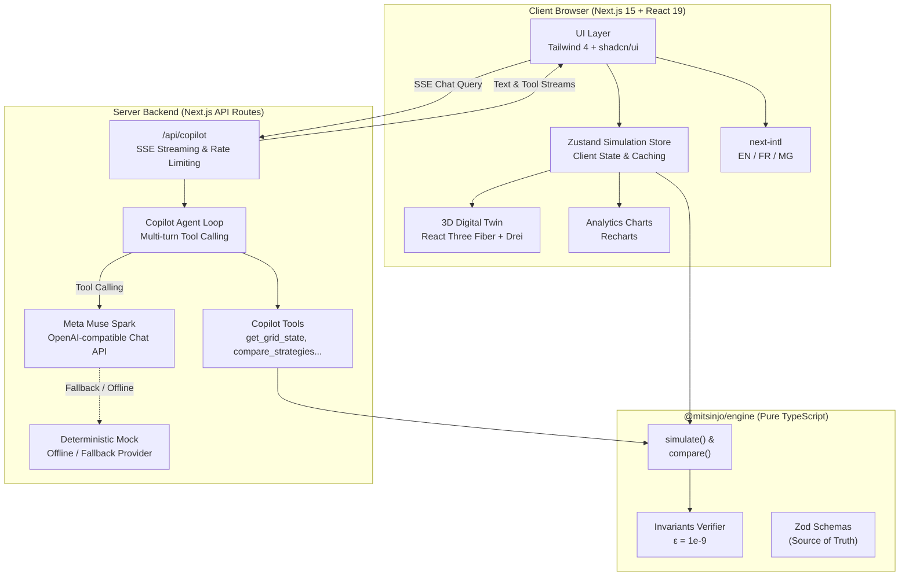

# Mitsinjo Grid — Rural Solar Microgrid Simulation & AI Decision Support

[](https://github.com/Tokiarivelo/mitsinjo-grid/actions/workflows/ci.yml)
[](LICENSE)
[](https://nextjs.org/)
[](https://react.dev/)
[](https://www.typescriptlang.org/)
[](https://tailwindcss.com/)
[](https://vitest.dev/)
[](https://playwright.dev/)

> **⚠️ SIMULATED DATA NOTICE**: All energy metrics, solar generation curves, battery state-of-charge figures, and load balances presented in this system are synthetic and generated for simulation, educational, and decision-support purposes. They do not represent real-time measurements from physical microgrid hardware.

**Public Production Deployment**: [https://mitsinjo-grid.vercel.app](https://mitsinjo-grid.vercel.app)  
**Demo Video (3 Minutes)**: _Pending recording (P9-T5) — script in [docs/demo-script.md](docs/demo-script.md)_  
**Documentation**: [docs/](docs/) · [docs/assumptions.md](docs/assumptions.md) · [docs/demo-script.md](docs/demo-script.md) · [docs/known-limitations.md](docs/known-limitations.md)

---

## 1. Problem: The Rural Microgrid Lifeline Dilemma

In off-grid rural communities across Madagascar and Sub-Saharan Africa, small solar-plus-storage microgrids (typically 30–50 kWp solar PV + 100–150 kWh battery storage) are the sole lifeline for essential civic and economic infrastructure.

When sudden monsoon cloud cover, severe weather, or high peak demands strike, battery reserves deplete rapidly. Traditional microgrid controllers rely on **naive proportional load shedding**—reducing power equally across all circuits by percentage.

Under proportional shedding, a severe deficit reduces power to the **Health Clinic** at the exact same rate as street markets and domestic lighting. An unexpected deficit can cut power to the clinic's vaccine refrigeration cold chain, incubator, and emergency lighting, risking catastrophic loss of life and supplies.

**Mitsinjo Grid** addresses this challenge with:

1. **Deterministic Microgrid Simulation**: Pure TypeScript simulation engine running identical, mathematically proven energy balance logic in under 3 ms on both client and server.
2. **Strategy Comparison Lab**: Direct quantitative comparison between proportional allocation, lexicographic essential-first priority, and balanced distribution. A parameters panel edits solar drop, demand, battery, per-sector priorities and power caps; all strategies re-run automatically.
3. **Meta AI Copilot**: Grounded AI assistant utilizing Meta Muse Spark with tool calling to inspect grid state, run counterfactual simulations, and provide evidence-backed dispatch recommendations.
4. **3D Village Digital Twin & Dispatch Controller**: Interactive spatial visualization of power flows, battery states, and infrastructure health. Golden-hour stylized village with an EMS dispatch controller shelter, real-time feeder breakers, continuous intensity-scaled lighting (street lamps, market garlands, window glow ∝ served kW), electron particle flow speeds ∝ power, and a fullscreen interactive 2D topology/circuit diagram with 100–400% zoom.
5. **Lifeline Survival Power (Courant de survie)**: Prevents total blackout across connected village sectors during supply deficits by guaranteeing minimum essential power floors (health 0.3 kW, water 0.2 kW, households 0.4 kW, school 0.1 kW, market 0.1 kW) with emergency failover prioritizing healthcare refrigeration and drinking water pumping.
6. **Complete Localization**: Zero static text, featuring full English, French, and native Malagasy (`MG`) translations with 100% key parity.

---

## 2. Target Users & Personas

- **Local Microgrid Operators**: Rural technicians who need clear, jargon-free explanations of why load shedding is occurring and actionable guidance on how to preserve hospital power.
- **Village Energy Committees & Community Councils**: Local leaders in Madagascar seeking equitable, transparent trade-offs between household lighting, agricultural water pumping, and emergency health reserves.
- **Microgrid Engineers & Humanitarian Planners**: Practitioners modeling mini-grid resilience under climate shocks before deploying physical hardware.

---

## 3. Canonical Demo Path

The platform is designed around a single, robust demonstration path that highlights the interplay between physical energy balance and AI reasoning:

```text
[ 1. Weather Shock ]       40% solar drop at 13:00 (2 h) on a low battery; reserve (20%) is reached at 23:00.
         │
         ▼
[ 2. Strategy Lab ]        Proportional shedding cuts the Health Clinic below its essential need at 23:00.
         │                 Essential-First priority reroutes power, guaranteeing 100% lifeline coverage.
         ▼
[ 3. Meta AI Copilot ]     Operator asks "Why is the clinic receiving less energy?".
         │                 Copilot calls get_grid_state() & compare_strategies(), diagnosing the root cause.
         ▼
[ 4. Computed Evidence ]   AI streams structured evidence (with exact Simulation Run IDs) and
                           issues an interactive proposal to adopt the Essential-First strategy.
```

---

## 4. Architecture



### Core Architecture Principles

- **Engine Isolation**: `@mitsinjo/engine` has zero browser, React, or network dependencies. The exact same code runs synchronously in client state hooks (<3 ms) and inside the server-side Copilot tool executor.
- **Invariants Enforcement**: Energy conservation ($\sum P_{\text{in}} = \sum P_{\text{out}}$), battery capacity ceilings, and minimum SoC reserves are verified on every single hour step ($t \in [0, 23]$).
- **Grounding & Guardrails**: The LLM Copilot is mathematically sandboxed. It can never fabricate energy metrics; all numbers are fetched dynamically via tool calls to the engine.

---

## 5. Visual Tour

| Screen                              | Description                                                                                                                                                                                                                                    | Mockup / Screenshot                                                      |
| :---------------------------------- | :--------------------------------------------------------------------------------------------------------------------------------------------------------------------------------------------------------------------------------------------- | :----------------------------------------------------------------------- |
| **Overview** (`/overview`)          | Incident screen: is the clinic at risk today, engine-computed impact (outage hour, hours, kWh), one CTA to the copilot, and essential coverage rings per strategy.                                                                             | [`design/stitch/overview.png`](design/stitch/overview.png)               |
| **Live Simulation** (`/simulation`) | 24-hour simulation runner with interactive sliders, 3D village digital twin, hourly telemetry table, timeline scrubber, and a simulated fire alarm (« Report a fire » → sector cut at once, red banner + snackbar, fire in 3D / 2D / circuit). | [`design/stitch/live-simulation.png`](design/stitch/live-simulation.png) |
| **Strategy Lab** (`/strategies`)    | Side-by-side comparison matrix of Proportional vs. Essential-First vs. Balanced strategies with delta highlights and decision summaries.                                                                                                       | [`design/stitch/strategy-lab.png`](design/stitch/strategy-lab.png)       |
| **AI Copilot** (`/copilot`)         | Streaming conversational copilot with 4-part structured reasoning, verifiable simulation IDs, and interactive one-click proposal cards.                                                                                                        | [`design/stitch/copilot.png`](design/stitch/copilot.png)                 |
| **Scenarios** (`/scenarios`)        | Scenario library featuring pre-tuned community benchmarks: Baseline, Cloudy Afternoon, High Evening Demand, Battery Constraint, Essential Stress, Meter Anomaly and Village Fire (scripted market → water pumps fire).                         | [`design/stitch/scenarios.png`](design/stitch/scenarios.png)             |

---

## 6. Real vs. Simulated vs. Estimated

To maintain strict scientific and ethical integrity, Mitsinjo Grid explicitly categorizes all data:

| Category                | Status         | Details                                                                                                                                                                                         |
| :---------------------- | :------------- | :---------------------------------------------------------------------------------------------------------------------------------------------------------------------------------------------- |
| **Simulation Data**     | **Synthetic**  | Hourly solar irradiance profiles, battery state-of-charge curves, and sector power demands are generated by mathematical models tuned to Malagasy solar coordinates ($\approx 3.1\text{ PSH}$). |
| **Physical Quantities** | **Modeled**    | Battery charging/discharging efficiency ($95\%$), power ceilings ($\pm 25\text{ kW}$), and reserve limits ($20\%$) follow standard LiFePO4 commercial energy storage specifications.            |
| **Estimated Values**    | **Calculated** | Critical shortfall energy ($\text{kWh}$), coverage percentages ($\%$), and unmet hours are calculated deterministically by `@mitsinjo/engine`.                                                  |
| **AI Text**             | **Advisory**   | Explanations generated by Meta Muse Spark are advisory decision-support statements. The AI cannot execute hardware commands directly; all proposals require human operator confirmation.        |

_For complete modeling formulas and boundary conditions, see [docs/assumptions.md](docs/assumptions.md)._

---

## 7. Technology Stack

- **Framework**: [Next.js 15](https://nextjs.org/) (App Router, Server Components, Route Handlers).
- **Frontend**: [React 19](https://react.dev/), [Tailwind CSS 4](https://tailwindcss.com/) (`@theme` tokens), [shadcn/ui](https://ui.shadcn.com/) (custom restyled).
- **3D Visualization**: [React Three Fiber](https://r3f.docs.pmnd.rs/) (Three.js) + [@react-three/drei](https://github.com/pmndrs/drei) + [@react-three/postprocessing](https://github.com/pmndrs/react-postprocessing) (high tier). CC0 assets: [Kenney](https://kenney.nl) models, [Poly Haven](https://polyhaven.com) HDRI (`apps/web/public/3d/CREDITS.md`).
- **Data Analytics**: [Recharts](https://recharts.org/) (responsive SVG charts with dark-mode styling).
- **State Management**: [Zustand](https://github.com/pmndrs/zustand) with client-side persistence and scenario caching.
- **Validation**: [Zod](https://zod.dev/) schemas defining simulation contracts and tool I/O.
- **Internationalization**: [next-intl](https://next-intl-docs.vercel.app/) supporting English (`EN`), Français (`FR`), and Malagasy (`MG`).
- **AI & LLM**: Meta Muse Spark API (`muse-spark-*`) with automatic offline deterministic fallback (`LLM_PROVIDER=mock`).
- **Testing**: [Vitest](https://vitest.dev/) (242 unit and property tests), [Playwright](https://playwright.dev/) (end-to-end demo path).

---

## 8. Getting Started

### Prerequisites

- Node.js >= 20.10.0
- pnpm >= 9.x / 10.x

### Quick Installation

```bash
# Clone the repository
git clone https://github.com/Tokiarivelo/mitsinjo-grid.git
cd mitsinjo-grid

# Install workspace dependencies
make install

# Configure environment variables
make env
```

### Development & Testing

```bash
# Start development server on http://localhost:$PORT (PORT in .env, default 3000)
make dev

# Run development server with deterministic offline mock LLM
make dev-mock

# Apply pending Neon migrations (also automatic on the app's first DB call; no DATABASE_URL → no-op)
make db-migrate

# Run full quality check suite (typecheck + lint + 242 tests + i18n parity)
make check

# Run the 3D shape golden set (5 street photos, 300 ms math budget)
make test-shape

# 3D shape report: scores + contact sheet (photo | flat | ¾) → test-results/shape-report/
make shape-report
# Facade → 3D on live Meta (front + side, sheet.png in OUT); any object with LABEL/SCENERY
make facade-e2e FRONT=front.png OUT=test-results/facade
make facade-e2e FRONT=car.png OUT=test-results/car LABEL='purple vintage car' SCENERY=vehicle
# Same, keeping the stage loop's Spark answers, then replay them offline (no API cost)
make facade-e2e FRONT=front.png OUT=test-results/facade ID=thatched
make eval-stages

# Real 3D viewer shots of those recipes, dark + light (dev server running, API stubbed)
make shape-shots
# Improvement chip shots (running + finalised), desktop + mobile, dark + light
make improve-shot

# Run Playwright end-to-end test suite
make e2e

# Run production build
make build

# 3D budgets per quality tier (server running; -gpu = real GPU fps)
make scene-audit
make scene-audit-gpu

# Physical scale model (docs/maquette-physique.md, settings: docs/bridge.md): bridge + fake ESP32
make bridge                     # BRIDGE_MODE=twin make bridge → sensors feed the engine
make bridge-sim                 # c = cloud over the sun lamp, q = quit
# Deployed site: open /simulation?bridge=ws://localhost:8787 (add &bridgeToken=… if BRIDGE_TOKEN is set)
NEXT_PUBLIC_BRIDGE_URL=ws://localhost:8787 make dev-mock   # /simulation → Controls → Physical scale model
```

---

## 9. Environment Variables

Create `.env` at repo root or `apps/web/.env.local` (see [.env.example](.env.example); local vs Vercel checklist: [docs/setup/env.md](docs/setup/env.md)):

```ini
# LLM Provider: 'mock' (default, offline, zero-credential) or 'meta'
LLM_PROVIDER=mock

# Meta AI API Configuration (required when LLM_PROVIDER=meta)
META_API_KEY=your_meta_api_key_here
META_MODEL=muse-spark-v1
META_BASE_URL=https://api.meta.ai/v1

# Optional Stitch MCP / design tooling key
STITCH_API_KEY=
```

---

## 10. Deployment

The project is configured for continuous deployment on [Vercel](https://vercel.com/):

- **Continuous Deployment**: Only pushes and merges to `main` trigger production deployments.
- **Zero Secret Exposure**: All keys are injected through Vercel Project Environment Variables. No secrets are committed to the Git repository.
- **Vercel env vars**: what to set (and what not to) in [docs/setup/env.md](docs/setup/env.md).

```bash
make deploy-link   # Link clone to Vercel project (once per machine)
make deploy        # Manual production deployment from clean origin/main
```

---

## 11. Known Limitations & Roadmap

### Known Limitations (see [docs/known-limitations.md](docs/known-limitations.md))

- **Simulation Time Horizon**: Each day is a discrete 24-hour cycle at 1-hour resolution ($t \in [0, 23]$). Multi-day runs (weather workflow, max 7 days) only carry battery SoC over; weather is a fixed daily solar factor, not a forecast.
- **Electrical Dynamics**: Single-phase aggregate real-power balance. Reactive power ($kVAR$), voltage drop along distribution lines, and frequency regulation are omitted.
- **Hardware Acceleration**: the `High` 3D tier targets ≥ 30 fps on a discrete GPU; integrated GPUs fall back to `Low` (≥ 45 fps target) automatically. In headless Linux CI without a hardware GPU, software rasterization (SwiftShader) is used (`make scene-audit`; `make scene-audit-gpu` on a real GPU).
- **All simulated**: every watt, incident and observation demo runs on the deterministic engine or `LLM_PROVIDER=mock` unless Meta keys are set; nothing is measured from, or controls, a live village (see §6).
- **Autonomous AI Dispatch Scope**: In Autonomous AI mode, actions apply automatically according to engine-computed policies and the Village Constitution. It operates strictly within simulated virtual grid models (or replay/twin telemetry on the experimental physical scale-model bridge); it never triggers irreversible or un-monitored high-voltage switching on real community hardware.
- **Natural Language Multi-Day Scenarios**: Scenarios drafted via chat are capped at 7 days and discrete 1-hour resolution. Extreme weather changes or complex concurrent incidents outside the engine catalog are mapped onto deterministic parametric equivalents.
- **Malagasy voice**: transcription and readout depend on the browser / Meta Voice; MG readout stays silent when no Malagasy voice is installed, and MG speech is not yet validated live.
- **No Meta TTS**: answer readout uses the browser SpeechSynthesis voice, not a Meta speech model.

### Stretch Features (shipped, simulated only)

- **Autonomous AI Dispatch Mode & Event Log (PA)**: 3-level dispatch toggle (`Manual`, `Assisted`, `Autonomous AI`). In Autonomous mode, the engine continuously detects grid incidents (fires, overload, battery reserve drops, solar surplus), evaluates multi-hour candidate trajectories, and applies actions autonomously without human approval. Hard guardrails enforce the Village Constitution (Health Clinic lifeline never cut) and anti-oscillation limits (max 2 actions/hour, no counter-actions in < 2h). Full auditability through a hash-sealed Event Log (FNV-1a integrity hash, not cryptographic; `Neon` database + offline fallback), CSV/JSON export, automated shift reports, and one-tap "Take back control" (≥ 44px) returning control immediately to manual. Clicking "Why?" on any action links directly to Copilot with an evidence-grounded prompt.
- **Natural Language Multi-Day Scenario Drafting (PA-8)**: Describe multi-day stress scenarios directly in natural language (EN, FR, MG — e.g. "jour 1 : nuageux, jour 2 : pluvieux, jour 3 : beau temps + école en feu"). Multilingual deterministic regex extractor and Meta Muse Spark `draft_scenario` tool generate structured `ScenarioDraft` objects, detect missing slots, and render an interactive draft card in chat with suggested response pills. Once completed, compute an engine preview and launch directly into 24h simulation or multi-day workflow in manual or autonomous mode, with persistent draft storage in Neon.
- **PX Anomaly Signal**: optional per-sector `meterReadings`; a persistent gap > 25 % vs the expected profile for ≥ 2 h raises `ANOMALY_TO_VERIFY` (a signal to verify, never a fraud or fault conclusion). Synthetic `meter_anomaly` scenario.
- **Weather Workflow**: chain up to 7 days with weather pills (sunny, partly cloudy, cloudy, rainy, storm); each day scales solar and starts from the previous day's battery charge; day strip and playback follow the days; the 3D village shows each day's sky (overcast, clouds, rain, storm lightning) and a weather change re-runs the engine at once.
- **Live Sector Load & Small Factory**: on `/simulation` (Buildings tab) a slider per sector scales its load ×0–3 and a button connects or disconnects it; each change re-runs the engine at once (3D, metrics, charts follow, even during playback). A small factory sector ships disconnected by default; adding another consumer sector follows the checklist in `docs/engine-spec.md`.
- **PY Sector Control Proposals**: hourly `sectorCaps` and priority overrides the copilot can only _propose_; the user confirms, the engine recomputes. No real equipment control. Each decision locks the card and is posted in the chat; cutting the clinic needs a second confirmation.
- **Village editor (`/village`, in progress)**: add a photo (or the sample room); Muse Spark finds the appliances and SAM outlines them (offline mock without a key); hover to highlight, tap or keyboard to select. Houses, cars, trees and other scenery are outlined too, marked « No load ». The live village (3D / 2D) stays visible beside the photo. Each object, scenery included, gets a 3D model (Spark recipe fitted to the photo, else its outline) and its own colour (photo box + list border). « Add to the simulation »: « AI estimate » (AI type + engine catalog power + suggested sector) or « Manual » (type, sector, watts within the catalog range, quantity); engine preview (peak kW, kWh per day), then « Insert into simulation » re-runs every strategy (« In simulation » chip, update or remove). Power never comes from the AI. Inserted appliances show in the 3D village (marker by their building, glowing while they run), as « n added » on the 2D diagram, and in « Appliances in the simulation » (on /village and the /simulation Buildings tab: remove, edit). Free placement: each object goes anywhere on the village map (minimap in the form, or drag its marker in 3D); its load stays on one feeder (nearest building by default, overridable). Also reachable from an image attached in the chat. A house with a validated 2D facade is rebuilt from it piece by piece (walls, roof, openings with glazed double doors, lintels, chimney caps), then improved stage by stage by Muse Spark against the drawing; stages that miss the first 60 s go on in the background (no time limit: it always waits for Meta) with a progress chip and a « Cancel » button on the viewer, and the model only ever gets closer to the drawing. Cars, appliances, solar panels, trees and poles built from their 2D view get the same loop with their own stages (body → glass → wheels → details, body → doors → details, body → cells, trunk → crown, body → head), scored part by part on the drawings; wheels show rims and panels their cell grid.
- **Long chats & voice**: older turns are folded into a number-free summary (auto-compaction); the chat microphone records in any modern browser, shows a live frequency spectrum of the voice while recording, and transcribes with Meta Voice (offline mock without a key). Answers can be read aloud (summary only, browser voice of the app language) and hands-free mode auto-sends on silence; a spoken fire order opens the report dialog pre-filled.
- **Copilot: fire, vision, visuals**: reporting a fire from the chat or `/simulation` cuts that sector at once (safety) with an alert banner, and the copilot explains the cut from engine incidents (restoring needs an approved proposal). A sky photo becomes editable observations, then an engine proposal (cloud cover → solar drop). The copilot also draws the evening village and FR/MG shedding posters: the picture is AI-generated, the hours overlaid in HTML come from the engine, exportable as PNG.

### Future Roadmap

- **Hardware Gateway (SCADA/IoT)**: MQTT / Modbus TCP ingestion adapters for physical microgrid telemetry in Madagascar.

---

## 12. Submission & Verification

- **Hackathon**: Meta AI Hackathon (Solo Project)
- **Tag**: `v1.0.0`
- **License**: [MIT](LICENSE) © 2026 Tokiarivelo
