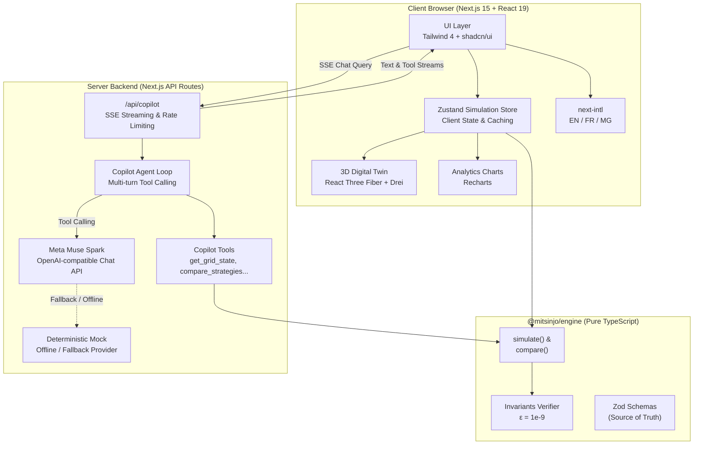

# Mitsinjo Grid — Rural Solar Microgrid Simulation & AI Decision Support

[](https://github.com/Tokiarivelo/mitsinjo-grid/actions/workflows/ci.yml)
[](LICENSE)
[](https://nextjs.org/)
[](https://react.dev/)
[](https://www.typescriptlang.org/)
[](https://tailwindcss.com/)
[](https://vitest.dev/)
[](https://playwright.dev/)

> **⚠️ SIMULATED DATA NOTICE**: All energy metrics, solar generation curves, battery state-of-charge figures, and load balances presented in this system are synthetic and generated for simulation, educational, and decision-support purposes. They do not represent real-time measurements from physical microgrid hardware.

**Public Production Deployment**: [https://mitsinjo-grid.vercel.app](https://mitsinjo-grid.vercel.app)  
**Demo Video (3 Minutes)**: [Watch on YouTube / Submission Link](https://mitsinjo-grid.vercel.app) _(or see [docs/demo-script.md](docs/demo-script.md))_  
**Documentation**: [docs/](docs/) · [docs/assumptions.md](docs/assumptions.md) · [docs/demo-script.md](docs/demo-script.md) · [docs/known-limitations.md](docs/known-limitations.md)

---

## 1. Problem: The Rural Microgrid Lifeline Dilemma

In off-grid rural communities across Madagascar and Sub-Saharan Africa, small solar-plus-storage microgrids (typically 30–50 kWp solar PV + 100–150 kWh battery storage) are the sole lifeline for essential civic and economic infrastructure.

When sudden monsoon cloud cover, severe weather, or high peak demands strike, battery reserves deplete rapidly. Traditional microgrid controllers rely on **naive proportional load shedding**—reducing power equally across all circuits by percentage.

Under proportional shedding, a severe deficit reduces power to the **Health Clinic** at the exact same rate as street markets and domestic lighting. An unexpected deficit can cut power to the clinic's vaccine refrigeration cold chain, incubator, and emergency lighting, risking catastrophic loss of life and supplies.

**Mitsinjo Grid** addresses this challenge with:

1. **Deterministic Microgrid Simulation**: Pure TypeScript simulation engine running identical, mathematically proven energy balance logic in under 3 ms on both client and server.
2. **Strategy Comparison Lab**: Direct quantitative comparison between proportional allocation, lexicographic essential-first priority, and balanced distribution.
3. **Meta AI Copilot**: Grounded AI assistant utilizing Meta Muse Spark with tool calling to inspect grid state, run counterfactual simulations, and provide evidence-backed dispatch recommendations.
4. **3D Village Digital Twin**: Interactive spatial visualization of power flows, battery states, and infrastructure health.
5. **Complete Localization**: Zero static text, featuring full English, French, and native Malagasy (`MG`) translations with 100% key parity.

---

## 2. Target Users & Personas

- **Local Microgrid Operators**: Rural technicians who need clear, jargon-free explanations of why load shedding is occurring and actionable guidance on how to preserve hospital power.
- **Village Energy Committees & Community Councils**: Local leaders in Madagascar seeking equitable, transparent trade-offs between household lighting, agricultural water pumping, and emergency health reserves.
- **Microgrid Engineers & Humanitarian Planners**: Practitioners modeling mini-grid resilience under climate shocks before deploying physical hardware.

---

## 3. Canonical Demo Path

The platform is designed around a single, robust demonstration path that highlights the interplay between physical energy balance and AI reasoning:

```text
[ 1. Weather Shock ]       Unforeseen 40% solar drop at 13:00 depletes battery to 20% reserve.
         │
         ▼
[ 2. Strategy Lab ]        Proportional shedding starves the Health Clinic of 8.8 kWh critical energy.
         │                 Essential-First priority reroutes power, guaranteeing 100% lifeline coverage.
         ▼
[ 3. Meta AI Copilot ]     Operator asks "Why is the clinic losing power?".
         │                 Copilot calls get_grid_state() & compare_strategies(), diagnosing the root cause.
         ▼
[ 4. Computed Evidence ]   AI streams structured evidence (with exact Simulation Run IDs) and
                           issues an interactive proposal to adopt the Essential-First strategy.
```

---

## 4. Architecture



### Core Architecture Principles

- **Engine Isolation**: `@mitsinjo/engine` has zero browser, React, or network dependencies. The exact same code runs synchronously in client state hooks (<3 ms) and inside the server-side Copilot tool executor.
- **Invariants Enforcement**: Energy conservation ($\sum P_{\text{in}} = \sum P_{\text{out}}$), battery capacity ceilings, and minimum SoC reserves are verified on every single hour step ($t \in [0, 23]$).
- **Grounding & Guardrails**: The LLM Copilot is mathematically sandboxed. It can never fabricate energy metrics; all numbers are fetched dynamically via tool calls to the engine.

---

## 5. Visual Tour

| Screen                              | Description                                                                                                                              | Mockup / Screenshot                                                      |
| :---------------------------------- | :--------------------------------------------------------------------------------------------------------------------------------------- | :----------------------------------------------------------------------- |
| **Overview** (`/overview`)          | Executive health dashboard, current KPI summary cards, quick scenario links, and 24h battery/solar graph.                                | [`design/stitch/overview.png`](design/stitch/overview.png)               |
| **Live Simulation** (`/simulation`) | 24-hour simulation runner with interactive sliders, 3D village digital twin, hourly telemetry table, and timeline scrubber.              | [`design/stitch/live-simulation.png`](design/stitch/live-simulation.png) |
| **Strategy Lab** (`/strategies`)    | Side-by-side comparison matrix of Proportional vs. Essential-First vs. Balanced strategies with delta highlights and decision summaries. | [`design/stitch/strategy-lab.png`](design/stitch/strategy-lab.png)       |
| **AI Copilot** (`/copilot`)         | Streaming conversational copilot with 4-part structured reasoning, verifiable simulation IDs, and interactive one-click proposal cards.  | [`design/stitch/copilot.png`](design/stitch/copilot.png)                 |
| **Scenarios** (`/scenarios`)        | Scenario library featuring pre-tuned community benchmarks: Baseline, Cloudy Afternoon, Evening Surge, and Battery Constraint.            | [`design/stitch/scenarios.png`](design/stitch/scenarios.png)             |

---

## 6. Real vs. Simulated vs. Estimated

To maintain strict scientific and ethical integrity, Mitsinjo Grid explicitly categorizes all data:

| Category                | Status         | Details                                                                                                                                                                                         |
| :---------------------- | :------------- | :---------------------------------------------------------------------------------------------------------------------------------------------------------------------------------------------- |
| **Simulation Data**     | **Synthetic**  | Hourly solar irradiance profiles, battery state-of-charge curves, and sector power demands are generated by mathematical models tuned to Malagasy solar coordinates ($\approx 3.1\text{ PSH}$). |
| **Physical Quantities** | **Modeled**    | Battery charging/discharging efficiency ($95\%$), power ceilings ($\pm 25\text{ kW}$), and reserve limits ($20\%$) follow standard LiFePO4 commercial energy storage specifications.            |
| **Estimated Values**    | **Calculated** | Critical shortfall energy ($\text{kWh}$), coverage percentages ($\%$), and unmet hours are calculated deterministically by `@mitsinjo/engine`.                                                  |
| **AI Text**             | **Advisory**   | Explanations generated by Meta Muse Spark are advisory decision-support statements. The AI cannot execute hardware commands directly; all proposals require human operator confirmation.        |

_For complete modeling formulas and boundary conditions, see [docs/assumptions.md](docs/assumptions.md)._

---

## 7. Technology Stack

- **Framework**: [Next.js 15](https://nextjs.org/) (App Router, Server Components, Route Handlers).
- **Frontend**: [React 19](https://react.dev/), [Tailwind CSS 4](https://tailwindcss.com/) (`@theme` tokens), [shadcn/ui](https://ui.shadcn.com/) (custom restyled).
- **3D Visualization**: [React Three Fiber](https://r3f.docs.pmnd.rs/) (Three.js) + [@react-three/drei](https://github.com/pmndrs/drei).
- **Data Analytics**: [Recharts](https://recharts.org/) (responsive SVG charts with dark-mode styling).
- **State Management**: [Zustand](https://github.com/pmndrs/zustand) with client-side persistence and scenario caching.
- **Validation**: [Zod](https://zod.dev/) schemas defining simulation contracts and tool I/O.
- **Internationalization**: [next-intl](https://next-intl-docs.vercel.app/) supporting English (`EN`), Français (`FR`), and Malagasy (`MG`).
- **AI & LLM**: Meta Muse Spark API (`muse-spark-*`) with automatic offline deterministic fallback (`LLM_PROVIDER=mock`).
- **Testing**: [Vitest](https://vitest.dev/) (242 unit and property tests), [Playwright](https://playwright.dev/) (end-to-end demo path).

---

## 8. Getting Started

### Prerequisites

- Node.js >= 20.10.0
- pnpm >= 9.x / 10.x

### Quick Installation

```bash
# Clone the repository
git clone https://github.com/Tokiarivelo/mitsinjo-grid.git
cd mitsinjo-grid

# Install workspace dependencies
make install

# Configure environment variables
make env
```

### Development & Testing

```bash
# Start development server on http://localhost:3000
make dev

# Run development server with deterministic offline mock LLM
make dev-mock

# Run full quality check suite (typecheck + lint + 242 tests + i18n parity)
make check

# Run Playwright end-to-end test suite
make e2e

# Run production build
make build
```

---

## 9. Environment Variables

Create `.env` at repo root or `apps/web/.env.local` (see [.env.example](.env.example)):

```ini
# LLM Provider: 'mock' (default, offline, zero-credential) or 'meta'
LLM_PROVIDER=mock

# Meta AI API Configuration (required when LLM_PROVIDER=meta)
META_API_KEY=your_meta_api_key_here
META_MODEL=muse-spark-v1
META_BASE_URL=https://api.meta.ai/v1

# Optional Stitch MCP / design tooling key
STITCH_API_KEY=
```

---

## 10. Deployment

The project is configured for continuous deployment on [Vercel](https://vercel.com/):

- **Continuous Deployment**: Only pushes and merges to `main` trigger production deployments.
- **Zero Secret Exposure**: All keys are injected through Vercel Project Environment Variables. No secrets are committed to the Git repository.

```bash
make deploy-link   # Link clone to Vercel project (once per machine)
make deploy        # Manual production deployment from clean origin/main
```

---

## 11. Known Limitations & Roadmap

### Known Limitations (see [docs/known-limitations.md](docs/known-limitations.md))

- **Simulation Time Horizon**: Discrete 24-hour cycle at 1-hour resolution ($t \in [0, 23]$). Multi-day roll-over is not modeled.
- **Electrical Dynamics**: Single-phase aggregate real-power balance. Reactive power ($kVAR$), voltage drop along distribution lines, and frequency regulation are omitted.
- **Hardware Acceleration**: 3D Digital Twin targets 60 fps on hardware GPUs. In headless Linux CI without a hardware GPU, software rasterization (SwiftShader) is utilized for testing.

### Future Roadmap

- **PX Anomaly Detection**: Statistical detector for unmetered consumption, persistent meter divergence (>25%), and distribution line faults.
- **PY Dynamic Sector Control**: Granular hourly sector capacity caps (`sectorCaps: { sector, maxKw, fromHour, toHour }`) and dynamic priority reassignment.
- **Hardware Gateway (SCADA/IoT)**: MQTT / Modbus TCP ingestion adapters for physical microgrid telemetry in Madagascar.

---

## 12. Submission & Verification

- **Hackathon**: Meta AI Hackathon (Solo Project)
- **Tag**: `v1.0.0`
- **License**: [MIT](LICENSE) © 2026 Tokiarivelo
