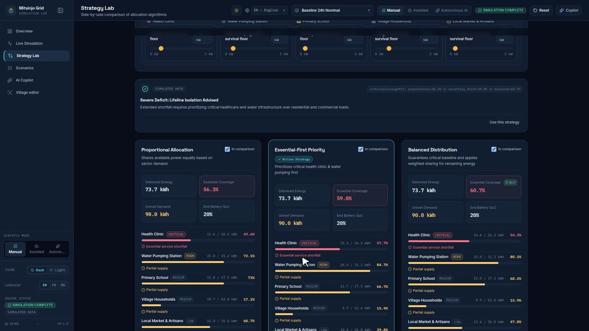
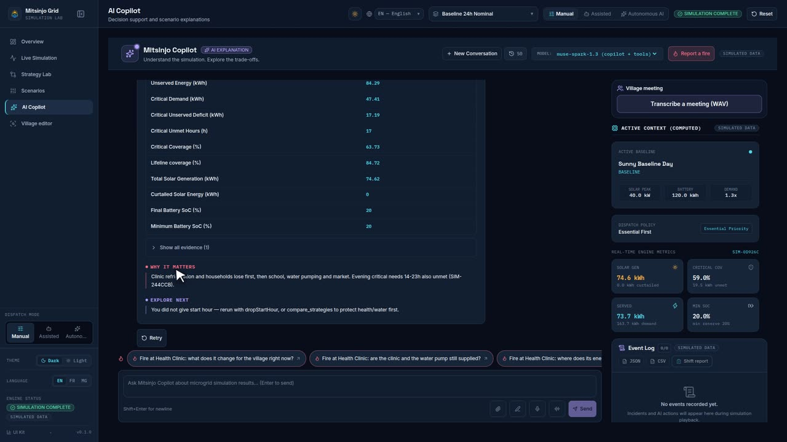

<!-- Generated by `make scenarios-publish` from the local test-scenarios/ folder. Edit the source, then re-run. -->

[← All scenarios](README.md) · solar drop → strategies → copilot → evidence · **18 scenarios** · written in French (UI labels from `fr.json`)

# Parcours démo (doit toujours marcher)

Chute solaire → comparaison des stratégies → explication IA → preuves calculées. `make dev-mock`.

- [ ] **D1** — Ouvre `/` → redirection vers `/overview`, badge `DONNÉES SIMULÉES` visible.
- [ ] **D2** — « Simuler une baisse solaire (−40 %) » → scénario « Après-midi Nuageux (-40%) » dans l'en-tête, alerte rouge « Le centre de santé et la pompe à eau s'éteignent à 23:00. ».
- [ ] **D3** — Tuiles d'impact remplies (23:00, heures sans courant, kWh manquants) ; anneaux : « Allocation proportionnelle » en rouge, « Priorité aux services essentiels » 100 % en vert.
- [ ] **D4** — « Comparer les stratégies » (section anneaux) → `/strategies`, 3 cartes remplies.
- [ ] **D5** — Le résumé de décision recommande « Priorité aux services essentiels » (Proportionnelle coupe la clinique, Essential-First non).
- [ ] **D6** — « Utiliser cette stratégie » sur le résumé → la carte Essential-First devient active.
- [ ] **D7** — Va sur Copilote IA, clique « Pourquoi le centre de santé reçoit-il moins d'énergie ? » → réponse en 4 sections (Ce qui s'est passé / Preuves calculées / Pourquoi c'est important / Pistes à explorer), badge `EXPLICATION IA` violet.
- [ ] **D8** — Les valeurs du tableau « Preuves calculées » sont **identiques** à celles des cartes de `/overview` et `/strategies` (même stratégie active).
- [ ] **D9** — Reprends D1–D8 en anglais puis en malgache : aucun texte dans la mauvaise langue.

## Démo optionnelle : maquette physique (locale, hors vidéo de 3 min)

Voir `docs/demo-script.md` § « Optional: Physical Scale Model ». Sans matériel, le faux ESP32 remplace la maquette.

- [ ] **D10** — Trois terminaux : `HW_TIME_SCALE=4 BRIDGE_MODE=twin make bridge`, `HW_TIME_SCALE=4 make bridge-sim`, `NEXT_PUBLIC_BRIDGE_URL=ws://localhost:8787 make dev-mock` → le bridge affiche `twin · cloudy_afternoon · essential_first`, puis « model online » ; le faux ESP32 affiche une ligne de consignes par heure (toutes les 4 s).
- [ ] **D11** — `/simulation` → onglet « Contrôles » → panneau « Maquette physique » : « Bridge connecté », « En ligne — capteurs reçus », « Jumeau : les capteurs alimentent le moteur », « 1 W = 4 kW · 1 h = 4 s », « Jour 1 · HH:00 » qui avance.
- [ ] **D12** — « Suivre la maquette » → scénario « Après-midi Nuageux (-40%) », le curseur d'heure et la 3D suivent l'heure de la maquette, badge « DONNÉES MAQUETTE », bouton « Arrêter le suivi ».
- [ ] **D13** — Vers 10:00, « Nuage sur la lampe » (ou touche `c` dans le faux ESP32) → le faux ESP32 affiche « cloud on » ; dans les heures suivantes la production solaire affichée baisse et le déficit grandit. « Labo Stratégies » → les 3 cartes reflètent les mêmes données ; « Copilote IA » → l'explication cite des valeurs identiques aux cartes.
- [ ] **D14** — « Arrêter le suivi » → l'heure ne suit plus la maquette, l'édition du scénario redevient normale ; arrêter le bridge → panneau « Bridge hors ligne », le parcours démo D1–D9 marche toujours sans la maquette.
- [ ] **D15** — Parcours démo : à l'étape copilote, si aucune simulation n'a tourné, l'encadré « Lancez d'abord une simulation » apparaît → « Lancer la simulation » → les questions du scénario « Après-midi Nuageux (-40%) » s'affichent (baisse de 40 % de 13 h à 15 h) et l'explication reste citée sur les chiffres moteur.

## Démo Dispatch autonome & Scénario par le chat (PA-T7)

- [ ] **D16** — Mode IA autonome : sur `/simulation`, charger « Incendie au village (marché → eau) » (`village_fire`), basculer en mode « IA autonome » (badge violet « IA AUX COMMANDES »). Avancer le curseur temporel à 14:00 → le marché prend feu et est isolé automatiquement par l'IA (0 kW) sans confirmation humaine requise. Alerte incendie rouge affichée.
- [ ] **D17** — Journal des événements, « Pourquoi ? » et reprise en main : ouvrir l'onglet « Journal des événements » → entrées d'incident et d'action consignées avec chiffres moteur avant/après. Cliquer « Pourquoi ? » sur l'action d'isolement du marché → bascule automatique vers le copilote avec question pré-remplie (« Pourquoi avoir appliqué l'action Isoler le secteur sur le secteur Marché à 14:00 ? »). Poser la question → explication 4 sections avec preuves chiffrées. Cliquer « Reprendre la main » (bouton rouge ≥ 44 px) → retour immédiat au mode Manuel, badge « IA AUX COMMANDES » retiré.
- [ ] **D18** — Scénario multi-jours par le chat (PA-8) : sur `/copilot`, saisir « jour 1 : nuageux, jour 2 : pluvieux, jour 3 : beau temps + école en feu ». La carte « Brouillon de scénario » apparaît avec les 3 jours et signale l'heure manquante pour le feu avec des puces (« 08:00 », « 12:00 », « 14:00 », « 16:00 »). Cliquer sur « 14:00 » → calcul de l'aperçu moteur (déficit, jour le pire, critique non servi) et boutons « Lancer cette simulation » et « Lancer en mode IA autonome ». Cliquer pour lancer → redirection vers `/simulation` avec le scénario 3 jours actif.
