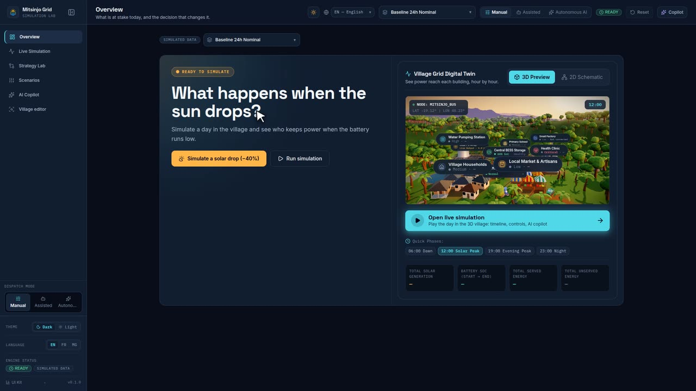

<!-- Generated by `make scenarios-publish` from the local test-scenarios/ folder. Edit the source, then re-run. -->

[← All scenarios](README.md) · `/overview` · **17 scenarios** · written in French (UI labels from `fr.json`)

# Aperçu — `/overview` (écran « Incident »)

But : en 5 secondes, voir ce qui est en jeu aujourd'hui (services essentiels en danger ou non), l'impact chiffré par le moteur, et la décision qui change tout. Plus de tableau de bord (cartes, graphique 24h, liste des secteurs retirés le 2026-10-30).

## États

- [ ] **O18** — Premier chargement, avant toute simulation → pastille « Prêt à simuler », titre « Que se passe-t-il quand le soleil baisse ? », boutons « Simuler une baisse solaire (−40 %) » et « Lancer la simulation » ; pas de section anneaux.
- [ ] **O19** — « Lancer la simulation » (scénario Référence) → pastille verte « Tout va bien », titre « Tous les services essentiels restent allumés. », tuiles « Couverture essentielle » 100% et « 0 h », bouton « Demander au copilote ».
- [ ] **O20** — « Simuler une baisse solaire (−40 %) » → le sélecteur passe à « Après-midi Nuageux (-40%) », pastille rouge clignotante « Incident · services essentiels », titre « Le centre de santé et la pompe à eau s'éteignent à 23:00. ».
- [ ] **O21** — En incident : 3 tuiles d'impact (« Début de la coupure » 23:00, « Heures sans courant essentiel », « Énergie essentielle manquante » en kWh) ; les valeurs sont identiques à celles du Labo Stratégies pour « Allocation proportionnelle ».
- [ ] **O22** — En incident, le jumeau à droite s'est placé à 23:00 ; mettre une autre phase (06:00) puis « Voir le village à 23:00 » → le jumeau revient à 23:00.
- [ ] **O23** — « Demander pourquoi au copilote » → `/copilot`.

## Anneaux « Même journée, autre décision »

- [ ] **O24** — Après une simulation : 3 anneaux (« Allocation proportionnelle », « Priorité aux services essentiels », « Distribution équilibrée ») côte à côte, même sur mobile ; Après-midi Nuageux → « Allocation proportionnelle » en rouge (< 100 %, « 1 h sans courant »), « Priorité aux services essentiels » en vert 100 % avec le badge « Meilleure protection vitale ».
- [ ] **O25** — Badge « Stratégie active » sous la stratégie choisie ; dans le Labo, « Utiliser cette stratégie » sur « Priorité aux services essentiels » puis retour à l'Aperçu → l'écran passe en « Tout va bien ».
- [ ] **O26** — « Comparer les stratégies » → `/strategies`.

## Jumeau numérique

- [ ] **O7** — Bascule « Aperçu 3D » / « Schéma 2D » (grands boutons dans l'en-tête du « Jumeau numérique du réseau », l'option active en cyan plein) → les deux vues montrent le même état.
- [ ] **O8** — Phases rapides 06:00 / 12:00 / 19:00 / 23:00 → la scène change (soleil à midi, batterie la nuit).
- [ ] **O9** — Bande de bilan sous le jumeau : production solaire totale, SoC (début → fin), énergie desservie, non desservie (rouge si > 0).
- [ ] **O10** — Sans WebGL (ou appareil faible) → le schéma 2D s'affiche à la place, sans erreur.
- [ ] **O29** — En-tête du jumeau : plus de badge « JUMEAU NUMÉRIQUE 3D » ni de petit lien ; sous-titre « Voyez le courant arriver dans chaque bâtiment, heure par heure. » ; sur mobile (390 px) les 2 boutons 3D/2D prennent toute la largeur, hauteur ≥ 44 px.
- [ ] **O30** — Sous la vue 3D, gros bouton cyan lumineux « Ouvrir la simulation en direct » (icône lecture, ligne « Rejouez la journée dans le village 3D : chronologie, réglages, copilote IA », flèche) → `/simulation`. Visible même avant toute simulation ; lisible en thème clair et sombre.

## Transverse

- [ ] **O27** — Changer de scénario dans le sélecteur de la page → recalcul immédiat (pas besoin de relancer) ; « Stress Essentiel (-60%) » → incident affiché.
- [ ] **O28** — 390 px de large, thèmes sombre et clair : aucun défilement horizontal, boutons ≥ 44 px, lueur rouge/verte derrière le titre lisible dans les deux thèmes.
