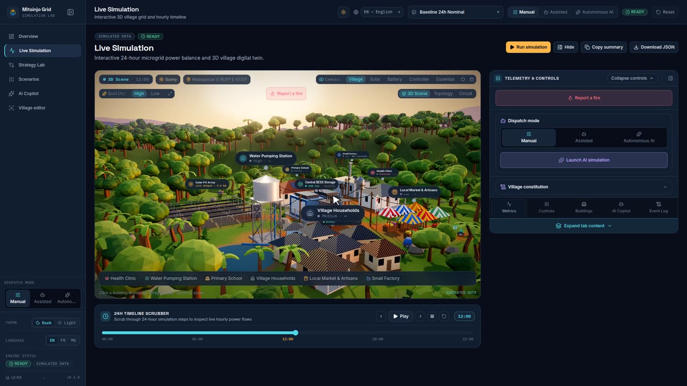
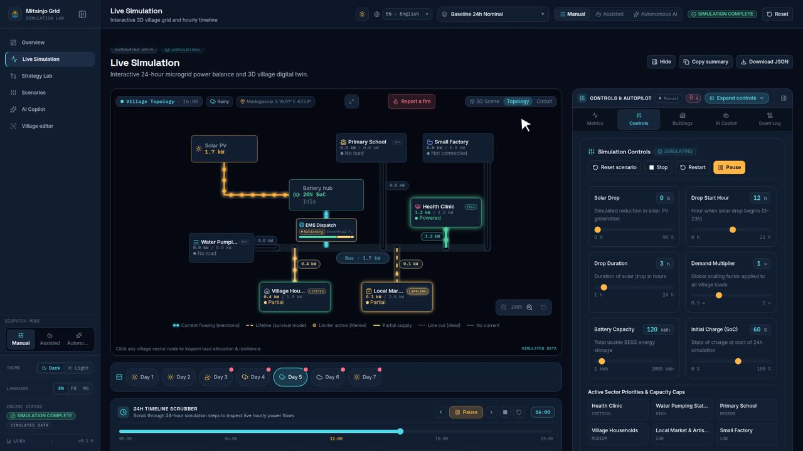
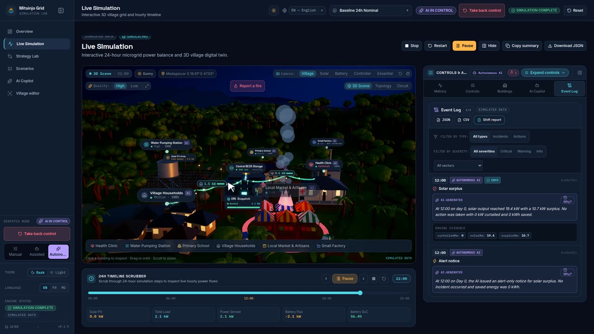

<!-- Generated by `make scenarios-publish` from the local test-scenarios/ folder. Edit the source, then re-run. -->

[← All scenarios](README.md) · `/simulation` · **118 scenarios** · written in French (UI labels from `fr.json`)

# Simulation en direct — `/simulation`

La scène 3D est au centre ; tout le reste est dans un panneau de droite à 4 onglets
(Métriques · Contrôles · Bâtiments · Copilote IA). Le curseur 24h reste en bas de la scène.

## Panneau et scène

- [ ] **S1** — « Masquer le panneau » → la scène prend toute la largeur ; « Ouvrir le panneau » le rouvre.
- [ ] **S2** — Préréglages caméra : Village, Solaire, Batterie, Essentiel, « Réinitialiser la caméra » → la caméra se déplace en douceur.
- [ ] **S3** — Mode d'affichage : Scène 3D / Topologie / Circuit. En Circuit, un disjoncteur par secteur : fermé si alimenté, ouvert et rouge si coupé.
- [ ] **S4** — Légende 2D : électrons qui bougent = courant ; tirets rouges = ligne coupée ; « Sans charge » = pas de demande. Aucun libellé ne se chevauche.
- [ ] **S5** — Plein écran → entre/sort sans casser la mise en page.
- [ ] **S6** — Qualité Haute/Basse ; sur appareil faible, message « Réduite automatiquement pour cet appareil ».

## Curseur temporel 24h

- [ ] **S7** — Avant simulation : « Lancer la simulation » lance le moteur **puis** la lecture.
- [ ] **S8** — Lecture → 1 heure toutes les ~0,75 s, boucle sur 24 h ; Pause l'arrête.
- [ ] **S9** — Reculer / Avancer d'une heure, ou glisser le curseur → met en pause et change l'heure.
- [ ] **S10** — Arrêter → pause + retour à 00:00 ; Redémarrer → repart de 00:00.
- [ ] **S11** — En changeant l'heure : la scène (lumière, lignes, badges) et les métriques horaires suivent.
- [ ] **S12** — Modifier un paramètre pendant la lecture → la lecture s'arrête.

## Onglet Métriques

- [ ] **S13** — Cartes compactes, graphique 24h, « Bilan Énergétique Net » avec « Autarcie : X % », barres des 5 secteurs.

## Onglet Contrôles

- [ ] **S14** — Curseurs : Baisse Solaire, Heure Début Chute, Durée de la Chute, Multiplicateur de Demande, Capacité Batterie, Charge Initiale (SoC). Chaque curseur affiche valeur + unité + min/max.
- [ ] **S15** — Bouger un curseur → badge `MODIFIÉ` / « Scénario modifié », la scène indique « Scénario modifié — affichage du dernier résultat simulé ».
- [ ] **S16** — Heure de début + durée > 24 h → message d'erreur sur le champ ; le corriger efface l'erreur.
- [ ] **S17** — Stratégie d'allocation : changer de stratégie → résultats différents en déficit (identiques en Référence).
- [ ] **S18** — Priorités et plafonds par secteur : ajoute un plafond → compteur « N plafonds actifs ».
- [ ] **S19** — « Réinitialiser scénario » → valeurs du scénario d'origine, badge modifié disparaît.

## Workflow météo (multi-jours)

- [ ] **S20** — « Ajouter un jour » → Jour 2 copie la météo du Jour 1 ; compteur « 2/7 jours » ; max 7 jours.
- [ ] **S21** — Choisis Orage pour le Jour 2 **après** une simulation → le moteur relance tout de suite (production, métriques, 3D changent).
- [ ] **S22** — Même chose **avant** toute simulation → seulement « Scénario modifié ».
- [ ] **S23** — Sous chaque jour : « SoC X · non servi Y » ; totaux multi-jours en bas (solaire, non servi, batterie min → fin).
- [ ] **S24** — Bande de jours au-dessus du curseur : point rouge sur un jour en déficit critique ; cliquer un jour → pause + résultats de ce jour. La lecture passe d'un jour à l'autre.
- [ ] **S25** — La scène 3D affiche la météo du jour (badge + rendu).
- [ ] **S26** — Supprimer un jour → il disparaît ; pas de bouton supprimer quand il reste 1 jour.

## Onglet Bâtiments

- [ ] **S27** — Clique un bâtiment dans la 3D → bascule sur l'onglet Bâtiments avec sa télémétrie (Demande 24h, Servi 24h, Déficit 24h, Couverture 24h, Part Vitale Critique, priorité).
- [ ] **S28** — Sans simulation → « Lancez la simulation pour voir les métriques calculées. »

## Onglet Copilote IA + export

- [ ] **S29** — Bannière d'impact + analyse IA (violet) ; propositions → boîte de confirmation avant application.
- [ ] **S30** — « Copier le résumé » → « Copié ! », le presse-papiers contient un résumé Markdown.
- [ ] **S31** — « Télécharger JSON » → fichier avec scénario, stratégie, métriques, version du moteur.

## Contexte WebGL (régression PW : scène blanche ou noire pendant la lecture)

- [ ] **S32** — `/simulation`, scénario « Référence 24h Nominale », « Lancer la simulation » et laisser la timeline jouer 24 h → la scène 3D reste affichée à chaque heure : jamais de cadre blanc, jamais bloquée sur « Initialisation du jumeau numérique 3D… » ; console sans « Too many active WebGL contexts ».
- [ ] **S33** — Même page, Qualité : Haute → Basse → Haute → Basse (attendre 2 s entre chaque) puis « Lancer la simulation » → la scène se reconstruit à chaque bascule et s'affiche ; le texte « Initialisation du jumeau numérique 3D… » ne reste jamais affiché.
- [ ] **S34** — Devtools, console : `document.querySelector('canvas').getContext('webgl2').getExtension('WEBGL_lose_context').loseContext()` → « Initialisation du jumeau numérique 3D… » s'affiche moins d'une seconde, puis la scène revient d'elle-même.

## Charge des secteurs en direct et petite usine

- [ ] **S35** — `/simulation`, scénario « Référence 24h Nominale », onglet « Bâtiments » → panneau « Charge des secteurs (en direct) » : un curseur ×0–3 par secteur ; « Petite usine » à ×0, « Non raccordé », bouton « Raccorder ». Dans la 3D, l'usine (au nord-est, derrière le dispensaire) est sombre, badge « Non raccordé ».
- [ ] **S36** — Cliquer « Raccorder » sur « Petite usine » → passe à ×1 « Raccordé » ; la simulation se relance aussitôt ; l'usine s'allume en 3D avec un taux de couverture ; elle apparaît dans le schéma Topologie (case en haut à droite) et dans la couverture des services.
- [ ] **S37** — Pendant la lecture de la timeline, monter « Ménages » à ×2 → la lecture continue sans revenir à 00:00 ; métriques et graphiques changent immédiatement ; aucun chiffre ne change si on remet ×1.
- [ ] **S38** — Scénario « Après-midi Nuageux (-40%) », raccorder « Petite usine » puis passer à ×3 → le déficit de la soirée augmente (énergie non servie plus haute) ; avec « Priorité aux services essentiels », le dispensaire reste couvert.
- [ ] **S39** — « Débrancher » la « Petite usine » → retour aux chiffres d'origine ; l'usine disparaît de l'Aperçu (`/overview`) et des cartes du Labo de stratégies.
- [ ] **S40** — Mobile 390 px, onglet « Bâtiments » → panneau sur une colonne, boutons ≥ 44 px, aucun défilement horizontal ; thème Clair : curseurs et libellés lisibles.
- [ ] **S41** — Scénario « Référence 24h Nominale », « Lancer la simulation », vue « Scène 3D », caméra « Village » → l'étiquette « Dispatch EMS » est devant l'abri, sous le toit : la batterie (conteneurs bleus) et son étiquette restent visibles derrière ; l'étiquette tient sur une ligne de titre + « Normal » + kW total + barre de répartition.
- [ ] **S42** — Même run, caméra « Contrôleur » → vue entre ménages et marché : 6 colonnes lumineuses sur le toit de l'abri, chaque câble de secteur part de sa propre colonne (aucun fil ne part du sol ou d'un mât à côté) ; plus de transformateur ni de mât à l'ancien emplacement du hub.
- [ ] **S43** — Même run, curseur à 12:00 → une pastille kW sur chaque câble alimenté (icône du secteur + kW + jauge de couverture), en vert ; survol → infobulle « Centre de santé : Fermé (x kW) ». Aucune pastille sur un câble sans demande (ex. « Petite usine » non raccordée).
- [ ] **S44** — Scénario « Stress Essentiel (-60%) », 20:00 → la pastille du secteur coupé reste affichée en rouge à « 0.0 kW » ; la barre de répartition du badge EMS ne contient que les secteurs servis ; badge « Survie seule » ou « Rationnement » en ambre.
- [ ] **S45** — Vue « Topologie » → le câble va Batterie → bloc « Dispatch EMS » → Bus (le bloc est sur le chemin, pas à côté) ; pastille kW à côté de chaque départ, qui ne recouvre ni câble ni carte ; le bloc EMS affiche mode + stratégie + barre de répartition sans texte tronqué au titre.
- [ ] **S46** — Vue « Circuit » → le bus et les 6 disjoncteurs sont dans un cadre pointillé « Dispatch EMS » (cyan en Normal, ambre sinon) ; une pastille kW entre le cadre et chaque carte secteur ; secteur sans demande → pastille et disjoncteur gris (pas vert).
- [ ] **S47** — Thème Clair puis mobile 390 px, vues 3D / Topologie / Circuit → pastilles et badge EMS lisibles, aucun défilement horizontal.

## Éclairage selon l'intensité et mode survie (Phase 3 PL)

- [ ] **S48** — Éclairage continu des fenêtres 3D (PL-T9) : à 22:00, comparer un secteur en survie (faible lueur chaude, une ampoule), un secteur à pleine charge (lumière vive) et un secteur non raccordé ou coupé (fenêtres noires, éteintes). Pas de plein éclairage sur secteur sans charge.
- [ ] **S49** — Lampadaires et guirlande du marché 3D (PL-T10) : de nuit, les lampadaires sur les poteaux d'un secteur coupé s'éteignent complètement (noir) ; les lampes d'un secteur en survie restent atténuées ; la guirlande du marché suit l'intensité réelle servie au marché (éteinte si marché à 0 kW).
- [ ] **S50** — Flux de particules 3D ∝ kW (PL-T11) : vitesse, espacement et émissivité des électrons augmentent avec les kW du départ ; câble coupé/déconnecté reste gris sans aucune particule.
- [ ] **S51** — Vue 2D Topologie et Circuit (PL-T12) : épaisseur et opacité du trait ∝ intensité servie ; état « Survie » en trait ambre pointillé avec lueur douce ; secteur coupé en trait gris sans électrons ; légende mise à jour avec « Survie (courant garanti) » en ambre pointillé.
- [ ] **S52** — Cartes bâtiments 2D (PL-T12) : chaque carte secteur affiche le ratio numérique `servi kW / demande kW`, le badge de mode (« Plein », « Limité », « Survie », « Coupé ») et un halo lumineux selon l'intensité (lueur ambre en survie, verte en plein, aucune en coupé).
- [ ] **S53** — Accessibilité et réduction de mouvement (PL-T13) : l'information n'est jamais portée par la couleur seule (libellé de mode + kW + pointillés) ; contraste AA en thème clair et sombre ; sous `prefers-reduced-motion` actif, les électrons sont immobiles en 2D et en 3D.
- [ ] **S54** — Régression revue PR #28 : scénario « Stress Essentiel (-60%) », 22:00, vue 3D → les lampadaires des poteaux de la ligne principale (champ solaire → batterie → contrôleur EMS) restent allumés tant que le bus est alimenté ; seuls les poteaux d'un départ coupé s'éteignent.
- [ ] **S55** — Vue 2D Topologie, scénario « Stress Essentiel (-60%) », stratégie « Priorité aux services essentiels », 06:00 → le fil d'un départ en « Survie » est ambre pointillé et porte encore 1 à 3 électrons ; un départ coupé est gris pointillé sans électron.
- [ ] **S56** — Vue 3D, caméra « Village » puis « Contrôleur » → l'étiquette « Dispatch EMS » est collée à l'avant de l'abri technique (à hauteur des disjoncteurs), au même niveau de taille que les autres étiquettes, et ne cache pas la batterie derrière.
- [ ] **S57** — Vue « Topologie » ou « Circuit » → boutons « Zoomer » / « Dézoomer » / « Réinitialiser le zoom » en bas à droite : le pourcentage passe de 100 % à 125 %… jusqu'à 400 % ; « Dézoomer » et « Réinitialiser » sont grisés à 100 %.
- [ ] **S58** — Schéma zoomé → glisser à la souris ou au doigt déplace le schéma sans sortir des bords ; un simple clic/tap sur une carte secteur la sélectionne toujours ; un glisser ne la sélectionne pas.
- [ ] **S59** — Schéma non zoomé → molette seule fait défiler la page (pas de zoom) ; Ctrl + molette (ou pincer sur pavé tactile/mobile) zoome autour du curseur.
- [ ] **S60** — Vue « Topologie » ou « Circuit » → bouton « Plein écran » dans la barre du haut : le schéma occupe tout l'écran, la molette seule zoome ; Échap ou « Quitter le plein écran » revient à la carte. Changer de vue remet le zoom à 100 %.
- [ ] **S61** — Régression : vue « Circuit » sur desktop 1440 px → l'étiquette « Bus » et la carte EMS ne passent plus sous le sélecteur de vue ; la légende ne chevauche plus la ligne d'aide « Cliquez sur… » en bas.

## Maquette physique (bridge local)

- [ ] **S62** — Sans `NEXT_PUBLIC_BRIDGE_URL` : `make dev-mock`, `/simulation` → onglet « Contrôles » → aucun panneau « Maquette physique ».
- [ ] **S63** — Terminal 1 : `HW_TIME_SCALE=4 BRIDGE_MODE=twin make bridge` ; terminal 2 : `HW_TIME_SCALE=4 make bridge-sim` ; terminal 3 : `NEXT_PUBLIC_BRIDGE_URL=ws://localhost:8787 make dev-mock`. `/simulation` → « Contrôles » → panneau « Maquette physique » : badge « Bridge connecté », « En ligne — capteurs reçus », « Jumeau : les capteurs alimentent le moteur », « 1 W = 4 kW · 1 h = 4 s », « Jour 1 · HH:00 » qui avance toutes les 4 s.
- [ ] **S64** — Cliquer « Suivre la maquette » → le scénario affiché devient « Après-midi Nuageux (-40%) » (scénario du bridge), le curseur d'heure et la 3D suivent l'heure de la maquette, badge « DONNÉES MAQUETTE » ; le bouton devient « Arrêter le suivi ».
- [ ] **S65** — Pendant le suivi, vers 10:00, « Nuage sur la lampe » → le faux ESP32 affiche « cloud on (from app) » ; dans les heures suivantes, la production solaire affichée est plus basse qu'au même moment sans nuage. « Retirer le nuage » → retour.
- [ ] **S66** — « Arrêter le suivi » → l'heure ne bouge plus avec la maquette ; changer de scénario dans le sélecteur pendant le suivi l'arrête aussi.
- [ ] **S67** — Arrêter le bridge (Ctrl+C) → badge « Bridge hors ligne », dernières valeurs gardées ; le relancer → « Connexion… » puis « Bridge connecté » sans recharger la page.
- [ ] **S68** — Mobile 390 px, thèmes clair et sombre → panneau en une colonne, lignes libellé–valeur lisibles, boutons ≥ 44 px, pas de défilement horizontal.
- [ ] **S69** — Bridge + faux ESP32 + web lancés comme S63 mais **sans** `HW_TIME_SCALE`. Panneau « Maquette physique » → « Vitesse (secondes réelles par heure simulée) » : bouton « 20 s » actif (ou celui de `.env`). Cliquer « 5 s » → le terminal du bridge affiche `speed: 1 h = 5 s`, l'échelle passe à « 1 h = 5 s », « 5 s » devient actif, l'heure en cours **ne saute pas** puis avance toutes les 5 s (la vue suivie aussi). Cliquer « 60 s » → ralentit. Bridge arrêté → les boutons sont grisés.
- [ ] **S70** — Bridge lancé (`make bridge`), web lancé **sans** l'URL : `NEXT_PUBLIC_BRIDGE_URL= make dev-mock`. `/simulation` → « Contrôles » : pas de panneau « Maquette physique ». Ouvrir `/simulation?bridge=ws://localhost:8787` → le panneau apparaît, « Bridge connecté » ; la barre d'adresse n'affiche plus `?bridge=`. Recharger `/simulation` dans le même onglet → panneau toujours là. Nouvel onglet → plus de panneau.
- [ ] **S71** — `/simulation?bridge=off` → le panneau disparaît (bridge oublié). Régression : `?bridge=https://exemple.org` → ignoré, pas de panneau.
- [ ] **S72** — Bridge avec jeton : `BRIDGE_TOKEN=demo-token-0123456789 make bridge` (le terminal affiche `commands: token required`). Ouvrir `/simulation?bridge=ws://localhost:8787` → note ambre « Lecture seule : ce bridge demande un jeton… », boutons « Nuage sur la lampe » et vitesses grisés, « Suivre la maquette » marche. Ouvrir `?bridge=ws://localhost:8787&bridgeToken=demo-token-0123456789` → pas de note, « 5 s » change l'échelle en « 1 h = 5 s ».
- [ ] **S73** — Identifiants MQTT : `MQTT_USERNAME=esp32 MQTT_PASSWORD=pw make bridge` puis `MQTT_USERNAME=esp32 MQTT_PASSWORD=pw make bridge-sim` → « connected », panneau « En ligne — capteurs reçus ». `MQTT_USERNAME=esp32 MQTT_PASSWORD=faux make bridge-sim` → « MQTT error: Connection refused: Not authorized ».
- [ ] **S74** — Régression (dev, `make dev-mock`) : ouvrir `/simulation` → « Contrôles », sans recharger cliquer tout de suite « 5 s » puis « Nuage sur la lampe » → le terminal du bridge affiche `speed: 1 h = 5 s`, l'échelle passe à « 1 h = 5 s » et le faux ESP32 affiche « cloud on (from app) » (avant : clic sans effet).

## Curseur Temporel 24h fluide

- [ ] **S75** — `make dev-mock`, `/simulation`, lancer la simulation puis glisser lentement le curseur du « Curseur Temporel 24h » → le pouce suit le doigt/la souris en continu (plus de saut d'une heure à l'autre) ; l'heure affichée et la 3D changent à chaque heure entière ; au relâchement le pouce glisse sur l'heure affichée.
- [ ] **S76** — Cliquer « Lecture » → le pouce avance en continu (sans à-coups) toutes les 0,5 s ; à 23:00 → retour direct à 00:00 sans balayer toute la barre. Boutons ◀ ▶ → glissement court d'une heure. Clavier (focus sur le curseur) : ← → avancent d'une heure, Début/Fin → 00:00 / 23:00.
- [ ] **S77** — Régression bridge : terminal 1 `make bridge`, terminal 2 `make bridge-sim`, terminal 3 `NEXT_PUBLIC_BRIDGE_URL=ws://localhost:8787 make dev-mock`. « Contrôles » → « Suivre la maquette » → le pouce du curseur avance en continu comme une horloge entre deux heures (avant : saut à chaque heure de la maquette).
- [ ] **S78** — Pendant « Suivre la maquette » : aucun bouton Lecture/Pause, Arrêter, Redémarrer ni dans l'en-tête (à côté de « Masquer »), ni dans « Contrôles de Simulation », ni dans le « Curseur Temporel 24h » (◀ ▶ aussi masqués) ; l'heure reste affichée. « Arrêter le suivi » → les boutons réapparaissent.
- [ ] **S79** — `/simulation`, bouton plein écran (vue « 3D Scene » puis « Circuit »), écran large → panneau « Contrôles de simulation » à gauche en verre transparent (le décor se voit à travers, plus de carte opaque), sliders sur une colonne lisible, rien de coupé ; le panneau commence sous les onglets « 3D Scene · Topology · Circuit » (ne les recouvre plus).
- [ ] **S80** — Plein écran, curseur temporel en bas : bouton « Réduire le curseur temporel » (icône ↙ à droite de l'heure) → une seule barre ◀ Lecture ▶ ■ ↺, heure, curseur ; la bande « SIMULATED DATA / Production / Batterie / Demande » et les cases Solaire PV… SoC disparaissent. « Agrandir le curseur temporel » → tout revient. Lecture fonctionne dans les deux états.
- [ ] **S81** — Régression (capture utilisateur) : plein écran vue « Circuit » avec « Contrôles » et « Copilot » ouverts → les cartes des secteurs (« Centre de santé », « Station de pompage d'eau », « École primaire », « Foyers du village », « Marché local et artisans », « Petite usine ») restent entières et cliquables, entre les deux panneaux et au-dessus du curseur temporel (avant : recouvertes par le curseur). Idem en vue « Topology ».
- [ ] **S82** — Mobile 390 px, plein écran « Circuit », fermer Copilot puis Contrôles → curseur temporel en bas, schéma au-dessus sans chevauchement ; « Réduire le curseur temporel » → boutons sur une ligne, curseur sur la ligne suivante ; aucun défilement horizontal. Thème clair : verre lisible, textes contrastés.
- [ ] **S83** — `make dev-mock`, scénario « Baseline », `/simulation`, curseur à 14:00, vue « Scène 3D » : bouton rouge « Signaler un incendie » dans la barre du haut → « Quel secteur est en feu ? » → « École primaire » → tout de suite : snackbar en bas à droite « Incendie signalé : École primaire » (disparaît après ~10 s ou avec ×), grande bannière rouge « INCENDIE : École primaire coupé » en haut de page avec « Alarme simulée », petite alerte rouge dans la vue ; flammes + fumée sur l'école en 3D.
- [ ] **S84** — Même état, vues « Topologie » puis « Circuit » : carte École bordure rouge + badge « En feu » (flamme), câble de l'école coupé (marque rouge) ; les autres secteurs reçoivent l'énergie libérée.
- [ ] **S85** — Panneau « Télémétrie & Contrôles » : bouton « Signaler un incendie » en haut du panneau, quel que soit l'onglet ; l'école y est grisée « En feu » (pas de double signalement).
- [ ] **S86** — Lecture : signaler « Centre de santé » à 14:00, ramener le curseur à 10:00 → bannière et alerte disparaissent ; lancer la lecture → à 14:00 la snackbar et la bannière reviennent d'elles-mêmes.
- [ ] **S87** — Plein écran (3D, Topologie, Circuit) : le bouton « Signaler un incendie » et l'alerte rouge compacte restent visibles dans la vue ; mobile 390 px : bouton ≥ 44 px, liste des secteurs lisible, snackbar au-dessus de la barre de navigation, pas de défilement horizontal.
- [ ] **S88** — Limite : l'incendie passe avant la stratégie, les plafonds et le courant de survie (« Essentiel d'abord » + plancher de survie : le « Centre de santé » en feu reste à 0 kW) ; carte d'alerte « Incendie : … isolé » dans la liste des avertissements. « Réinitialiser » ou changer de scénario retire l'incendie.
- [ ] **S89** — Après avoir inséré un appareil depuis /village : onglet « Bâtiments » → bloc « Appareils dans la simulation (n/30) » avec chaque ligne ; crayon → ouvre /village ; corbeille → retire l'appareil, les résultats et le village 3D se mettent à jour. Sans appareil : « Aucun appareil ajouté pour l'instant. Ouvrir l'éditeur du village ».
- [ ] **S90** — Mode IA autonome (PA-T3) : scénario « village_fire » lancé en mode autonome (`dispatchMode === 'autonomous'`) → aux heures 14 h et 15 h, les feux du marché et de la pompe sont automatiquement détectés, isolés sans clic de l'opérateur, et enregistrés dans le journal d'événements (`dispatchLog` ≥ 4 entrées). « Reprendre la main » restaure immédiatement le mode manuel. Dans le chat copilote en mode IA autonome, `propose_change` s'applique seul après vérification de la constitution du village (la clinique ne peut être coupée).
- [ ] **S91** — Mode IA autonome, garde-fous copilote (PA-T3c, revue PR #38) : scénario « village_fire » en mode autonome, à 15 h demander au copilote « Rétablis le courant du marché » → la proposition `clearFires` n'est **pas** appliquée seule : la carte Approuver / Refuser reste affichée et aucune ligne « operator » n'est ajoutée au journal. Idem pour une baisse du plancher de la clinique (< 0,5 kW) ou « Augmente la demande de 20 % » (aucune action de dispatch ne correspond).
- [ ] **S92** — Bascule de dispatch 3 niveaux (PA-T4a) : dans l'en-tête, la barre latérale et `MobileNav` (sur mobile), basculer entre « Manuel », « Assisté » et « Autonome ». En mode autonome, badge permanent « IA AUX COMMANDES » (violet, pastille animée) et bouton « Reprendre la main » (touch target ≥ 44 px). Cliquer « Reprendre la main » restaure instantanément le mode manuel.
- [ ] **S93** — Journal des événements de dispatch (PA-T4b) : onglet « Journal » dans la simulation et dans l'inspection copilote. Liste chronologique des incidents et actions, badge d'origine (IA vs Opérateur) et sévérité. Distinction visuelle claire entre texte IA (étiquette IA-GÉNÉRÉ) et chiffres certifiés moteur (police mono). Filtres par sévérité/type/secteur et exports JSON et CSV. Clic sur une ligne → ajuste l'heure, le jour et sélectionne le secteur en 2D/3D.
- [ ] **S94** — Alertes critiques et pulsion 3D (PA-T4c) : tout incident de sévérité `critical` (incendie ou prévision de déficit critique) déclenche la bannière d'alerte rouge et les notifications snackbars. En 3D, le secteur concerné s'entoure d'un halo rouge clignotant au sol et d'un badge d'alerte pulsé.
- [ ] **S95** — Régression revue PR #39 (action IA appliquée deux fois) : scénario « village_fire », panneau latéral ouvert, mode « IA autonome », avancer de 13 h à 14 h → onglet « Journal des événements » : **une seule** ligne « Incendie » sur le marché et **une seule** ligne « Isoler le secteur » (avant : chaque ligne apparaissait en double). Masquer le panneau latéral puis avancer à 15 h → l'isolement de la pompe se fait quand même (une ligne).
- [ ] **S96** — Journal traduit (revue PR #39) : en FR, ligne d'action du journal → libellés « Avant » / « Après », « Non servi : … », « SoC : … » ; filtre secteur → première option « Tous les secteurs » (plus de « (secteurs) » codé en dur). En EN → « Before » / « After » / « Unserved » / « All sectors ». Export « CSV » → un texte IA contenant une virgule reste dans une seule colonne.
- [ ] **S97** — Étiquette « IA » des bâtiments 3D (revue PR #39) : mode « IA autonome » → chaque étiquette de bâtiment montre « IA » en FR, « AI » en EN ; retour en « Manuel » → l'étiquette disparaît.
- [ ] **S98** — Narration IA, bouton « Pourquoi ? » et rapport de quart (PA-T5) : scénario « village_fire » en mode « IA autonome » → chaque action du journal affiche immédiatement le texte IA de repli dans la langue de l'interface (gabarit `reasonTemplate`), remplacé par la narration Muse Spark si `/api/dispatch/narrate` répond (clé Meta configurée, plafond de dépense non atteint, aucun chiffre inventé). « Pourquoi ? » ouvre l'onglet Copilote et pré-remplit la question. « Rapport de quart » ouvre la synthèse du jour (incidents, actions, énergie critique préservée, impact contrefactuel, « Copier le résumé », « Discuter avec le copilote »).
- [ ] **S99** — « Pourquoi ? » répond avec le journal (revue PR #41) : scénario « village_fire » en mode « IA autonome », jouer jusqu'à 15 h, cliquer « Pourquoi ? » sur l'isolement du marché puis envoyer → le copilote cite les actions du journal (outil `get_dispatch_log`) au lieu de « Aucune intervention autonome n'est consignée ». Régression : avant la correction, le journal n'était pas envoyé et la réponse était toujours vide.
- [ ] **S100** — Textes du journal traduits (revue PR #41) : interface en EN, mode « IA autonome », scénario « village_fire » → textes IA du journal en anglais (plus de phrases françaises codées en dur) ; « Why? » pré-remplit « Why did you apply Isolate sector on Market at 14:00? » ; dans « Shift report », « Discuss with copilot » pré-remplit une question en anglais et la carte SoC affiche « Min … » ou « Stable » traduits (MG : « Farany ambany … » / « Milamina »).
- [ ] **S101** — Dérivation et raccordement de charge placée (PI-T9/PI-T10) : insérer un appareil placé depuis /village → sur /simulation (en vue 3D, schéma topologique et circuit), la dérivation s'affiche avec son câble, ses poteaux et ses électrons ; en mode direct EMS, le câble rejoint le contrôleur au centre.
- [ ] **S102** — Étiquette de l'élément ajouté en 3D : insérer un appareil depuis /village puis ouvrir /simulation en « Scène 3D » → son nom apparaît (icône prise) dans la barre d'étiquettes en bas, après « Petite usine » ; la barre passe sur deux lignes au lieu de défiler. Cliquer l'étiquette → la caméra vole jusqu'à l'objet et l'étiquette passe en cyan ; cliquer un secteur (ex. « Centre de santé ») → la caméra repart vers ce bâtiment.
- [ ] **S103** — Élément visible en « Topologie » et « Circuit » : avec 1 à 3 appareils insérés (secteurs différents), chaque appareil a sa carte (point d'état, nom, kW du moteur) reliée par un câble à la ligne de son secteur (ou au contrôleur EMS en mode direct) ; aucune carte ne recouvre une autre carte, une étiquette kW ou un câble. En « Circuit », les cartes sont à droite des secteurs. Cliquer une carte sélectionne son secteur. Régression : avant, seul un point minuscule (souvent caché) était dessiné.
- [ ] **S104** — Outil main : en « Scène 3D », cliquer l'icône main à côté de « Réinitialiser la caméra » → elle passe en cyan, l'aide en bas dit « Glissez pour déplacer la vue » ; glisser (souris gauche ou un doigt) déplace la vue au ras du sol sans pivoter ; re-cliquer → glisser pivote de nouveau. Sans l'outil, clic droit glissé déplace aussi la vue.
- [ ] **S105** — Sol rouge et chemin rouge : insérer un appareil placé loin d'un sentier (ex. dans l'herbe au nord-est du marché) → en « Scène 3D », le sol sous l'objet devient latérite rouge (cour d'au moins ~2 m), un chemin rouge relie la cour au sentier le plus proche, et les arbres sur la cour et le chemin disparaissent. Supprimer l'appareil → herbe et arbres reviennent. Régression : avant, la cour était orientée vers le bas et invisible.
- [ ] **S106** — Incendie sur plusieurs jours : dans le flux météo, « Ajouter un jour » deux fois, lancer la simulation, se placer au jour 1 vers 14 h et « Signaler un incendie » sur l'École primaire → le feu brûle de 14 h à minuit, puis reste visible en 3D (flammes, câble coupé) et dans la bannière toute la journée des jours 2 et 3, sans disparaître la nuit ni réapparaître à 14 h ; pas de nouvelle notification à minuit. Le jour 1 avant 14 h reste sans feu. Rétablir le secteur via le copilote (« clearFires ») → le feu s'éteint sur tous les jours. Sur une simulation d'un seul jour, comportement inchangé (14 h → minuit).
- [ ] **S107** — Incendie après minuit sur un seul jour : simulation d'un jour, se placer à 14 h, « Signaler un incendie » sur le Marché local, puis « Lecture » → à 23 h → 0 h le feu reste allumé (flammes 3D, bannière, câble coupé) et ne s'éteint plus à aucune heure, même au tour suivant ; plus de disparition de 0 h à 14 h. Rétablir le secteur via le copilote → le feu s'éteint. Régression : avant, le feu disparaissait à minuit et revenait à 14 h.
- [ ] **S108** — Accordéon du panneau : ouvrir /simulation → les contrôles du haut sont ouverts (titre « Télémétrie & Contrôles », pastille « Réduire les contrôles ») et un bouton « Agrandir le contenu de l'onglet » est en bas. Cliquer un onglet (ex. « Contrôles ») → le haut devient une barre compacte « Contrôles & Pilote » avec le mode (Manuel/Assisté/IA autonome) et la pastille cyan « Agrandir les contrôles » ; l'onglet occupe la hauteur. Cliquer la barre → les contrôles reviennent. Au clavier : Tab jusqu'à la barre puis Entrée → même effet.
- [ ] **S109** — Fermer le panneau depuis la barre : en barre compacte ou ouverte, cliquer l'icône de fermeture à droite → le panneau se masque, sans basculer l'accordéon avant. Sur mobile (390 px), l'icône fait au moins 44 px de haut et de large. Régression : avant, le bouton de fermeture était imbriqué dans la barre cliquable.
- [ ] **S110** — Lancement IA en 1 clic : mode Manuel, cliquer « Lancer la simulation en mode IA » → mode IA autonome, la lecture démarre ; après quelques heures avec un déficit (scénario « Chute solaire ») le compteur affiche « 1 décision IA enregistrée » puis « N décisions IA enregistrées » (pluriel correct). Mettre en pause → « Reprendre la simulation en mode IA » relance la lecture. En thème clair, le point gris du mode Manuel dans la barre compacte reste visible.
- [ ] **S111** — Preuves du journal arrondies (régression vidéo démo) : scénario « Chute solaire », mode « IA autonome », lancer la lecture jusqu'au soir → onglet « Journal », pastilles de preuve d'un incident (ex. `peakKw`) → au plus 2 décimales, sans zéros inutiles (ex. « 10.64 », « 60 ») ; avant : « 10.640000000000002 ».
- [ ] **S112** — Journal sans doublons en boucle (régression vidéo démo) : scénario « Référence 24 h nominale » (ou tout scénario), mode « IA autonome », laisser la lecture boucler deux fois sur la journée (ou « Redémarrer ») → onglet « Journal » : le compteur reste le même après le 1er passage, une seule ligne « Surplus solaire » à 12:00 ; « Rapport de quart » → « Incidents détectés » ne grimpe plus à chaque boucle (avant : 86 lignes et 97 incidents en une minute).

### Étiquette d'un objet inséré, comme les bâtiments (PT-11)

- [ ] **S113** — Étiquette identique : page « Éditeur du village » → « Utiliser la pièce d'exemple » → cliquer « Fridge » → « Insérer dans la simulation » → menu « Simulation en direct », vue 3D → l'objet a une petite sphère lumineuse au-dessus, puis un badge vitré comme les bâtiments : icône de frigo sur la couleur du secteur « Foyers du village », nom « Fridge », point de statut vert, « Moyenne · 0.05 kW » (priorité du secteur · puissance du moteur à l'heure affichée).
- [ ] **S114** — Priorité critique en rouge : même parcours mais « Ligne d'alimentation » = « Centre de santé » avant d'insérer → la ligne du bas affiche « Critique » en rouge, comme le badge du Centre de santé.
- [ ] **S115** — Statut qui suit le moteur : scénario « Chute solaire » (déficit 13–15 h), objet inséré sur un secteur partiellement servi → à 14:00 le point du badge passe ambre (ou rouge si le secteur n'est pas servi) ; à une heure où l'objet ne consomme rien (0.00 kW), point gris.
- [ ] **S116** — Clic sur le badge : cliquer le badge de l'objet → anneau cyan au sol et bordure cyan sur le badge ; recliquer → désélection. Glisser l'objet en 3D fonctionne toujours.
- [ ] **S117** — Taille et hauteur : cliquer la puce « Fridge » sous la vue 3D (la caméra vole vers l'objet) → le badge a la taille d'un badge de bâtiment centré, au-dessus de la sphère, sans couvrir l'objet ; en vue « Village », il est un peu plus petit que les badges des bâtiments. Thème clair et sombre lisibles ; à 390 px le badge peut passer sous les boutons flottants du haut de la vue (limite connue, comme les bâtiments).
- [ ] **S118** — Plus de 6 objets : insérer 7 objets → seuls les badges des objets du secteur sélectionné s'affichent (comme avant) ; incendie signalé sur leur secteur → badge à bordure rouge qui pulse.
