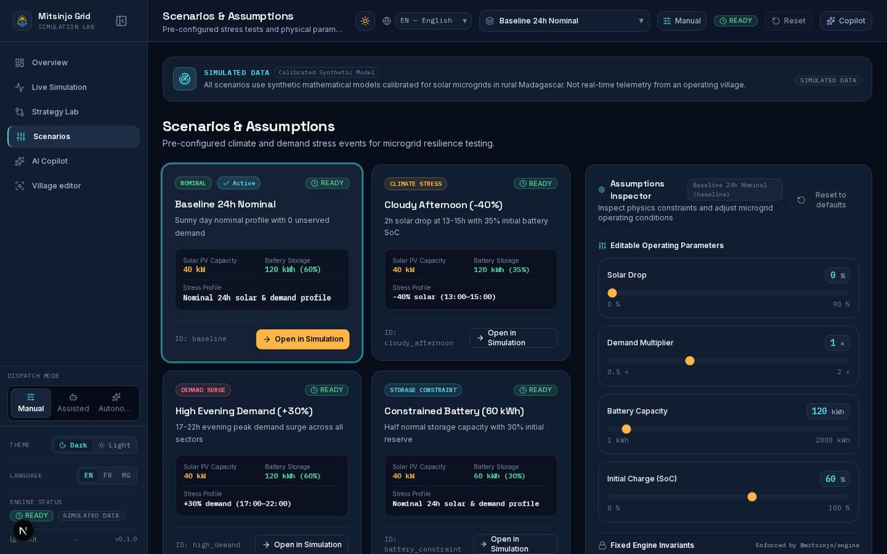

<!-- Generated by `make scenarios-publish` from the local test-scenarios/ folder. Edit the source, then re-run. -->

[← All scenarios](README.md) · `/scenarios` · **18 scenarios** · written in French (UI labels from `fr.json`)

# Scénarios & Hypothèses — `/scenarios`

But : rendre les hypothèses compréhensibles, reproductibles et comparables.

## Cartes

- [ ] **C1** — 6 scénarios listés avec nom, description, type (Nominal, Stress Climatique, Contrainte Stockage, Pic de Demande…) et changements clés (ex. « -40% solaire (13–15) »).
- [ ] **C2** — Avis « Modèle Synthétique Étalonné » / données synthétiques visible.
- [ ] **C3** — Statut par carte : « Non encore exécuté » avant simulation, puis à jour après.
- [ ] **C4** — « Ouvrir le scénario » → devient actif (sélecteur d'en-tête mis à jour).
- [ ] **C5** — « Ouvrir en Simulation » → va sur `/simulation` avec ce scénario.

- [ ] **C16** — Carte « Incendie au village (marché → eau) » : badge rouge « Incident », delta « Incendie – Marché … dès 14:00 ». Ouvrir en Simulation → lecture : le marché s'éteint et prend feu à 14:00 (bannière incendie), la station de pompage à 15:00 ; le centre de santé reste alimenté toute la journée.
- [ ] **C17** — Le même scénario apparaît dans le sélecteur de scénario de l'en-tête (toutes pages) ; avec une clé Meta, « Lance le scénario incendie au village » → le copilote appelle run_scenario avec `village_fire` sans erreur d'outil.

## Inspecteur d'hypothèses

- [ ] **C6** — Paramètres modifiables (PV, batterie, SoC, demande…) vs « Invariants Moteur Fixes » en lecture seule (« Imposé par @mitsinjo/engine » : horizon 24 h pas de 1 h, réserve SoC min, charge/décharge max, rendement).
- [ ] **C7** — Secteurs du village avec palier de résilience et « X% demande critique » ; plafond affiché « PLAFOND : N kW (Xh–Yh) » s'il y en a.
- [ ] **C8** — Valeur invalide → erreur qui explique la correction (pas de correction silencieuse).
- [ ] **C9** — Modifier une valeur → statut « Scénario modifié ».
- [ ] **C10** — « Rétablir les défauts » → demande « Confirmer la réinitialisation ? » ; confirmer remet les valeurs d'origine.

## Résumé de la dernière simulation

- [ ] **C11** — Avant simulation : « Non encore exécuté ».
- [ ] **C12** — Après : Demande, Servi, Déficit, Couverture Essentielle, SoC Final — mêmes valeurs que `/overview`.
- [ ] **C13** — « Copier le résumé » → « Copié ! » ; « Télécharger JSON » → fichier JSON reproductible.

## Mobile

- [ ] **C14** — 390 px : cartes sur 1 colonne, inspecteur en dessous (ou tiroir), pas de défilement horizontal.
- [ ] **C15** — Cliquer « Ouvrir en Simulation » sur la carte « Après-midi nuageux » → une seule navigation vers /simulation avec ce scénario chargé ; clic molette / Ctrl+clic ouvre /simulation dans un nouvel onglet (c'est un lien).
- [ ] **C18** — Après A116 « Enregistrer » → `/scenarios` → « Mes scénarios personnalisés » : la carte affiche J1 J2 J3 (FR) avec icônes météo, infobulle « Jour 1 : Nuageux », déficit et critique en « x.x kWh ». Boutons Exporter / Supprimer : 44 px, lus par le lecteur d'écran (aria-label). Supprimer → la carte disparaît.
