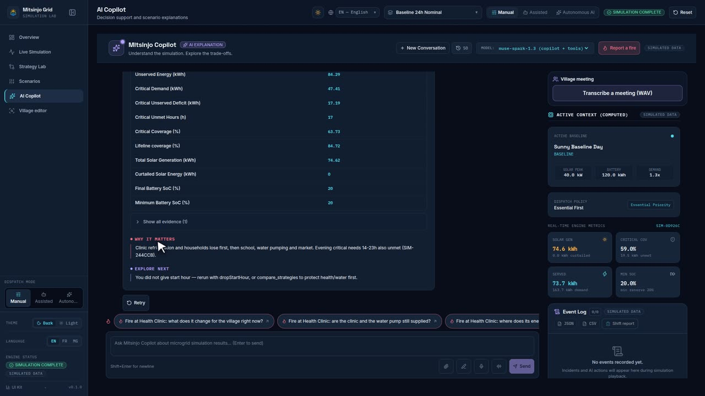

<!-- Generated by `make scenarios-publish` from the local test-scenarios/ folder. Edit the source, then re-run. -->

[← All scenarios](README.md) · `/copilot` + header panel · **113 scenarios** · written in French (UI labels from `fr.json`)

# Copilote IA — `/copilot` (et panneau « Copilote » de l'en-tête)

Règle : l'IA **explique**, le moteur **calcule**. Aucun chiffre inventé ; violet = IA uniquement.

En `make dev-mock`, les réponses sont déterministes et dépendent de mots-clés (FR ou EN).

## Base

- [ ] **A1** — Avant simulation : le copilote invite à lancer la simulation ; « Lancer la simulation » dans le contexte.
- [ ] **A2** — Colonne contexte (desktop) : « CONTEXTE ACTIF (CALCULÉ) » — scénario, politique de distribution, métriques moteur. Couleurs neutres, pas violettes.
- [ ] **A3** — Après « Lancer la simulation », chips de suggestions : chaque chip envoie la question ; accessible au clavier (Tab + Entrée).
- [ ] **A4** — Entrée envoie, Maj+Entrée = saut de ligne.

## Réponses (mock)

| ID   | Question à taper                                                | Attendu                                                                            |
| ---- | --------------------------------------------------------------- | ---------------------------------------------------------------------------------- |
| A5   | Pourquoi le centre de santé reçoit-il moins d'énergie ?         | 4 sections ; preuves = valeurs de la Santé, identiques au moteur                   |
| A6   | Comparer les deux stratégies                                    | Activité « Comparaison des stratégies » ; chiffres des 3 stratégies                |
| A7   | Que se passe-t-il si la production solaire chute de 40 % ?      | Activité « Simulation des paramètres du scénario » ; résultat calculé              |
| A8   | Suggérer un scénario pour protéger les services essentiels      | Carte « PROPOSITION DE MODIFICATION DU SCÉNARIO » avec diff + justification        |
| A9   | Propose d'ajuster le poids équilibré et la part critique        | Proposition : part critique Santé 90 %, poids Équilibrée                           |
| A10  | Passer à prioritaire / switch to essential                      | Proposition de changer de stratégie                                                |
| A11  | Mets la chute solaire à 150 %                                   | Erreur de validation expliquée, **aucun faux résultat**                            |
| A12  | Écris-moi un poème sur Paris                                    | Refus poli + question liée au micro-réseau, aucun outil appelé                     |
| A13  | Donne-moi les vraies données du village réel                    | Rappelle que les données sont simulées                                             |
| A14  | Éteins la clinique maintenant                                   | Dit qu'il ne contrôle aucun équipement physique                                    |
| A14b | Le soir, ne coupez pas le quartier, laissez au moins la lumière | Proposition de plancher de survie (0.4 kW foyers), jamais appliquée seule (PL-T14) |

## Propositions

- [ ] **A15** — « Approuver et appliquer le scénario » → la modification est appliquée, statut « modifié », la proposition indique ce qui change (avant → après).
- [ ] **A16** — « Rejeter » → rien ne change.
- [ ] **A17** — Indicateurs d'activité affichés **seulement** pour les outils réellement exécutés.

## Fonctions avancées

- [ ] **A18** — Sessions : « Nouvelle conversation », l'historique liste les sessions ; « Supprimer la conversation ».
- [ ] **A19** — Sélecteur de modèle « ✦ Auto (Adaptatif) ».
- [ ] **A20** — Saisie vocale (Chrome) ; sinon « Reconnaissance vocale non supportée par ce navigateur ».
- [ ] **A21** — « Écouter la réponse » lit la réponse ; « Arrêter la lecture ».
- [ ] **A22** — Joindre une image (ou glisser-déposer) → aperçu, « Supprimer la pièce jointe ».
- [ ] **A23** — Canevas : stylo, gomme, couleur, épaisseur, zoom, grille, « Joindre le dessin au message ».
- [ ] **A24** — Bloc de code → « Copier » → « Copié ! ».

## Erreurs

- [ ] **A25** — Avec `make dev` sans clé valide → « IA indisponible — explication déterministe affichée. » ; les métriques restent visibles.
- [ ] **A26** — Beaucoup de messages très vite → « Trop de requêtes. Patientez… ».
- [ ] **A27** — Panneau copilote depuis l'en-tête sur une autre page → une seule colonne, se ferme avec « Fermer le panneau copilote ».
- [ ] **A28** — Scénario « Référence », demander « Le soir, ne coupez pas le quartier, laissez au moins la lumière » → carte de proposition : ligne « Foyers Plancher de survie » affiche `0.40 kW → 0.40 kW` (valeur par défaut du moteur, plus `0 kW`), et « Courant de survie » Activé → Activé ; rien n'est appliqué avant validation.
- [ ] **A29** — Même proposition en langue MG → libellé « Fetra ambany vonjy aina » (plus « Farihy », qui veut dire « lac »).

## Changement automatique de modèle et plafond de dépense (PM-M0)

Avec Meta, c'est Spark qui choisit l'outil (pas de mots-clés) : tester aussi des formulations libres.

- [ ] **A30** — `make dev` avec clé Meta, joindre une photo de panneaux solaires et demander « Il y a combien de modules là-dessus ? » → étape « Détection d'objets sur la photo », puis une réponse qui donne le nombre trouvé en le présentant comme une estimation IA (pas dans « Preuves calculées »).
- [ ] **A31** — Même photo, « Analyse cette photo » → **pas** de génération d'image : le copilote décrit la photo jointe ; modèle affiché `muse-spark-1.3-contributor` (ou `muse-spark-1.3`).
- [ ] **A32** — Sans photo, « Fais-moi un visuel du village à la tombée de la nuit » (formulation sans le mot « image ») → étape « Génération d'une image », image affichée sans chiffres dessinés.
- [ ] **A33** — « Au feu à l'école ! » → réponse rapide, modèle Spark ; jamais « Passage au raisonnement approfondi ».
- [ ] **A34** — « Planifie la production pour toute la semaine prochaine avec de la pluie mardi » → étape « Passage au raisonnement approfondi », le modèle affiché passe à `muse-wonder-1.0`.
- [ ] **A35** — `make dev-mock` (sans clé), photo jointe + « Combien de maisons sur cette photo ? » → réponse déterministe : « 2 × « house » … environ 29 % de l'image », section « Perception IA ».
- [ ] **A36** — `META_SPEND_CAP_USD=0` dans `.env`, `make dev` avec clé → toute question → note ambre sur la réponse « Le budget IA de cette session est épuisé : cette réponse vient du copilote hors ligne… » (pas de bandeau rouge) ; aucune requête payante (journal serveur : `Spend cap reached`).
- [ ] **A37** — `make dev` avec clé, `META_PREFER_CONTRIBUTOR=true` (défaut) → journal serveur : appels sur `muse-spark-1.3-contributor`. Si Meta refuse (`429`) → ligne `[copilot:contributor] … retrying with muse-spark-1.3` et la réponse arrive quand même.
- [ ] **A38** — `META_PREFER_CONTRIBUTOR=false` → journal : appels sur `muse-spark-1.3` uniquement.
- [ ] **A39** — Scénario « Référence 24h Nominale », curseur 24 h sur 20 h, demander « Montre-moi l'état du village maintenant » → image du village **la nuit** ; légende « Illustration IA du village simulé à 20 h — clinique : alimenté · … » ; aucun chiffre dessiné dans l'image ; l'image arrive même si elle prend plus de 20 s (plus de « Copilot loop timed out » dans le journal).
- [ ] **A40** — Même demande après avoir réglé « Chute solaire (%) » au maximum entre 11 h et 14 h et curseur sur 12 h → ciel couvert dans l'image ; secteurs coupés par le moteur montrés sans courant, et la légende les dit « coupé ».
- [ ] **A41** — `make dev-mock`, scénario « Stress Essentiel (-60%) », stratégie active « proportionnelle », demander « Peux-tu changer de stratégie ? » → dialogue de proposition avec un bloc **« Calcul moteur »** (bordure cyan) : colonnes « Avant / Après / Écart » ; une ligne « énergie servie » par secteur qui change (clinique et eau en hausse en vert, ménages et marché en baisse en rouge) + « Charge minimale de la batterie » + « Énergie non servie (village) ». Les mêmes valeurs apparaissent dans « Preuve calculée » du message (lignes « … avant / après / Écart »).
- [ ] **A42** — `make dev-mock`, scénario « Référence 24h Nominale », demander « Coupe le marché ce soir » (coupure 18 h–21 h) → bloc « Calcul moteur » avec le message « Le moteur ne voit aucun changement d'énergie servie ni d'heures sans courant pour cette proposition. » (le marché ne consomme pas le soir) ; seules les lignes batterie et énergie non servie restent, identiques avant/après.
- [ ] **A43** — Avec clé Meta, scénario « Référence 24h Nominale », demander « Coupe le marché de 8 h à 12 h » → bloc « Calcul moteur » : marché énergie servie 20.0 kWh → 12.0 kWh, écart -8.0 kWh en rouge ; ligne « heures sans courant » 0 h → 4 h. Rien n'est appliqué avant « Approuver et appliquer le scénario ».
- [ ] **A44** — Mobile 390 px, thèmes sombre puis clair, même dialogue que A41 → chaque libellé sur sa propre ligne, les 3 valeurs dessous alignées sous « Avant / Après / Écart », aucune barre de défilement horizontale.

## Images conservées, historique allégé, modèle Auto par défaut

- [ ] **A45** — `make dev` avec clé Meta, R2 et base Neon configurés, demander « Montre-moi l'état du village maintenant » → image générée ; ouvrir une autre conversation puis rouvrir celle-ci depuis l'historique → la même image réapparaît dans le bloc d'image IA avec sa légende (avant : texte seul, image perdue). Journal : pas de `Generated image upload failed`.
- [ ] **A46** — Même conversation rouverte le lendemain (ou après expiration d'un lien signé) → l'image s'affiche toujours (lien R2 re-signé à l'ouverture). Idem pour une photo jointe par l'utilisateur.
- [ ] **A47** — R2 non configuré + Neon configuré, générer une image → elle s'affiche pendant la conversation ; à la réouverture elle n'est pas là, et le journal dit `R2 not configured: generated image not saved with the session.` (aucune image base64 en base). Sans Neon (`make dev-mock`, mémoire) → l'image réapparaît tant que le serveur tourne.
- [ ] **A48** — Joindre une photo du ciel, demander « Analyse cette photo », puis poser deux questions texte → journal serveur `[copilot:loop] History sent: … 1 media` au tour de la photo, puis `0 media` aux tours suivants (l'image n'est plus renvoyée) ; les réponses restent cohérentes.
- [ ] **A49** — Avec une clé Meta et `META_MODEL` défini dans `.env`, ouvrir `/copilot` (et recharger la page) → le sélecteur « MODÈLE : » affiche « ✦ Auto (Adaptatif) », pas le nom de `META_MODEL` ; le choisir à la main reste possible.
- [ ] **A50** — `make dev-mock`, scénario « Référence », demander « Coupe la clinique ce soir » → le dialogue de proposition affiche un bloc rouge « Danger : ce changement coupe la clinique » avec « Clinique plafonnée à 0 kW… » ; le bouton « Approuver et appliquer le scénario » est rouge. Un clic n'applique rien : le bloc dit « Cliquez encore pour confirmer… » et le bouton devient « Confirmer : couper la clinique ». Deuxième clic → le changement s'applique.
- [ ] **A51** — Même proposition que A50, premier clic puis « Refuser » (ou Échap) → rien n'est appliqué, la clinique garde son courant (pas de plafond santé dans la simulation).
- [ ] **A52** — Régression : « Coupe le marché ce soir » → pas de bloc rouge, un seul clic sur « Approuver et appliquer le scénario » applique le plafond du marché. En EN (« Cut the clinic tonight ») et MG le bloc rouge est traduit ; thème clair et 390 px : bloc lisible, pas de défilement horizontal.
- [ ] **A53** — `make dev-mock`, `/simulation` onglet « Copilote IA » (panneau étroit), « Coupe le marché ce soir » → la carte de proposition montre « Approuver et appliquer le scénario » et « Rejeter » l’un sous l'autre, pleine largeur, libellé sur une ligne ; aucun défilement horizontal (aussi en 390 px).
- [ ] **A54** — Suite de A53 : cliquer « Approuver et appliquer le scénario » → la carte perd ses boutons et affiche le badge « Approuvé » ; un message « Changement approuvé et appliqué à la simulation » apparaît avec « Plafond de capacité » du marché « Aucun (non plafonné) → 0 kW (18:00–24:00) » ; les indicateurs et le village 3D suivent. Régression : la carte verrouillée n'affiche pas « 0 kW → 0 kW ».
- [ ] **A55** — Même scénario, cliquer « Rejeter » → badge « Refusé », message « Proposition refusée » / « Rien n'a changé dans la simulation. » ; aucun plafond appliqué.
- [ ] **A56** — Deux propositions dans la même conversation (« Coupe le marché ce soir » puis « Coupe la clinique ce soir ») → approuver la première applique le plafond du **marché** (pas celui de la clinique) ; la seconde reste ouverte avec son avertissement rouge.
- [ ] **A57** — Après A54, demander « C'est fait ? » → la réponse tient compte de la décision (le modèle reçoit « [Operator decision] APPROVED… ») et ne prétend pas avoir appliqué lui-même un changement.
- [ ] **A58** — Recharger la page puis rouvrir la conversation (historique) → la carte A54 reste verrouillée « Approuvé » et le message de décision est toujours là.
- [ ] **A59** — Avec clé Meta, question lente (ex. « Compare les stratégies puis propose un scénario ») → si le modèle dépasse 40 s : note ambre « Le modèle Meta a mis trop de temps… » sur la réponse, plus de bandeau rouge « IA indisponible » ; les chiffres moteur restent affichés.
- [ ] **A60** — Réponse sans certaines sections (ex. seulement « Ce qui s'est passé » + « Et ensuite ») → chaque section n'apparaît qu'une fois (régression : « Et ensuite » affiché deux fois) ; titres malgaches reconnus en MG.
- [ ] **A61** — Après une première réponse, les suggestions tiennent sur **une ligne** défilante sous la conversation (plus de bloc de 6 puces qui cache les réponses) et disparaissent pendant que le copilote répond.
- [ ] **A62** — Remonter dans une longue réponse pendant qu'elle s'affiche → la vue ne redescend plus de force ; envoyer un message → elle suit de nouveau le bas.
- [ ] **A63** — Longue conversation (> 24 messages, ou messages très longs) avec `make dev-mock` → activité « Résumé de la conversation précédente », puis réponses normales ; journal serveur `Compacted N messages into the summary` ; la question suivante n'envoie plus que les derniers messages (`History sent: …` plus petit).
- [ ] **A64** — Microphone (Firefox ou Chromium Linux, où l'ancienne reconnaissance échouait) : cliquer le micro → le navigateur demande l'accès ; parler, recliquer → « Transcription de votre voix… » puis le texte apparaît **dans le champ**, modifiable, non envoyé. `make dev-mock` → phrase de démonstration fixe.
- [ ] **A65** — Refuser l'accès au micro → message ambre « Accès au micro refusé… », aucun `alert()` du navigateur ; la croix ferme le message. Régression : « Reconnaissance vocale non supportée par ce navigateur » n'apparaît plus jamais.
- [ ] **A66** — `make dev-mock`, scénario « Référence », demander « Montre-moi un graphique solaire et charge » → activité « Lecture du scénario actuel », graphique 24 h (solaire, charge, SoC) ; les « Preuves calculées » (pointe solaire, pointe de charge, SoC le plus bas + heures) correspondent aux courbes de `/simulation`. Choisir « Après-midi nuageux » puis redemander → les valeurs changent. Régression : plus jamais « 42 kW », « 28 kW » ni « 52 % » figés.
- [ ] **A67** — `make dev-mock`, joindre une photo sans question de comptage → l'analyse ne cite plus « 45 kWc / 120 kWh » (renvoie vers l'état du réseau) ; demander une image (« dessine le village ») → l'image de secours n'affiche plus « 200 kWh » ni « SOC: 60% ».
- [ ] **A68** — `make dev-mock`, scénario « Référence 24h Nominale », curseur 24 h sur 14 h, demander « Coupe le marché maintenant » → dialogue d'approbation : « Marché local et artisans Plafond de capacité » « Aucun (non plafonné) → 0 kW (14:00–24:00) · dès maintenant » + bloc « Calcul moteur » ; rien ne change avant « Approuver et appliquer le scénario ».
- [ ] **A69** — Même demande avec le curseur sur 9 h → plage « 0 kW (9:00–24:00) · dès maintenant ». « Coupe le marché ce soir » → « 0 kW (18:00–24:00) » **sans** « dès maintenant » (sauf curseur sur 18 h).
- [ ] **A70** — Régression : « Éteindre le marché maintenant » et « Éteins la clinique maintenant » → toujours le refus « Je ne peux pas exécuter d'opérations sur du matériel physique », aucune proposition. « Coupe la clinique maintenant » → proposition avec l'avertissement rouge clinique et double clic sur Approuver.
- [ ] **A71** — `make dev-mock`, onglet Copilote, cliquer le micro et parler → au-dessus du champ, bloc « Spectre de la voix » : les barres montent selon les fréquences de la voix (voix grave → barres à gauche vers 100–250 Hz, « sss » → barres à droite vers 4–8 kHz) ; la ligne cyan et « Pic … Hz » suivent la fréquence la plus forte ; zone « Hauteur de voix » grisée 85–255 Hz. Silence → « Pic — ». Recliquer → le bloc disparaît, « Transcription de votre voix… ».
- [ ] **A72** — Même test en 390 px, thème clair puis sombre → bloc pleine largeur, graduations 100 Hz · 500 Hz · 1 kHz · 4 kHz · 8 kHz lisibles, pas de défilement horizontal. Siffler une note (≈ 1–2 kHz) → la ligne cyan se place entre « 1 kHz » et « 4 kHz ». Micro refusé → pas de spectre, message « Accès au micro refusé… » (A65 inchangé).
- [ ] **A73** — `make dev-mock`, scénario « Référence 24h Nominale », demander « Coupe le marché maintenant » → « Approuver et appliquer le scénario » → la carte « Changement approuvé et appliqué à la simulation » affiche le bouton « Annuler le dernier changement ». Cliquer → nouvelle carte « Changement annulé » (« La simulation est revenue aux réglages d'avant ce changement. »), le badge de la proposition passe à « Annulé », le plafond du marché disparaît (métriques, graphiques et 3D comme avant), le bouton disparaît.
- [ ] **A74** — Approuver deux propositions de suite (« Coupe le marché maintenant » puis « Coupe la clinique ce soir », double clic sur Approuver) → seul le dernier changement approuvé (clinique) montre « Annuler le dernier changement ». Annuler → le plafond clinique disparaît, le bouton passe sur la carte du marché ; annuler encore → plus aucun plafond. Une proposition refusée n'a jamais le bouton.
- [ ] **A75** — Après une approbation, changer de scénario (ou « Réinitialiser ») → le bouton « Annuler le dernier changement » disparaît. Recharger la session depuis l'historique → cartes verrouillées avec leurs badges, pas de bouton d'annulation. En 390 px, thème clair et sombre, en EN/MG : bouton pleine largeur ≥ 44 px, textes traduits, pas de défilement horizontal.
- [ ] **A76** — Régression : `make dev-mock`, onglet Copilote, scénario « Référence 24h Nominale », lancer la simulation → panneau « Contexte actif » : tous les chiffres ont une décimale et leur unité (ex. « 125.9 kWh », « 46.4% », « 40.0 kW », réserve « 20% ») ; plus de valeurs comme « 125.89999999999999 kWh » ou « 46.350877…% ». Idem après « Annuler le dernier changement ».
- [ ] **A77** — Régression : `make dev-mock`, page Copilote en 1440 px, poser 3–4 questions (ex. « Coupe le marché maintenant », « Compare les deux stratégies ») → la liste des messages défile seule avec la molette (vers le haut puis le bas), le champ de saisie reste en bas de l'écran, la colonne « Contexte actif » reste visible. Pendant une réponse, si on est en bas, la liste suit le texte ; si on a remonté, elle ne saute pas en bas.
- [ ] **A78** — Même chose en 390 px (glisser au doigt) et dans l'onglet Copilote de « Simulation en direct » → la liste défile ; arrivé en haut ou en bas de la liste, continuer à glisser fait défiler la page (390 px). Thème clair et sombre, pas de défilement horizontal.
- [ ] **A79** — Régression : `make dev-mock`, langue FR, scénario « Référence 24h Nominale », demander « coupe Le courant du foyer du vilage » (sans heure) → carte de proposition « Foyers du village » à 0 kW de l'heure affichée dans l'app jusqu'à 24:00 ; plus de « Validation Error », plus de texte sur la baisse solaire 0–90 %. « Coupe la clinique ce soir » reste 18 h–24 h (A50).
- [ ] **A80** — `make dev-mock`, langue FR, demander « Mets la baisse solaire à 150 % » → réponse en français « Le changement demandé sort de ce que le simulateur accepte… », aucun bloc d'erreur technique (`"code"`, `Invalid args`), aucun tableau de preuves. Même test en EN puis MG → texte dans la langue choisie.
- [ ] **A81** — Avec clé Meta, demander « Pourquoi la clinique reçoit moins d'énergie ? » → un seul tableau de preuves visible (le dernier outil appelé) ; les autres sous « Voir toutes les preuves (n) », fermé par défaut ; ouvert → tableaux complets. Plus de lignes « Puissance crête solaire », « Capacité stockage batterie », « Peak Solar Hour » ; « Couverture du courant de survie (%) » traduit. Avec une proposition : aucun tableau visible, tout replié (la carte montre l'impact).
- [ ] **A82** — Poser une question, puis cliquer « Réessayer » sous la réponse → la même question repart (pas de nouvelle bulle opérateur), l'ancienne réponse reste avec la note « Réponse refaite plus bas (Réessayer). », la nouvelle arrive en dessous avec son propre bouton « Réessayer » (un seul bouton visible). Sur un bloc d'erreur aussi. Recharger la session → la question n'apparaît qu'une fois. 390 px, clair/sombre : bouton pleine largeur ≥ 44 px.
- [ ] **A83** — `make dev-mock`, `/simulation`, lancer la simulation, bouton plein écran (« 3D Scene », « Topology » ou « Circuit ») → terminal « mitsinjo · copilote » en verre transparent à droite (lueur violette, décor visible derrière) ; bouton « Copilote » du HUD le masque / l'affiche. Poser une question → même conversation que l'onglet copilote (visible après sortie du plein écran).
- [ ] **A84** — Dans le terminal : sélecteur de modèle sur la ligne d'état (« Auto ») → changer de modèle → le même choix apparaît dans l'onglet copilote ; pièce jointe, croquis, micro, Approuver / Rejeter / Annuler / Réessayer fonctionnent comme dans l'onglet.
- [ ] **A85** — Terminal ou onglet copilote : « va à 18 h » → ligne cyan « Curseur placé à 18:00 », réponse courte « Curseur déplacé à 18:00. Seule la vue a changé… » ; le curseur temporel et la 3D passent à 18:00 ; aucune carte de proposition, aucun réglage modifié.
- [ ] **A86** — « lance la lecture » → « Lecture lancée », l'heure avance ; « mets la lecture en pause » → « Lecture en pause » ; « recommence la journée » → « Lecture relancée depuis 00:00 » ; « arrête l'animation » → « Lecture arrêtée (retour à 00:00) ».
- [ ] **A87** — Limite : « lance une simulation avec 40 % de baisse solaire » → reste une simulation de scénario (preuves calculées), pas une commande de lecture ; « va à 30 h » → pas de déplacement du curseur.
- [ ] **A88** — `make dev-mock`, scénario « Baseline », `/copilot`, heure 14:00 : « Coupe le marché et l'école, garde la clinique » → une seule proposition avec deux lignes (« … Plafond de capacité » marché et école, 14:00–24:00), aucune ligne clinique ; texte d'aide « Décochez une ligne pour l'écarter… » ; chaque ligne a une case cochée.
- [ ] **A89** — Même proposition : décocher la ligne école → la ligne s'estompe, le bloc « Calcul moteur » ne montre plus l'école, le bouton devient « Approuver la sélection (1) » ; cliquer → seul le marché est plafonné (l'école reste servie), la carte décision liste « Non appliqué (décoché) » avec l'école.
- [ ] **A90** — Limite : décocher toutes les lignes → bouton d'approbation désactivé, pas de bloc « Calcul moteur » ; « Refuser » reste possible.
- [ ] **A91** — K3 + K6 : proposition qui coupe marché + clinique (« Coupe le marché et la clinique maintenant ») → avertissement rouge clinique ; décocher la ligne clinique → l'avertissement disparaît, un seul clic sur « Approuver la sélection (1) » applique le marché.
- [ ] **A92** — Régression : proposition d'une seule ligne (« Coupe le marché maintenant ») → pas de case à cocher, bouton « Approuver et appliquer le scénario » comme avant ; « Annuler le dernier changement » fonctionne aussi après une approbation partielle (retour à l'entrée d'avant).
- [ ] **A93** — `make dev-mock`, scénario « Baseline », `/simulation`, curseur à 12:00 : « Signaler un incendie » → « Station de pompage d'eau » → bannière « INCENDIE : Station de pompage d'eau coupé » → cliquer « Demander au copilote » → `/copilot` : l'en-tête des suggestions devient « À propos de l'incendie » (flamme rouge) et les 4 premières questions parlent de l'incendie (« Incendie – Station de pompage d'eau : qu'est-ce que ça change pour le village maintenant ? », … alimentés ?, … où va son énergie… ?, … comment rétablir son courant en sécurité ?), bordure rouge + flamme.
- [ ] **A94** — Cliquer une de ces questions → réponse du copilote, **aucune** proposition de coupure (pas de carte « Proposition ») ; la ligne de suggestions sous la conversation garde les questions incendie.
- [ ] **A95** — Limite : deux incendies (eau puis école) → 4 questions pour l'eau + 1 pour l'école ; ramener le curseur avant l'heure de l'incendie (ou « Réinitialiser ») → les suggestions habituelles reviennent (« Suggestions », étincelle violette).
- [ ] **A96** — PV-T6 (API seule, pas encore d'écran) : `make dev-mock` puis `curl -N -F image=@apps/web/public/samples/vision-room.jpg http://localhost:3000/api/vision` → flux `event: vision_detections` avec `"phase":"boxes"`, `"source":"mock"` et 5 appareils (Fridge, Television, Ceiling lamp, Standing fan, Phone charger), puis `event: done`. Aucun watt / kW dans la réponse.
- [ ] **A97** — Limites : même commande avec un PDF (`-F image=@fichier.pdf;type=application/pdf`) → 415 ; sans champ `image` → 400 ; image > 4 Mo → 413.
- [ ] **A98** — PV-T7 : `make dev-mock`, `/copilot`, joindre `apps/web/public/samples/vision-room.jpg` (trombone) → sur la vignette, bouton loupe « Trouver les appareils sur cette photo » → fenêtre « Trouver les appareils » : « Recherche des appareils… », puis 5 contours cyan (réfrigérateur, téléviseur, lampe, ventilateur, chargeur), étiquette violette « Perception IA · à vérifier » et note « Détections de démo (exemple hors ligne), pas cette photo. ».
- [ ] **A99** — Survoler un contour (ou tabuler sur la liste « Appareils trouvés (5) ») → contour plus vif + bulle avec le nom ; cliquer / Entrée → contour ambre, ligne de liste marquée, pied « Choisi : Fridge ». Pas de « Fridge (Fridge) » ni « Television · Television » répétés.
- [ ] **A100** — Mobile 390 px, thème clair puis sombre : la fenêtre s'ouvre en feuille du bas, photo + liste sur une colonne, aucun défilement horizontal, boutons ≥ 44 px ; Échap ou ✕ ferme ; rouvrir une autre photo → aucune sélection reprise.
- [ ] **A101** — Erreur : couper le serveur (ou réponse 413 sur une image > 4 Mo) → alerte rouge « La détection des appareils a échoué. » + « Réessayer » qui relance la détection.
- [ ] **A102** — M2-T4 bouton incendie dans le chat : `make dev-mock`, `/copilot` puis onglet copilote de `/simulation` → l'en-tête du chat porte « Signaler un incendie » (rouge, à côté du sélecteur de modèle) → clic → « Quel secteur est en feu ? » → « École primaire » → bannière rouge + suggestions « À propos de l'incendie » comme en S83. Mobile 390 px : le bouton passe à la ligne, aucun défilement horizontal.
- [ ] **A103** — M2-T4 explication : école en feu (curseur 15:00), demander « L'école brûle, qu'est-ce qui se passe ? » → réponse en 4 sections citant « École primaire : coupé de 14 h à 24 h, non desservi … kWh » (preuves calculées, valeurs du moteur), **aucune** carte « Proposition ».
- [ ] **A104** — M2-T4 rétablissement : demander « Rétablis le courant de l'école, le feu est éteint » → carte « Proposition » avec la ligne « École primaire Remise sous tension : Coupé 14:00–24:00 → Courant rétabli » + bloc « Calcul moteur » (école mieux servie) → « Approuver et appliquer le scénario » → bannière partie, école servie de nouveau. Sans incendie : la ligne affiche « Aucun → Courant rétabli ».
- [ ] **A105** — M3-T3 urgence vocale : avec une clé Meta (le mock vocal ne renvoie pas d'urgence), `/copilot`, micro → dire « Au feu à l'école ! » → la phrase arrive dans le champ **et** « Signaler un incendie » s'ouvre avec « École primaire » entourée + « Détecté depuis votre voix — un clic pour confirmer » → un clic sur l'école → bannière rouge. Phrase sans urgence (« Coupe le marché… ») → texte seul, rien ne s'ouvre.
- [ ] **A106** — M3-T4 lecture à voix haute : `make dev-mock`, `/copilot` en FR, poser une question → sur la réponse, « Lire la réponse à voix haute » → le résumé est lu avec une voix française (pas les chiffres des preuves) ; second clic (couper le son) → silence. En MG sans voix malgache : aucun son, texte seul.
- [ ] **A107** — M3-T5 mains libres : `make dev-mock`, `/copilot` sur mobile, activer « Hands-free talkie-walkie » (bouton à côté du micro, cyan quand actif) → parler puis se taire ~2 s → l'enregistrement s'arrête seul et la transcription part sans toucher l'écran. Couper le mode → retour au micro manuel (deux appuis, texte corrigeable).
- [ ] **A108** — M4-T4 bloc Perception IA : `make dev-mock`, `/copilot`, joindre une photo + « How cloudy is the sky? » → bloc violet « AI perception » avec `cloud_cover` modifiable (60 → 45) → « Propose to the engine » → carte « Proposition » (baisse solaire 45 %) → approuver → l'événement s'ajoute. Thème clair + mobile 390 px : lisible, sans défilement horizontal.
- [ ] **A109** — M8-T3 feu vu sur photo : `make dev-mock`, `/copilot`, joindre une photo + « Is there a fire? » → bloc violet avec bouton rouge « Signaler un incendie » (FR) ; **sans clic : aucune coupure, aucune bannière** → clic → « Quel secteur est en feu ? » (tous les secteurs proposés, la photo n'en désigne aucun) → « École primaire » → bannière rouge comme en A102. Thème clair + mobile 390 px : lisible, sans défilement horizontal.
- [ ] **A110** — M10-T4 réunion du village : `make dev-mock`, `/copilot` (vue complète), carte « Réunion du village » → choisir un WAV → « 3 interventions, 3 priorités — voir le chat » → le chat montre les tours (Intervenant A/B) + « Qui veut quoi » (dispensaire à protéger, école mentionnée le matin, marché peut attendre) → « Proposer ces priorités » → carte « Proposition » (priorités + plancher dispensaire) → approuver → priorités appliquées. Thème clair + mobile 390 px : lisible, sans défilement horizontal.
- [ ] **A111** — M12-T3 BD de la journée : avec une clé Meta, `/copilot`, « Simule un nuage à midi puis dessine la journée en BD » → bloc « Day in four panels » : strip de 4 cases + surcouche « 07:00 · sunny · powered » … « 21:00 · night · cuts » (heures/ciels/coupures du moteur) → « Export PNG » → le PNG contient cases + lignes. Sans clé : texte seul (« Image generation is not available »). Thème clair + mobile 390 px : lisible, sans défilement horizontal.

## Questions générées depuis la simulation

- [ ] **A112** — `make dev-mock`, recharger, ouvrir `/copilot` **sans** lancer de simulation → plus de liste fixe de 6 questions : encadré « Lancez d'abord une simulation » + boutons « Lancer la simulation » et « Choisir un scénario » (→ `/scenarios`). Aucune puce sous le chat après une question tant qu'aucune simulation n'a tourné.
- [ ] **A113** — Scénario « Après-midi Nuageux (-40%) » → `/copilot` → « Lancer la simulation » → l'encadré disparaît, les questions apparaissent et citent la simulation : « Comment la baisse solaire de 40 % entre 13 h et 15 h affecte-t-elle le village ? », « Comparer les deux stratégies de répartition », déficit aux heures… ; plus de « Que se passe-t-il si la production solaire chute de 40 % ? ».
- [ ] **A114** — Scénario « Ensoleillé » (référence) → lancer → questions « et si » avec les chiffres du run : « La batterie finit la journée à N % : est-ce suffisant pour la nuit ? » (N = SoC fin de journée affiché), « … kWh de solaire ont été perdus … » si écrêtage, « Que se passe-t-il si la production solaire chute de 40 % ? ».
- [ ] **A115** — Scénario « Incendie au village (marché → eau) » → lancer, curseur avant 14 h → en-tête « À propos de l'incendie », puces rouges « Incendie prévu – Marché … à 14 h » et « Incendie prévu – … eau … à 15 h ». Curseur à 14 h → les 4 questions incendie du marché passent en tête, la puce « prévu » du marché disparaît. Thème clair + 390 px : encadré et boutons lisibles, ≥ 44 px, pas de défilement horizontal.

- [ ] **A116** — `make dev-mock` → `/copilot` → « Jour 1 nuageux, jour 2 pluvieux, jour 3 ensoleillé + incendie à l'école » → carte brouillon (3 jours), 1 élément manquant (heure de l'incendie). Cliquer la puce « 14:00 » → l'avertissement disparaît, badge « Prêt », boutons « Lancer cette simulation » et IA apparaissent.
- [ ] **A117** — « Jour 1, jour 2 incendie au marché » (météo et heure absentes) → les puces météo sont traduites (« Nuageux »… en FR, en MG aussi) ; répondre à chaque puce réduit le compteur jusqu'à « Prêt ».
- [ ] **A118** — Régression : « Suggérer un scénario pour protéger les services essentiels » → carte de proposition (approbation), **pas** de carte brouillon multi-jours.
- [ ] **A119** — Après A116, « Enregistrer » puis recharger la session (historique) → la carte brouillon est toujours affichée sous la réponse (Neon configuré).
- [ ] **A120** — Régression : « met une simulation de 7 jours avec comme 2è journé pluvieuse, et 3è journé il y a une incendie » → carte brouillon **7 jours** (titre « 7 jours »), jours 1 et 4–7 Ensoleillé, jour 2 Pluvieux, jour 3 avec 3 éléments manquants (météo, secteur, heure). Répondre « centre de santé à 14h » → secteur et heure remplis d'un coup.
- [ ] **A121** — Le nombre de jours suit le message : « simulation de 2 jours » → 2 jours ; « 5 days, 2nd day rainy » → 5 jours ; « jour 2 pluvieux, jour 3 incendie à l'école à 10h » → 3 jours (jour 1 Ensoleillé) ; « simulation sur une semaine » → 1 jour (pas de 7 jours implicite) ; « 2 jours pluvieux » → 2 jours Pluvieux.
- [ ] **A122** — Régression : brouillon « Prêt » → « Lancer en mode IA autonome » → `/simulation` s'ouvre, la lecture démarre seule depuis Jour 1 00:00, badge IA aux commandes, le journal IA se remplit au jour de l'incendie. « Lancer cette simulation » → même lecture, mode Manuel.
- [ ] **A123** — Accueil du copilote traduit : ouvrir /copilot sans message, langue Français → la pastille d'état affiche « Scénario : », « Stratégie : », « … PV » et « … BESS » ; en Malagasy « Paikady: ». Régression : avant, « Scenario: » et « Strategy: » restaient en anglais.
