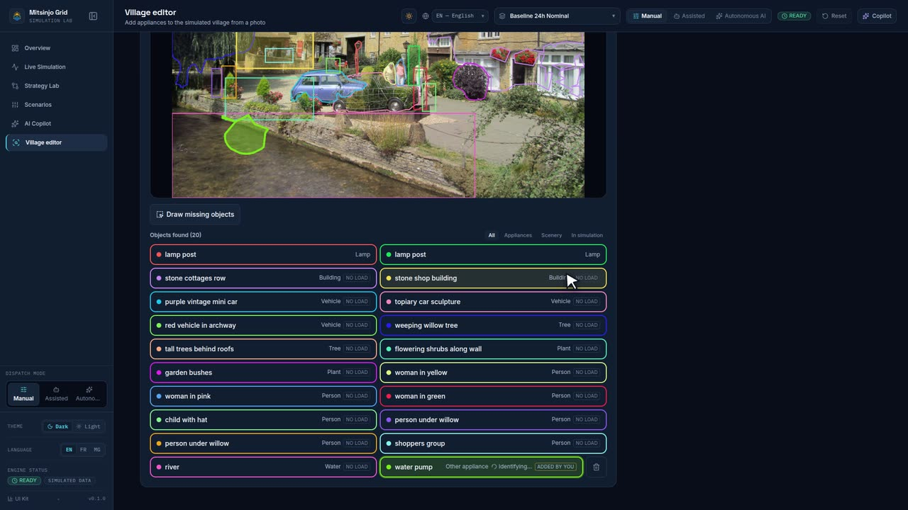
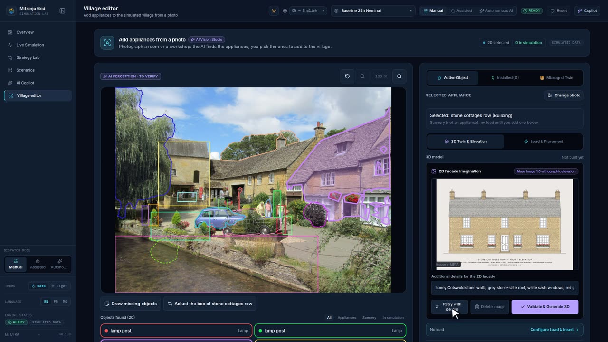
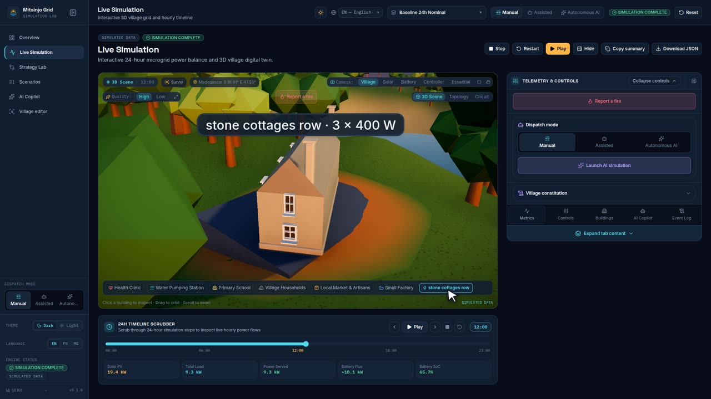

<!-- Generated by `make scenarios-publish` from the local test-scenarios/ folder. Edit the source, then re-run. -->

[← All scenarios](README.md) · `/village` · **185 scenarios** · written in French (UI labels from `fr.json`)

# /village — Éditeur du village

- [ ] **V1** — `make dev-mock` → menu latéral « Éditeur du village » (icône loupe), et 6ᵉ onglet de la barre du bas en mobile 390 px → page « Éditeur du village » avec carte « Ajouter des appareils depuis une photo » et badge « DONNÉES SIMULÉES ».
- [ ] **V2** — « Utiliser la pièce d'exemple » → « Recherche des appareils… » puis la pièce avec 5 contours cyan, étiquette « Perception IA · à vérifier », note de démo, liste « Appareils trouvés (5) ».
- [ ] **V3** — Cliquer le réfrigérateur (photo ou liste) → contour ambre, encadré « Appareil choisi » : « Choisi : Fridge » ; survoler le ventilateur → bulle « Standing fan · Ventilateur ».
- [ ] **V4** — « Choisir une photo » avec un GIF → alerte rouge « Utilisez une photo JPEG, PNG ou WebP. », aucune détection lancée ; glisser-déposer une photo JPEG dans la zone → détection lancée.
- [ ] **V5** — « Changer de photo » → nouvelle photo analysée, aucune sélection reprise.
- [ ] **V6** — Thème clair et sombre, 320 px et 1440 px : aucune barre de défilement horizontale, encadré « Appareil choisi » sous la photo en mobile, boutons ≥ 44 px.
- [ ] **V7** — Ouvrir « Éditeur du village » → colonne de droite (sous la photo en mobile) : « Jumeau numérique du réseau » avec bascule « Aperçu 3D » / « Schéma 2D », même état que la page Aperçu (scénario « Référence 24h Nominale »).
- [ ] **V8** — Avec une clé Meta : photo extérieure d'un village (maisons, voitures, arbres) → plus de message « Aucun appareil trouvé » ; liste « Objets trouvés (n) » avec maisons/voitures/arbres en contour gris et puce « SANS CHARGE ».
- [ ] **V9** — Même photo avec un lampadaire → « Street lamp » en tête de liste, contour cyan, indice « Lampe », sans puce « SANS CHARGE » ; cliquer une maison → encadré « Appareil choisi » avec « Pas un appareil électrique : aucune charge dans la simulation. ».
- [ ] **V10** — Régression (clé Meta, serveur redémarré) : la photo du village qui renvoyait `"detections":[]` → la réponse `/api/vision` (onglet Réseau) contient des objets (maisons, voiture, arbres) et la page affiche « Objets trouvés (n) ».
- [ ] **V11** — Clé Meta + R2 configurés : envoyer une photo → terminal sans « retrying with base64 » ; le bucket R2 contient `vision/<horodatage>-….jpg` ; les objets s'affichent comme avant. Sans R2 (variables vides) → même résultat, photo envoyée en base64.
- [ ] **V12** — Régression Firefox (photo de plus de 1280 px, protection anti-pistage active ; Chrome n'est pas concerné) : envoyer la photo du village → la requête `/api/vision` (Réseau → Requête) contient la vraie photo (pas une image unie) et la page affiche « Objets trouvés (n) » au lieu de « Rien de reconnu sur cette photo. ».
- [ ] **V13** — Régression cadrage : même photo de téléphone (prise en portrait) envoyée dans Firefox puis dans Chrome → les contours tombent sur les mêmes objets dans les deux navigateurs, aucun cadre décalé ou tourné ; R2 `vision/…jpg` est droite et ≤ 1280 px.
- [ ] **V14** — Photo de téléphone de 8 Mo → acceptée (limite 12 Mo) ; photo de plus de 12 Mo → message d'erreur avec « Réessayer ».
- [ ] **V15** — `make dev-mock`, « Utiliser la pièce d'exemple » → « Dessiner des objets manquants » → trois outils « Rectangle », « Main levée », « Lasso magnétique » ; « Envoyer l'objet » grisé tant qu'aucune forme n'est tracée.
- [ ] **V16** — Outil « Rectangle » : tracer un cadre autour de la lampe suspendue, puis « Lasso magnétique » autour du ventilateur → deux formes ambre en pointillé, deux lignes « Forme 1 » / « Forme 2 » ; le contour du lasso colle aux bords du ventilateur ; « Main levée » suit le doigt/la souris sans coller.
- [ ] **V17** — Régression (avant : un cadre tracé ne se modifiait plus) : cliquer « Forme 1 » ou la forme → 4 poignées aux coins ; glisser la forme → elle se déplace ; glisser un coin → elle se redimensionne ; au clavier (zone photo focalisée) flèches = déplacer, Maj + flèches = agrandir, Suppr = retirer.
- [ ] **V18** — « Qu'est-ce que c'est ? (facultatif) » : taper « lampe » sur la forme 1, laisser la forme 2 vide → « Envoyer les objets (2) » → les deux apparaissent aussitôt dans « Objets trouvés (n) » avec « AJOUTÉ PAR VOUS » et « Identification… », puis la forme 1 n'affiche plus « Autre appareil » (classée Lampe) ; la forme 2 reste « Objet dessiné · Autre appareil ». Une seule requête `/api/vision` avec le champ `regions` (onglet Réseau).
- [ ] **V19** — Avec une clé Meta : tracer autour d'un objet non trouvé sans rien taper → après envoi le modèle le nomme et le classe (appareil ou « SANS CHARGE »), contour affiné ; logs serveur sans erreur.
- [ ] **V20** — Corbeille « Retirer lampe » → l'objet disparaît de la photo et de la liste ; « Annuler » ou « Tout effacer » dans le panneau → aucune forme envoyée ; « Changer de photo » → aucun objet dessiné repris.
- [ ] **V21** — Mobile 390 px tactile, thème clair puis sombre : tracer au doigt ne fait pas défiler la page, poignées faciles à attraper, panneau sur une colonne, boutons ≥ 44 px, aucun défilement horizontal. Idem dans la fenêtre « Trouver les appareils » du chat.
- [ ] **V22** — Détection en échec (clé Meta invalide, sans repli) ou serveur coupé pendant l'envoi → « Dessiner des objets manquants » reste visible ; l'objet envoyé garde votre texte et le message « Les objets dessinés n'ont pas pu être identifiés… » s'affiche.
- [ ] **V23** — Régression (avant : noms toujours en anglais) : langue FR, « Utiliser la pièce d'exemple » → « Objets trouvés (5) » liste « Réfrigérateur », « Télévision », « Plafonnier », « Ventilateur sur pied », « Chargeur de téléphone » ; bulle au survol et « Choisi : … » en français. Passer en MG → mêmes objets en malgache (« Vata fampangatsiahana »…) sans nouvelle requête `/api/vision` ; EN → noms anglais.
- [ ] **V24** — Avec une clé Meta, langue FR : photo réelle → noms des objets en français ; contours SAM toujours affinés (le nom anglais reste envoyé à SAM). Objet dessiné avec un texte tapé → garde votre texte tant que le modèle n'a pas répondu, puis prend le nom traduit.
- [ ] **V25** — `make dev-mock`, « Village editor » → « Utiliser la pièce d'exemple » → choisir « Réfrigérateur » → sous « Choisi : … » le bloc « Modèle 3D » affiche « Construction du modèle 3D… » puis le badge violet « Forme IA » et un frigo en 3D (portes, poignée) avec la photo sur la face avant. Glisser = tourner, molette / pincer = zoom (pas de déplacement latéral).
- [ ] **V26** — Même page : choisir « Télévision », puis revenir à « Réfrigérateur » → le frigo réapparaît tout de suite (onglet Réseau : une seule requête `/api/vision/shape` par objet). « Changer de photo » → l'objet suivant redemande sa forme.
- [ ] **V27** — Objet de décor (photo extérieure, ex. « cottages en pierre (Bâtiment) ») → « Pas un appareil électrique : aucune charge dans la simulation. » ET un bloc « Modèle 3D » (maison, arbre, voiture… en 3D ; hors ligne : maison à toit plat, arbre rond). Une requête `/api/vision/shape` avec `scenery` (onglet Réseau).
- [ ] **V28** — Repli : avec une clé Meta, couper le réseau (DevTools hors ligne) avant de choisir un appareil → badge gris « Forme du contour » + « Le serveur de l'application est injoignable : forme construite à partir du contour de l'objet. » + « Cause : offline » + bouton « Réessayer la forme IA » (réseau rétabli → la forme IA apparaît), l'objet est extrudé depuis son contour SAM (ou son cadre) avec la photo devant ; aucun message d'erreur.
- [ ] **V29** — Thème clair puis sombre, 1440 px et 390 px : fond du visualiseur lisible dans les deux thèmes, bloc sur une colonne en mobile, aucun défilement horizontal. Navigateur sans WebGL → « La vue 3D demande WebGL. La photo reste la référence. ».
- [ ] **V30** — `make dev-mock`, « Utiliser la pièce d'exemple », choisir « Réfrigérateur » → « Ajuster le cadre de Réfrigérateur » → le cadre devient orange pointillé avec 4 poignées ; le glisser ou tirer un coin, puis « Enregistrer le cadre » → le contour suit le nouveau cadre, puce « Ajusté » dans la liste. « Annuler » → l'ancien cadre revient.
- [ ] **V31** — Clavier : après « Ajuster le cadre », cliquer dans la photo puis flèches = déplacer, Maj + flèches = agrandir / réduire ; « Enregistrer le cadre ».
- [ ] **V32** — Zoom : « Zoomer » deux fois → « 200 % », la photo s'agrandit dans son cadre (défilement pour se déplacer, aucune barre horizontale sur la page) ; « Dézoomer » est grisé à 100 % ; cliquer « 200 % » revient à 100 %. Contours et noms restent bien posés sur les objets à chaque niveau.
- [ ] **V33** — Dessin précis : « Dessiner des objets manquants », zoomer à 300 %, tracer un petit objet (prise) → forme précise ; bouton main « Déplacer la photo » activé → glisser déplace la photo au lieu de dessiner (mobile 390 px au doigt aussi) ; le désactiver pour dessiner à nouveau.
- [ ] **V34** — Ajuster un objet zoomé : zoomer puis « Ajuster le cadre » d'un objet hors de la vue → la vue se centre sur lui. Choisir un autre objet dans la liste pendant l'ajustement → l'ajustement s'arrête sans enregistrer.
- [ ] **V35** — Régression (avant : contours décalés) : photo en portrait (téléphone, plus haute que large) → contours bien posés sur les objets, photo limitée en hauteur.
- [ ] **V36** — Régression (avant : « La forme IA n'était pas utilisable » sur un lampadaire) : avec une clé Meta, photo de rue avec un lampadaire fin (≈ 20 px de large), choisir « lamp post » → badge violet « Forme IA », mât fin et haut avec bras et tête, proportions de la photo ; pas de forme du contour.
- [ ] **V37** — « Ajuster le cadre » d'un objet déjà en 3D puis « Enregistrer le cadre » → « Construction du modèle 3D… » puis une nouvelle forme qui suit le nouveau cadre. Resélectionner sans ajuster → aucune nouvelle attente.
- [ ] **V38** — Couleurs : photo avec ≥ 15 objets (« Objets trouvés (17) ») → chaque cadre a sa propre couleur, deux cadres voisins jamais identiques ; la bordure de chaque ligne de la liste a la couleur de son cadre ; survol d'une ligne = cadre plus marqué, objet choisi = trait épais et ligne teintée. Thème clair et sombre : couleurs lisibles dans les deux.
- [ ] **V39** — `make dev-mock`, « Utiliser la pièce d'exemple », choisir « Réfrigérateur » → bloc « Ajouter à la simulation » sous le modèle 3D : « Estimation IA » actif (violet), type « Réfrigérateur », secteur proposé, puissance = valeur du catalogue, quantité 1, ligne « Moteur : pointe … · … par jour ». « Insérer dans la simulation » → « Dans la simulation : stratégies recalculées. », puce « Dans la simulation » sur la ligne de la liste ; l'aperçu du village (3D / 2D) change sa demande.
- [ ] **V40** — Manuel : sur l'objet inséré, changer « Quantité » à 3 → « Manuel » actif, la ligne « Moteur » change ; « Mettre à jour dans la simulation » → toujours un seul appareil, quantité 3. « Estimation IA » → valeurs du catalogue de nouveau. « Retirer de la simulation » → la puce disparaît, les résultats reviennent comme avant.
- [ ] **V41** — Limite : « Puissance par unité (W) » = 99999 → plage du catalogue en rouge, « Vérifiez le nom et la plage de puissance. », bouton « Insérer » grisé ; quitter le champ → la valeur revient au maximum de la plage. Changer le « Type de charge » → la puissance reste dans la nouvelle plage.
- [ ] **V42** — Décor : photo extérieure, choisir une maison (« Sans charge ») → « Le décor n'a pas de charge par défaut… », type « Autre appareil », secteur « Foyers du village » ; saisir 400 W puis « Insérer dans la simulation » → la maison compte dans la simulation (puce « Dans la simulation »).
- [ ] **V43** — Effet visible : scénario « Après-midi Nuageux (-40%) » (déficit) puis insérer 5 « Pompe à eau » (quantité 5, secteur eau) → sur /strategies la comparaison change (plus de demande non servie côté eau). Mobile 390 px + thème clair : formulaire sur une colonne, champs ≥ 44 px, pas de défilement horizontal.
- [ ] **V44** — Après « Insérer dans la simulation » d'une « Pompe à eau » : l'aperçu 3D du village montre un petit bloc près de la « Station de pompage d'eau », avec l'étiquette « Pompe à eau · 1 × 750 W » ; à 12:00 (pompe en marche, secteur servi) le bloc brille en cyan, la nuit il est gris. En 2D, la carte du secteur eau affiche « · 1 ajouté(s) ».
- [ ] **V45** — Bloc « Appareils dans la simulation (1/30) » sous l'aperçu : « 1 × 750 W · Station de pompage d'eau · … par jour » ; crayon « Modifier Pompe à eau » → l'objet est sélectionné sur la photo et son formulaire s'ouvre ; corbeille → la ligne disparaît, « Aucun appareil ajouté pour l'instant. », le bloc 3D disparaît.
- [ ] **V46** — 7 appareils ou plus : les étiquettes 3D ne s'affichent que pour le secteur choisi (clic sur un bâtiment) ; la vue reste fluide (`?perf=1` : quelques appels de dessin en plus seulement).
- [ ] **V47** — Régression (avant : « Le modèle Meta n'a pas répondu » presque à chaque fois, coupure à 20 s) : avec une clé Meta, choisir un objet → encadré violet des étapes : « Extraction de l'objet de la photo (recadrage, agrandissement) » coché, « Muse Spark imagine les pièces et les couleurs » qui tourne avec un compteur « 12 s… », note « Muse Spark met en général 15 à 40 s (limite 60 s). », puis « Ajustement des pièces… » ; ensuite badge violet « Forme IA ». Le terminal du serveur affiche « [vision] 3D recipe for "…": n parts in x s ».
- [ ] **V48** — Causes : si la forme du contour apparaît quand même, la note dit pourquoi : « Muse Spark a mis plus de 60 s », « Le modèle Meta n'a pas répondu » + « Cause : HTTP 429 » (ou autre code), « Le plafond de dépense Meta est atteint », ou « Le serveur de l'application est injoignable ». Resélectionner l'objet relance l'IA (l'échec n'est pas gardé) ; « Réessayer la forme IA » aussi.
- [ ] **V49** — Régression (avant : impossible de choisir / ajuster une boîte sous une autre) : photo de rue avec un lampadaire devant une maison → cliquer sur le lampadaire le sélectionne (sa boîte est dessinée au-dessus) ; recliquer au même endroit sélectionne la maison dessous, puis de nouveau le lampadaire. La couleur de chaque boîte reste celle de sa ligne dans la liste.
- [ ] **V50** — « Ajuster le cadre » du lampadaire (boîte très fine) : les 4 poignées sont à l'extérieur des coins ; glisser l'intérieur de la boîte la déplace, tirer une poignée la redimensionne ; au zoom 300 % aussi.
- [ ] **V51** — Choisir un objet dans « Objets trouvés (17) » → bloc « Modèle 3D » : « Pas encore construit » + carte « Imaginer la façade 2D », **aucun** bouton « Imaginer la façade 2D » puis « Valider et générer la 3D » ; aucun appel 3D (onglet Réseau : pas de `/api/vision/shape`). « Ajuster le cadre » puis « Enregistrer le cadre » → toujours rien. « Imaginer la façade 2D » → la façade s'affiche ; « Valider et générer la 3D » → étapes de l'IA puis le modèle. Resélectionner l'objet plus tard → le modèle revient tout de suite, sans nouvel appel.
- [ ] **V52** — Thème sombre : générer le modèle d'un objet noir (télévision, pompe) → le fond du visualiseur est un dégradé gris clair au centre, l'objet se détache nettement avec un liseré de lumière derrière et une ombre au sol. Thème clair : fond presque blanc, objet clair (réfrigérateur) toujours lisible grâce à l'ombre.

- [ ] **V53** — Régression (avant : « Muse Spark a mis plus de 60 s… Cause : timeout » sur un bâtiment) : avec une clé Meta, photo de rue (Bourton-on-the-Water), choisir « cottages en pierre à droite (Bâtiment) » → « Imaginer la façade 2D » puis « Valider et générer la 3D » → les étapes passent en général en moins de 30 s, badge violet « Forme IA » : une maison (murs, toit en gradins, fenêtres et porte sur la façade, cheminée si visible), couleurs proches de la pierre et du toit de la photo. Le terminal affiche « [vision] 3D kit for "…" ».
- [ ] **V54** — Autres types avec une clé Meta : lampadaire → mât fin + lanterne ; voiture → caisse + habitacle + roues ; arbre → houppier + tronc ; réfrigérateur → caisson avec poignée. Chaque modèle remplit le cadre de la photo (largeur / hauteur respectées). Sans clé (`make dev-mock`) : les formes fixes du mode démo, inchangées.
- [ ] **V55** — Pas de photo sur le modèle (demande utilisateur) : avec une clé Meta, photo de rue (Bourton-on-the-Water), « cottages en pierre à droite (Bâtiment) » → « Imaginer la façade 2D » puis « Valider et générer la 3D » → le modèle n'affiche aucune partie de la photo (ni façade, ni ciel, ni voitures) : murs, toits, fenêtres et porte sont des volumes de couleur unie, couleurs proches de la pierre et des toits ; tourner le modèle : même aspect sur toutes les faces. Repli silhouette (échec Spark) : contour extrudé gris uni, sans photo.
- [ ] **V56** — PF-T2 couleurs mesurées : avec une clé Meta, même photo de rue, « cottages en pierre à droite (Bâtiment) » → « Imaginer la façade 2D » puis « Valider et générer la 3D » → le toit du modèle a la couleur des toits de la photo (gris-brun, plus de toit noir), les murs la couleur de la pierre (beige), aucune pièce bleu ciel ; tourner le modèle : les côtés et le dessus gardent ces couleurs. Le terminal affiche « [vision] 3D colours measured for "…" (n px, outline) ». Sans clé (`make dev-mock`) : couleurs fixes du mode démo, inchangées.
- [ ] **V57** — PF-T3 toit mesuré : avec une clé Meta, photo de rue (Bourton-on-the-Water), « cottages en pierre à droite (Bâtiment) » → « Imaginer la façade 2D » puis « Valider et générer la 3D » → le toit en gradins est remplacé par un pignon triangulaire par maison visible sur le contour (une rangée de cottages → plusieurs pignons côte à côte, faîtes aux bonnes positions) ; les murs s'arrêtent à la hauteur des gouttières de la photo ; fenêtres et porte restent sur les murs. Le terminal affiche « [vision] 3D roof measured for "…": n gables, pitch …° ». Cadre déplacé à la main (contour supprimé) ou toit plat : toit en gradins comme avant. Réfrigérateur, lampadaire : inchangés. Sans clé (`make dev-mock`) : formes fixes du mode démo, inchangées.
- [ ] **V58** — PF-T4 rangée de maisons : avec une clé Meta, photo de rue (Bourton-on-the-Water), « cottages en pierre à droite (Bâtiment) » → « Imaginer la façade 2D » puis « Valider et générer la 3D » → le modèle montre une rangée de maisons accolées (un pignon par maison, au même nombre que sur la photo : 6 pour la rangée det-4), chaque maison avec sa porte et ses fenêtres sur sa propre largeur, jamais de fenêtre à cheval entre deux maisons ; au plus 12 pièces. Le terminal affiche « [vision] 3D repetition for "…": units=6 (R=…), windows=… ». Maison isolée : une seule maison (façade comme avant). Immeuble à toit plat : jamais découpé en maisons. Sans clé (`make dev-mock`) : inchangé.
- [ ] **V59** — PF-T5 perspective : avec une clé Meta, photo d'un bâtiment vu de trois quarts (façade fuyant vers la droite), sélectionner le bâtiment → « Imaginer la façade 2D » puis « Valider et générer la 3D » → le modèle est tourné comme sur la photo (côté droit plus loin), la façade et le côté visible sont visibles en couleurs mesurées ; sa largeur de façade est plus grande que ce que le cadre laisse croire de face. Le terminal affiche « [vision] 3D perspective for "…": yaw=…° (n lines, f=…) ». Façade vue de face : modèle de face comme avant (pas de log). Arbre, personne : jamais tournés. Sans clé (`make dev-mock`) : inchangé.
- [ ] **V60** — Matériaux (IA) : avec une clé Meta, photo de rue (Bourton-on-the-Water), « cottages en pierre à droite (Bâtiment) » → « Imaginer la façade 2D » puis « Valider et générer la 3D » → sous le visualiseur, ligne violette « Matériaux (IA) : pierre · ardoise · verre » (ou proche) ; murs mats, fenêtres brillantes quand on tourne le modèle (reflet de la lumière), toit légèrement satiné. Voiture → « métal · verre · caoutchouc » : carrosserie avec reflets, pneus mats. Arbre → « feuillage · bois ». Sans clé (`make dev-mock`) : pas de ligne Matériaux, formes du mode démo inchangées. Langue FR/MG : noms des matériaux traduits.
- [ ] **V61** — PF-T6 ajustement : avec une clé Meta, photo de rue (Bourton-on-the-Water), « cottages en pierre à droite (Bâtiment) » → « Imaginer la façade 2D » puis « Valider et générer la 3D » → sous le visualiseur, ligne « Correspond au contour de la photo : 82% » (valeur calculée, texte gris, pas violet) ; la hauteur des gouttières et la largeur du modèle suivent le contour. Le terminal affiche « [vision] 3D fit for "…": iou=… (start …, n evals) … yaw=…° », iou ≥ start. Cadre déplacé à la main (contour supprimé) : pas de ligne « Correspond ». Arbre : jamais tourné. Sans clé (`make dev-mock`) : pas de ligne.
- [ ] **V62** — PF-T7 fusion : avec une clé Meta, photo de rue (Bourton-on-the-Water), « cottages en pierre à droite (Bâtiment) » → « Imaginer la façade 2D » puis « Valider et générer la 3D » → le terminal affiche « [vision] 3D fit for "…": iou=… units=n yaw=…° · confidence colours …, yaw …, fit … » (valeurs entre 0 et 1). Régression : la rangée garde son nombre de maisons mesuré (V58), les couleurs restent celles de la pierre (V56). Petit objet (peu de pixels dans le contour) : couleurs entre la mesure et celles de l'IA, jamais grises. Sans clé (`make dev-mock`) : inchangé.
- [ ] **V63** — Régressions PF-T9 : avec une clé Meta, lampadaire fin → « Imaginer la façade 2D » puis « Valider et générer la 3D » → le mât a la couleur sombre de la photo (avant : gris pâle mélangé au ciel). Rangée de cottages vue de face → modèle de face, pas tourné (avant : tourné de ~35°, les pentes des pignons lues comme des lignes de façade). Voiture vue de profil → modèle pas tourné (≤ 6°). `make test-shape` → 5 tests verts.
- [ ] **V64** — PR-1.1 lumière studio : `make dev-mock`, « Utiliser la pièce exemple » → choisir « Réfrigérateur » → « Imaginer la façade 2D » puis « Valider et générer la 3D » → le modèle a des reflets doux et des faces latérales éclairées (plus de face noire), ombre au sol. Thème sombre puis clair : même rendu, le modèle se détache du fond. Régression couleurs : avec une clé Meta, rangée de cottages en pierre → mur beige clair et toit gris ardoise comme sur la photo (avant : mur orange foncé, toit presque noir) ; voiture rouge → rouge vif (avant : bordeaux sombre). `make shape-report && make shape-shots` → 10 images dans `test-results/shape-report/viewer/`.
- [ ] **V65** — PR-1.2 arêtes arrondies : `make dev-mock`, « Utiliser la pièce exemple » → « Réfrigérateur » → « Imaginer la façade 2D » puis « Valider et générer la 3D » → coins et arêtes du corps légèrement arrondis (reflet doux le long des arêtes), pas de cassure ni de trou. Avec une clé Meta : pièce en métal (seau, pompe) nettement plus arrondie qu'un mur en pierre (arêtes presque vives). Petits détails (fenêtres, poignée fine) : restent nets, rendu fluide en tournant le modèle.
- [ ] **V66** — PR-1.3 débord de toit : avec une clé Meta, photo de rue (Bourton-on-the-Water), « cottages en pierre à droite (Bâtiment) » → « Imaginer la façade 2D » puis « Valider et générer la 3D » → chaque toit à pignon dépasse un peu des murs devant, derrière et sur les côtés (avant : coin aligné sur le mur), le faîtage garde sa hauteur. Arbre / lampadaire : boule lisse sans facettes visibles. Sans clé (`make dev-mock`) : réfrigérateur inchangé.
- [ ] **V67** — PR-1.4 textures procédurales : avec une clé Meta, photo de rue, « cottages en pierre à droite (Bâtiment) » → « Imaginer la façade 2D » puis « Valider et générer la 3D » → murs en pierre avec assises et joints visibles, toit en ardoise en rangées parallèles au faîtage, la couleur reste celle mesurée (beige, gris). Arbre : feuillage en touffes, tronc veiné verticalement (pas en spirale). Voiture : pneus avec sculptures, vitres lisses. Pièce sans matériau (`make dev-mock`, réfrigérateur) : lisse, blanche, inchangée. Thème clair et sombre : même rendu.
- [ ] **V68** — PR-0.7 prévisualisation 6 angles : `make dev-mock`, « Utiliser la pièce d'exemple », choisir « Réfrigérateur » → le bloc « Modèle 3D » propose « Prévisualiser les 6 angles 2D » (violet) et « Imaginer la façade 2D » puis « Valider et générer la 3D » (secondaire) → « Prévisualiser » → une requête `/api/vision/views` (onglet Réseau, pas d'appel Spark), 6 vignettes (Avant, Arrière, Profil G/D, Dessus, 3/4) avec grande vue, description et détails → changer d'angle → la grande vue suit → « Valider & Générer le modèle 3D » → « Construction du modèle 3D… » puis badge « Forme IA » avec onglets « Modèle 3D » / « Vues 2D imaginées (6 angles) ».
- [ ] **V69** — PR-0.7 couleurs et qualité : avec une clé Meta, photo extérieure, voiture → « Prévisualiser » → les 6 angles montrent la voiture aux couleurs mesurées de la photo (pas de violet imposé) ; arbre → canopée en volume (plus d'une seule boule parfaite). Mobile 390 px, thèmes clair et sombre : 6 vignettes lisibles, aucun défilement horizontal, boutons ≥ 44 px.
- [ ] **V70** — PR-2.2 corps de profil : avec une clé Meta, photo de profil d'une voiture → « Imaginer la façade 2D » puis « Valider et générer la 3D » → la carrosserie suit la silhouette de la photo (bas de caisse, ligne de ceinture), les vitres restent vitrées, les 4 roues sont rondes dans leurs passages de roues (pas de carrosserie dans les roues). Réfrigérateur : inchangé (bloc + poignée). « Correspond au contour : » reste affiché avec un IoU crédible.
- [ ] **V71** — PR-2.10 cheminée mesurée : avec une clé Meta, photo de maison avec une cheminée visible → « Imaginer la façade 2D » puis « Valider et générer la 3D » → le conduit monte sur le toit à l'emplacement de la photo (plus de cheminée figée à x = 0,3), pieds noyés dans le toit (jamais flottante), dépassant au moins un peu du faîtage. Le terminal affiche « [vision] 3D chimney for "…" ». Maison sans cheminée sur la photo et sans masque → gabarit inchangé (pas de conduit inventé). Sans clé (`make dev-mock`) : inchangé.
- [ ] **V72** — PR-2.11 arrières de véhicules : `make dev-mock`, pièce d'exemple ou photo avec une voiture → « Imaginer la façade 2D » puis « Valider et générer la 3D » → tourner le modèle : l'arrière porte deux feux rouges (plus de copie de l'avant), l'avant garde ses phares clairs ; berline : malle en pente ; van : pare-chocs arrière sombre ; pick-up : benne. Sans clé : mêmes feux rouges (couleur fixe, pas mesurée).
- [ ] **V73** — PR-2.19…2.21 mini verte : avec une clé Meta, photo de rue, choisir une voiture à moitié cachée par une haie (ou « Ajuster le cadre » pour enlever le contour) → « Imaginer la façade 2D » puis « Valider et générer la 3D » → la carrosserie a la couleur de la voiture (plus de vert de haie), silhouette qui suit la voiture. Le terminal affiche « 3D outline for "…" segmented on demand » (ou, si SAM échoue, des couleurs proches de celles devinées par Spark). Sans clé (`make dev-mock`) : inchangé.
- [ ] **V74** — PR-2.12 dos des maisons : avec une clé Meta, photo de maison de face → « Imaginer la façade 2D » puis « Valider et générer la 3D » → tourner le modèle : le dos porte les mêmes fenêtres/portes mesurées que la façade (plus de mur nu). Maison vue de trois quarts (17–60°) : façade mesurée, dos nu (pas de miroir). Sans clé : inchangé.
- [ ] **V75** — PR-2.15 statuts des mesures : avec une clé Meta, n'importe quelle photo → « Imaginer la façade 2D » puis « Valider et générer la 3D » → le panneau « Modèle 3D » affiche « Dimensions : mesurées — … » et « Pièces : … » (comptes mesurées/estimées/déduites), plus la note « cachées sur la photo » quand des pièces sont déduites. FR/EN/MG : mêmes lignes traduites. Sans clé (`make dev-mock`) : inchangé (pas de statuts).
- [ ] **V76** — PR-2.16 faces cachées : avec une clé Meta, photo de maison de face → « Imaginer la façade 2D » puis « Valider et générer la 3D » → vue trois quarts : les murs pignons portent une fenêtre (plus de mur nu) ; tourner derrière : fenêtres et porte déduites quand le budget le permet. Voiture : inchangée de face (pas de place au budget), l'arrière garde ses feux. Sans clé : inchangé.
- [ ] **V77** — PR-2.17 vraies ouvertures : avec une clé Meta, photo de maison avec fenêtres nettes → « Imaginer la façade 2D » puis « Valider et générer la 3D » → orbiter : les vitres sont ENCASTRÉES dans le mur (en retrait, épaisseur du mur visible autour), plus de plaques flottantes ; porte idem. Hutte/tree en mock : gabarits inchangés (décals). Sans clé : inchangé.
- [ ] **V78** — Bouton « Relancer la détection » : photo chargée, détections affichées → l'en-tête « Perception IA » porte une icône ↻ à gauche du zoom → clic : « Recherche des appareils… » puis nouvelles détections (les objets dessinés à la main sont gardés). Pendant le chargement et pendant dessin/ajustement : icône absente. En erreur : l'alerte garde son bouton « Réessayer » texte. Sans clé (`make dev-mock`) : re-détecte en mock.
- [ ] **V79** — Placement libre (PP-T4) : `make dev-mock`, pièce d'exemple, choisir « Réfrigérateur » → le formulaire montre « Position : Anneau autour du bâtiment » et « Ligne d'alimentation » (secteur suggéré) → « Placer sur la carte » → minicarte du village (disque + pastilles des bâtiments, curseur en croix) → cliquer près de l'école → « Placé : x, z » et « La plus proche : École », la ligne d'alimentation passe à l'école ; l'aperçu 3D déplace le bloc à cet endroit avec un fin câble vers l'école. « Retour à l'anneau » → le bloc revient près de son bâtiment.
- [ ] **V80** — Surcharge de la ligne (PP-T4) : objet placé près de l'école (V79) → changer « Ligne d'alimentation » vers « Dispensaire » → bouton « Auto » visible ; replacer l'objet ailleurs → la ligne reste au dispensaire ; « Auto » → la ligne suit de nouveau le bâtiment le plus proche. Retirer l'objet puis le réinsérer sans position → anneau par défaut, ligne suggérée.
- [ ] **V81** — Clavier (PP-T4) : tabuler jusqu'à la minicarte → flèches = déplacer le curseur (Maj = ×5), Entrée = placer ; le lecteur d'écran annonce la position du curseur. La carte reste utilisable à 320 px, aucun défilement horizontal.
- [ ] **V82** — Glisser en 3D (PP-T5) : objet inséré, aperçu 3D → cliquer son bloc → anneau au sol + étiquette à bordure cyan ; recliquer → désélectionné. Presser-glisser le bloc ailleurs → le bloc disparaît, un fantôme cyan suit le pointeur, la caméra ne tourne plus ; relâcher → le bloc est à la nouvelle place, la ligne suit le bâtiment le plus proche (sauf surcharge). Annulation du pointeur (appel entrant, geste système) → rien n'est validé, le bloc reste.
- [ ] **V83** — Glisser et surcharge (PP-T5) : ligne surchargée vers le dispensaire (V80) → glisser le bloc loin du dispensaire → la ligne reste au dispensaire ; bouton « Auto » (formulaire) → la ligne suit le nouveau voisin. Mêmes gestes sur /simulation (grand viewport).
- [ ] **V84** — Mobile et thèmes (PP-T4/PP-T5) : 390 px tactile, thème sombre puis clair → minicarte et boutons ≥ 44 px, glisser le bloc au doigt sans faire défiler la page ; anneau, fantôme, étiquette et câble lisibles dans les deux thèmes ; aucun défilement horizontal. FR/EN/MG : « Placer sur la carte », « La plus proche : … », « Retour à l'anneau » traduits.
- [ ] **V85** — Coupure réseau passagère (fix `fetch failed`) : `make dev` avec `LLM_PROVIDER=meta`, /village, photo d'une maison → générer le modèle 3D en coupant le Wi-Fi ~1 s au lancement puis le rétablir → le terminal affiche « transient Meta error, retrying once » avec la cause (ex. `ECONNRESET`), puis le modèle 3D vient de Meta (pas de « silhouette »). Réseau coupé tout le long → après 2 essais, repli silhouette avec « failed on Meta (network) » et la cause précise.
- [ ] **V86** — Façade 2D d'abord (demande utilisateur, 2026-11-02) : `make dev` avec une clé Meta, photo de rue, « maison beige à volets » → « Imaginer la façade 2D » → « Valider et générer la 3D » → le terminal affiche `[vision] 3D describeShape → … image [image data-url …] + reference [image …]` et la question contient « The second image is the validated front elevation » ; le modèle reprend les fenêtres, portes et le toit de la façade (même nombre de fenêtres), avec la taille et les couleurs de la photo.
- [ ] **V87** — Pas de raccourci 3D : objet sans façade → seul « Prévisualiser les 6 angles 2D » est proposé sous la carte façade ; après l'aperçu des 6 angles, pas de « Valider et générer le modèle 3D » tant qu'aucune façade n'existe ; une fois la façade imaginée, le bouton apparaît et lance la 3D avec cette façade.
- [ ] **V88** — Façade par objet (régression : la façade du TV restait affichée pour la maison) : imaginer la façade du « Samsung TV », puis choisir « Stone house » → carte « Imaginer la façade 2D » vide (pas l'image du TV) ; revenir au TV → sa façade revient sans nouvel appel `/api/vision/facade`. Changer de photo → aucune façade gardée.
- [ ] **V89** — Nouvelle façade = nouveau modèle (régression : le cache rendait l'ancien modèle) : objet déjà construit avec une façade → « Réessayer avec des détails » (ex. « volets verts ») → « Valider et générer la 3D » → nouvel appel `/api/vision/shape` (Réseau) avec le nouveau `facadeKey`, modèle mis à jour. « Régénérer le modèle 3D » → la requête contient encore `facadeUrl` (la façade validée est réutilisée).
- [ ] **V90** — Fenêtres mesurées sur la façade (PR-2.22, repris par PR-2.23) : `make dev` avec une clé Meta, photo de rue, « maison beige à volets » (Bâtiment) → « Imaginer la façade 2D » → « Valider et générer la 3D » → le terminal affiche « [vision] 3D facade house for "…": … n windows, m door(s) … » ; sur le modèle, fenêtres et porte aux positions de la façade (même nombre, mêmes rangées), même si sur la photo une haie ou une voiture les cache. Maison vue de trois quarts : les ouvertures restent sur la face avant.
- [ ] **V91** — Repli photo : façade que SAM ne lit pas (ex. « Réessayer avec des détails » : « croquis abstrait sans maison ») → pas de ligne « 3D facade house », le modèle est construit comme avant depuis la photo (lignes « facade masks » / « panels » éventuelles). Voiture avec façade validée : ni « facade house » ni « facade masks » (la façade d'une voiture est l'avant).
- [ ] **V92** — Maison reconstruite depuis la façade (PR-2.23, régression : tour étroite, toit crénelé, porte en tuiles) : maison rurale à 2 étages, toit en croupe, 2 cheminées (façade comme celle du rapport) → « Valider et générer la 3D » (≈ 45–60 s) → log « 3D facade house … roof hip ridge 0.5–0.7, 7 windows, 1 door(s), 2 chimney(s) … w:h:d 1.00:0.6–0.75:… » ; dans « Modèle 3D » : maison large (plus large que haute), toit en croupe d'un seul tenant (plus de dents), 2 cheminées en brique qui dépassent du toit, 7 fenêtres vitrées sur 2 rangées, porte en bois au centre, aucune pièce en tuile/pierre sur la façade.
- [ ] **V93** — Toit à pignon sur rue : façade « petite case, toit en tôle rouge à pignon face à la rue » → log « roof prism » ; le modèle montre un triangle de toit de face et le long pan sur les côtés (pas une pyramide).
- [ ] **V94** — Vue de côté générée puis vérifiée : log « 3D side view 1/2 inconsistent with the front, drawing it again » possible ; après 2 essais ratés « … dropped » → la maison reste construite (profondeur de Spark), pas d'erreur. Avec une vue de côté gardée, le log donne « side n windows, depth x vs Spark y ».
- [ ] **V95** — Façade d'une maison, cliquer « Régénérer le modèle 3D » → même forme (toit, ouvertures), pas de tour ; les autres objets (TV, voiture, arbre) se construisent exactement comme avant (pas de ligne « facade house »).
- [ ] **V96** — Maison au chaume (PV-G, régression : toit et murs de la même texture tachée, fenêtres = trous sombres) : `make dev` avec une clé Meta, « Imaginer la façade 2D » d'une « maison rurale au toit de chaume, 2 fenêtres à petits carreaux, porte double, soubassement en pierre, 2 cheminées en brique » → « Valider et générer la 3D » → le terminal affiche « [vision] 3D elevation n/100 (IoU …, edges …; massing … · roof … · openings … · accessories …; openings 3/3 drawn, 3 built) » ; dans « Modèle 3D » : toit couleur paille avec stries qui descendent la pente (pas de losanges), murs clairs d'une autre teinte, soubassement en pierre plus large que les murs au pied, une marche devant la porte.
- [ ] **V97** — Fenêtres lisibles (PG-T8) : même maison → chaque fenêtre a un cadre en bois en relief (sombre sur mur clair, clair sur mur sombre), une vitre en retrait non miroir, des petits bois (grille 2×4 si SAM lit les carreaux, sinon une croix) et un appui sous la fenêtre ; la porte large montre deux battants séparés par un montant ; tourner la vue de trois quarts : le relief cadre / vitre se voit.
- [ ] **V98** — Textures photo refusées (PG-T6) : avec la même maison, si toit et murs viennent de la même zone de la photo, le terminal affiche « [vision] swatches dropped: … same_as_other » et le modèle garde les textures procédurales (chaume, enduit) teintées par les couleurs mesurées ; jamais la même texture photo sur le toit et les murs.
- [ ] **V99** — Fenêtres percées (PG-T11) : maison au chaume de V96 → tourner la vue tout près d'une fenêtre : le mur est ouvert derrière le cadre, on voit l'épaisseur du tableau (4 faces) et la vitre au fond, plus de plaque collée sur le mur ; idem pour la porte (battants en retrait). Une voiture ou un frigo : inchangés.
- [ ] **V100** — Chaume arrondi et colombages (PG-T12, poutres) : même maison, façade dessinée avec des poutres apparentes → le bord du toit forme un boudin arrondi tout autour (toit en croupe) ou sur les deux longs pans (pignon), texture de paille dans le sens de la pente ; sur le mur avant, poteaux et traverses en bois sombre qui s'arrêtent aux fenêtres et à la porte (aucune poutre ne passe devant une vitre). Façade sans poutres (et Spark ne lit pas de colombage) : mur lisse, pas de colombage inventé.
- [ ] **V101** — Essai réel sur dessin au trait (live 2026-11-02) : `make facade-e2e` avec le dessin « maison rurale au toit de chaume » 1920×1280 → le terminal affiche « [vision] 3D elevation details: stone foundation×…, doorstep×…, window pane×…, timber beam×… » sans aucun timeout SAM, puis « [vision] 3D elevation n/100 » ≥ 85 ; la source du modèle est « facade » (pas de retour au chemin photo).
- [ ] **V102** — Détails déduits (Spark) : même dessin, quand SAM ne trouve ni soubassement ni poutres → le modèle a quand même un soubassement en pierre, une marche et des colombages réguliers sur le mur avant ; ces pièces sont marquées « inféré » dans le panneau, et le score d'élévation ne baisse pas à cause du soubassement non dessiné.
- [ ] **V103** — Porte vitrée (régression : carreaux de la porte comptés comme fenêtres) : même dessin avec une porte double vitrée → « Modèle 3D » montre 2 fenêtres en façade (pas de fenêtre en plus au milieu de la porte) et une porte double à deux battants.
- [ ] **V104** — Voiture complète depuis sa vue 2D (PV-H, régression : voiture vue de face → bloc tronqué, roues manquantes) : `make dev` avec une clé Meta, photo d'une voiture violette ancienne → « Imaginer la façade 2D » (vue de face) → « Valider et générer la 3D » → le terminal affiche « [vision] 3D views for "…": hull body, n parts, side drawn (length/width ≈ 2,2) … silhouette IoU front ≥ 0,8, side ≥ 0,75 » ; dans « Modèle 3D » : voiture entière (capot, habitacle, coffre), plus longue que large, 4 roues, pare-brise et vitres latérales sombres qui suivent la carrosserie, phares ronds, pare-chocs chromé. Le panneau n'affiche pas « Correspond au contour de la photo » pour ce modèle.
- [ ] **V105** — Vérification par l'IA : même voiture → pendant la génération, la liste « Étapes de l'IA pour le modèle 3D » ajoute une 4e ligne « Muse Spark vérifie chaque côté par rapport aux dessins et ajoute ce qui manque » avec ses secondes ; le terminal affiche « [vision] 3D views check from muse-spark…: <pièces> (front|side) » puis « [vision] 3D views check 1: +<pièce> (…) → n parts, IoU a → b, kept » ; les enjoliveurs et le pare-chocs arrière demandés apparaissent sur le modèle (pare-chocs arrière sur la face arrière, pas sur les flancs).
- [ ] **V106** — Limite de temps : même voiture → la génération se termine en ≤ 90 s ; si le premier tour a pris trop de temps, le terminal affiche « [vision] 3D views check 2: no time left, model kept » et le modèle du tour 1 est gardé.
- [ ] **V107** — Photo seule (sans façade 2D validée) : sélectionner une voiture sans « Imaginer la façade 2D » → la 3D suit l'ancien chemin photo (« Correspond au contour de la photo : n % » affiché), pas d'étape de vérification. Une maison avec façade validée : chemin façade inchangé (V96), pas d'étape de vérification.
- [ ] **V108** — Mode hors ligne (`make dev-mock`) : voiture avec façade → aucune erreur, le modèle reste celui du kit (le mock ne lit pas les vues, la vérification ne corrige rien).
- [ ] **V109** — Porte double vitrée en assemblage (PG-T10) : maison au chaume de V96 (dessin avec porte double vitrée en haut) → dans « Modèle 3D », la porte montre une vitre en haut (sombre bleutée) avec ses petits bois, une traverse sous la vitre, le bas en bois, et un montant central entre les deux battants ; un linteau en bois au-dessus de la porte et de chaque fenêtre (sauf façade à colombages : pas de linteau, les traverses suffisent).
- [ ] **V110** — Cheminées et fenêtres complètes (PG-T10) : même maison → chaque cheminée porte un chapeau plus large qu'elle, de la même brique ; chaque fenêtre a son appui ; toutes les fenêtres de la façade et du côté sont présentes (plus de fenêtre perdue au-delà de 12 pièces), log « [vision] 3D facade house … n parts » avec n pouvant dépasser 12.
- [ ] **V111** — Budget triangles : maison très détaillée (beaucoup de fenêtres à petits carreaux) → le modèle s'affiche sans ralentir ; au-delà de 5 k triangles les petits bois, panneaux et linteaux disparaissent mais cadres, vitres et appuis restent. Voiture, frigo, arbre : inchangés.
- [ ] **V112** — Boucle par étapes (PG-T15/T16) : `make dev` avec une clé Meta, maison au chaume de V96 (« Valider et générer la 3D ») → le terminal affiche « [vision] 3D stage ops from … (prompt v1): … » puis « [vision] 3D stages for "…": massing a→b (…) · roof … · openings … · accessories …; overall x→y » avec y ≥ x ; le modèle reçu n'est jamais moins fidèle au dessin que sans boucle (score « elevation n/100 » égal ou meilleur), réponse en ≤ 60 s.
- [ ] **V113** — Boucle hors ligne (`make dev-mock`) : même maison → pas d'erreur, log « stages … (no_gain) » ou « (gate) », modèle identique à celui sans boucle.
- [ ] **V114** — Amélioration en arrière-plan (PG-T18) : `make dev` avec une clé Meta, maison au chaume de V96 → le modèle s'affiche (≤ 60 s) puis une pastille en bas du visualiseur indique « Amélioration : étape n/4 — Toit » avec une barre de progression et une icône qui tourne ; à la fin d'une étape, « Score de l'étape a % → b % » ; si un patch est gardé, le modèle change sans recharger ; à la fin « Modèle finalisé » puis la pastille disparaît après ~4 s. Pendant ce temps on peut tourner le modèle, changer d'onglet, placer l'objet.
- [ ] **V115** — Coupure et reprise : pendant « Amélioration… », couper le réseau quelques secondes (DevTools → Offline) puis le rétablir → la pastille continue à l'étape suivante (reprise depuis la dernière étape vue) ; si le serveur a redémarré (arrêter puis relancer `make dev` pendant « Amélioration… »), « Amélioration arrêtée : le serveur a redémarré, ce modèle est conservé », le modèle déjà affiché reste.
- [ ] **V116** — Annulation : pendant « Amélioration… », cliquer « Régénérer le modèle 3D » ou sélectionner un autre objet → l'amélioration précédente s'arrête (terminal : plus de « 3D stage … (background) » pour l'ancien modèle) ; en FR/MG et en thème clair/sombre, la pastille reste lisible et tient sur 320 px.
- [ ] **V117** — Arbre depuis sa vue 2D (PG-T19) : `make dev` avec une clé Meta, photo avec un arbre → « Imaginer la façade 2D » (dessin de l'arbre entier, du sol à la cime) → « Valider et générer la 3D » → le terminal affiche « [vision] 3D views for "…": lathe body, … side none … » sans « 3D side view … drawing it again » ; dans « Modèle 3D » : couronne qui suit la forme dessinée (ronde, conique…), tronc brun dessous. Même chose pour un poteau / lampadaire (corps fin, pas de vue de côté) et un buisson.
- [ ] **V118** — Panneau solaire depuis sa vue 2D (PG-T19) : panneau solaire → façade 2D validée → le terminal montre « side drawn » et « hull body » ; le modèle montre l'inclinaison et les pieds vus sur la vue de côté. Une maison garde le chemin façade (V96), une voiture le chemin PV-H (V104).
- [ ] **V119** — Captures de la pastille (`make dev-mock` lancé, puis `make improve-shot`) → 8 images dans `test-results/shape-report/improve-chip/` : « Improving: stage 2/4 — Roof » avec barre violette puis « Model finalised » + « Stage score 71% → 80% », lisibles en sombre et clair, sans débordement à 390 px.
- [ ] **V120** — Fenêtres du côté conservées (régression PG-T22) : `make dev` avec une clé Meta, maison dont la vue de côté dessinée montre des fenêtres (V96) → « Valider et générer la 3D » puis attendre « Modèle finalisé » → en tournant le modèle, les fenêtres du mur de côté sont toujours là ; le terminal ne montre jamais « remove window.3 » suivi de « model updated » pour une fenêtre de côté. Avant : la boucle supprimait les fenêtres du côté pour « améliorer » le score de face.
- [ ] **V121** — Rejouer la boucle hors ligne : `make facade-e2e FRONT=front.png OUT=test-results/facade ID=maison` (clé Meta) puis `make eval-stages` → un tableau « capture | prompt | massing | roof | openings | accessories | overall » avec une ligne « maison | v1 », overall jamais en baisse ; sans capture, « no stage captures in … ».
- [ ] **V122** — Voiture améliorée par étapes (PG-T20) : `make dev` avec une clé Meta, voiture → façade 2D validée → « Valider et générer la 3D » → le terminal affiche « [vision] 3D stage 1/4 body … », puis glass, wheels, details (ou « stages left for the background ») ; la pastille du visualiseur lit « Amélioration : étape n/4 — Roues » (puis « Vitres », « Détails ») ; le modèle ne perd jamais une roue ni une vitre vue sur le dessin.
- [ ] **V123** — Autres objets (PG-T20) : frigo ou armoire avec façade validée → étapes « Corps », « Portes et panneaux », « Détails » (poignée, écran) ; panneau solaire → « Corps », « Cellules solaires » ; arbre → « Tronc », « Couronne » ; lampadaire → « Corps », « Tête ». Une étape sans rien de dessiné (aucune poignée vue) est sautée. En FR/MG les noms d'étapes sont traduits.
- [ ] **V124** — Jantes et cellules (PG-T21) : voiture issue de sa vue 2D → chaque roue montre un disque métal clair côté extérieur ; panneau solaire issu de sa vue 2D → grille de lignes claires sur les cellules bleu foncé, qui suit l'inclinaison du panneau. Modèle très détaillé : la grille disparaît au-delà de 5 k triangles, les jantes restent.
- [ ] **V125** — Hors ligne (`make dev-mock`) : voiture, frigo, arbre avec façade → aucune erreur, modèle identique à avant (le mock ne propose aucune modification), pas de pastille bloquée.
- [ ] **V126** — Voiture sans vue de côté lisible (régression PG-T20) : voiture dont la vue de côté dessinée est illisible (terminal « 3D side view 2/2 unreadable, dropped » ou « side none ») → le modèle a quand même 4 roues (2 essieux, avec jantes), à la hauteur et au diamètre des roues du dessin de face. Avant : voiture sans roues.
- [ ] **V127** — Toit à demi-croupe (PG-T22) : maison au toit de chaume dont la façade 2D validée montre des pignons verticaux sous une petite croupe → le modèle 3D a les mêmes extrémités : pignon vertical en chaume jusqu'aux ⅔ environ, petite croupe au-dessus (terminal « roof hip ridge 0.8x half-hip 0.6x »). Avant : pignon plein (ridge 1).
- [ ] **V128** — Toit à croupe pleine (régression PG-T22) : maison dont la façade montre un toit qui descend en pente jusqu'aux angles → croupe pleine, pas de pignon vertical (terminal sans « half-hip »).
- [ ] **V129** — Murs à colombages (PG-T22) : maison à pans de bois avec enduit blanc (façade 2D avec poutres) → les murs 3D sont blanc cassé (enduit), les poutres foncées ; pas de murs beige/tan. Maison sans colombages → couleur des murs inchangée (couleur dominante de la photo).
- [ ] **V130** — Vérification finale par Muse Wonder (PG-T24) : `make dev` avec une clé Meta, maison au chaume de V96 (façade validée) → après le premier modèle, la pastille montre les étapes puis, en dernier, « Amélioration : étape 5/5 — Vérification finale (Muse Wonder) » ; terminal : « [vision] 3D proposeShapeOps → params {… "refine":true} » puis « 3D stage ops from muse-wonder-1.0 ». À la fin « Modèle finalisé ». Si Wonder a amélioré le score, le modèle change sans recharger ; sinon il reste identique (jamais pire).
- [ ] **V131** — Objet dessiné (voiture violette de PG-T20) → même dernière étape « Vérification finale (Muse Wonder) » après Détails ; le premier modèle n'attend jamais Wonder (il s'affiche dans les mêmes délais qu'avant).
- [ ] **V132** — Wonder indisponible (mettre `META_REFINE_MODEL=modele-inexistant` dans `.env`, relancer `make dev`) → terminal « 3D final check on modele-inexistant failed, retrying on muse-spark-1.3 », l'étape finale se termine quand même, pastille « Modèle finalisé » (pas d'erreur). En FR/MG et thème clair/sombre, le libellé de l'étape reste lisible sur 320 px.
- [ ] **V133** — Pièces hors de l'objet (régression 2026-11-03) : objet « voiture sculptée en buis » (topiary car sculpture) sur un socle, façade 2D validée → le modèle 3D n'a plus de grand bloc gris flottant sous ou devant la voiture (le socle n'est plus pris pour un pare-chocs) ; phares et pare-chocs restent collés à la carrosserie.
- [ ] **V134** — Vitres et calandre (régression) : même voiture, puis voiture violette de PG-T20 → les vitres latérales et la calandre suivent la carrosserie et ne dépassent jamais au-dessus du toit ni devant le capot, dans toutes les vues (face, profil, 3/4) et pendant « Amélioration : étape n/5 ».
- [ ] **V135** — Pas de limite de temps (régression 2026-11-03) : `make dev` avec une clé Meta, voiture sculptée de V133 → la pastille « Amélioration : étape n/5 » continue même au-delà de 3 min ; terminal : plus jamais « proposeShapeOps failed on Meta (aborted), using mock » ni « Amélioration arrêtée : temps écoulé » ; à la fin « Modèle finalisé ».
- [ ] **V136** — Bouton « Annuler » : pendant « Amélioration : étape n/5 », toucher « Annuler » (cible ≥ 44 px, aussi au clavier Tab + Entrée) → la pastille affiche « Amélioration arrêtée : annulée » puis disparaît ; le dernier modèle affiché reste ; terminal : aucun nouvel appel « proposeShapeOps ». Le bouton n'apparaît pas une fois « Modèle finalisé ».
- [ ] **V137** — « Annuler » en FR / EN (« Cancel ») / MG (« Foanana »), thème clair et sombre, 320 px : le bouton reste lisible et ne cache pas le libellé de l'étape (tronqué avec …).
- [ ] **V138** — Limite Vercel 300 s (régression 2026-11-03, prod « Task timed out after 300 seconds ») : sur le déploiement Vercel, TV ou voiture de V133 (façade validée) → la pastille « Amélioration : étape n/N » va jusqu'à « Modèle finalisé » même si l'amélioration dure plus de 5 min ; logs Vercel : « request time up, checkpoint at <étape> round <n> » puis un nouveau `POST /api/vision/shape/stages` qui continue (étapes « (resumed) »), aucun « Task timed out ». La numérotation des étapes continue (pas de retour à 1/N).
- [ ] **V139** — « Annuler » pendant une reprise (après un checkpoint, logs « (resumed) ») → « Amélioration arrêtée : annulée », plus aucun appel `proposeShapeOps` dans les logs, le modèle affiché reste.
- [ ] **V140** — Régression (Vercel) : sur https://mitsinjo-grid.vercel.app/village, importer une photo de téléphone > 4,5 Mo (ex. 4,8 Mo) → la détection démarre, plus de « Request Entity Too Large / FUNCTION_PAYLOAD_TOO_LARGE » ; DevTools › Réseau : la requête POST `/api/vision` pèse < 3,5 Mo. Photo prise en portrait → les cadres restent bien placés (photo pas couchée).
- [ ] **V141** — Petite photo (< 3,5 Mo) → envoyée telle quelle (taille identique dans l'onglet Réseau), résultat inchangé, y compris dans Firefox.
- [ ] **V142** — Construction visible : `make dev` avec une clé Meta, maison avec façade validée (ex. rangée de cottages en pierre), « Générer » → pendant « Amélioration : étape n/5 », la caméra tourne lentement autour du modèle et se rapproche des pièces de l'étape (toit à « Toit », fenêtres/portes à « Ouvertures », cheminées à « Accessoires »), entourées d'un contour violet qui pulse ; à « Modèle finalisé », la caméra revient sur l'objet entier et s'arrête de tourner.
- [ ] **V143** — Changement gardé : quand une étape garde une modification (terminal « model updated »), les pièces changées sont entourées en vert ~3 s et la caméra les cadre, puis reprend l'étape suivante.
- [ ] **V144** — Reprise en main : pendant l'amélioration, faire glisser le modèle (souris ou doigt) → la caméra arrête de bouger seule jusqu'à l'étape suivante ; zoom et rotation restent libres. Avec « Réduire les animations » activé dans le système → pas de rotation ni de pulsation, la caméra saute directement sur les pièces.
- [ ] **V145** — Fin des `no_gain` systématiques (régression 2026-11-03) : même maison → terminal : « 3D stage <étape> ops, one by one: … kept ×0.5 / worse / no effect (…) » à chaque étape ; une étape sans gain repose une 2e question à Spark avec « Previous round 1: … » ; au moins une étape se termine « model updated » au lieu de « (no_gain) » partout. Une réponse vide (« déjà conforme ») termine l'étape sans 2e appel.

### PI-T1 / PI-T2 — modèle 3D placé dans le village (PR #49)

- [ ] **V146** — `make dev-mock`, « Utiliser la pièce d'exemple », choisir « Réfrigérateur », attendre le badge « Forme IA » → « Insérer dans la simulation » → dans l'aperçu 3D du village (et sur /simulation), le frigo apparaît en 3D à sa place (plus la petite boîte), son étiquette au-dessus du modèle, un fil vers le bâtiment du secteur. Recharger la page → l'appareil et son modèle ne sont plus là (la simulation n'est pas sauvegardée).
- [ ] **V147** — Même objet, glisser le modèle 3D sur une colline (bord du village) → au relâchement il se pose sur un socle gris, le haut du terrain ne traverse pas le modèle ; ramené au centre plat → plus de socle.
- [ ] **V148** — Scénario « Baisse solaire » (ou délestage du secteur de l'objet) → le modèle s'assombrit quand le secteur n'est plus servi ou quand l'appareil ne consomme pas à l'heure choisie ; incendie sur ce secteur → teinte rouge.
- [ ] **V149** — Régression (fluidité) : avec 3 objets 3D insérés, faire défiler les heures de la simulation → pas de saccade ; les objets ne « clignotent » pas (la géométrie n'est refaite que si leur état change).
- [ ] **V150** — « Retirer de la simulation » → le modèle 3D disparaît du village. Objet sans forme 3D prête → toujours la petite boîte (marqueur) comme avant.
- [ ] **V151** — Modèle 3D inséré (V146), puis choisir un autre scénario dans le sélecteur (ex. « Baisse solaire ») → l'objet et son modèle disparaissent ; revenir à l'éditeur, réinsérer l'objet sans regénérer la 3D → petite boîte (marqueur), pas l'ancien modèle.
- [ ] **V152** — Modèle 3D inséré, puis retirer l'appareil via une proposition du copilote approuvée (« Approuver ») → le modèle disparaît ; « Annuler » la modification → l'appareil revient avec son modèle 3D (pas la petite boîte).

### PI-T3 / PI-T4 / PI-T5 — zones, clairière et cour en latérite (PR #52)

- [ ] **V153** — Deux objets ne se superposent plus (PI-T3, revue PR #52) : `make dev-mock`, pièce d'exemple, insérer « Réfrigérateur » placé via « Placer sur la carte » à un endroit libre, puis un 2ᵉ objet → « Placer sur la carte » : le 1ᵉʳ objet apparaît en cercle ambre sur la minicarte ; cliquer dessus → le curseur passe ambre et « Emplacement occupé (bâtiment, chemin, mare ou objet) : il sera déplacé vers le bord libre le plus proche. » s'affiche ; « Placé : x, z » est décalé hors du cercle. Régression : avant la correction, le 2ᵉ objet se posait exactement sur le 1ᵉʳ.
- [ ] **V154** — Glisser un bloc sur un autre (PI-T3, revue PR #52) : avec deux objets placés, glisser le bloc du 2ᵉ sur celui du 1ᵉʳ dans l'aperçu 3D et relâcher → il se repose au bord du cercle libre le plus proche, jamais dans l'autre ; glisser un bloc sur sa propre place → il ne bouge pas.
- [ ] **V155** — Chemin et mare (PI-T3) : sur la minicarte, chemins tracés en gris et mare en bleu ; cliquer sur un chemin ou dans la mare → message « Emplacement occupé… », la position retenue est au bord du chemin / de la mare.
- [ ] **V156** — Clairière et cour (PI-T4/PI-T5) : placer un objet en forêt → les arbres, buissons et rochers dans son cercle disparaissent et une cour en latérite (même rouge que les cours du village, bord irrégulier) apparaît dessous ; « Retirer » l'objet → les arbres reviennent à la même place et la cour disparaît. Thèmes sombre et clair : cercles ambre et mare lisibles sur la minicarte.

### PI-T6 / PI-T7 / PI-T8 — raccordement, poteaux et câbles de dérivation (PR #56)

- [ ] **V157** — `make dev-mock`, « Utiliser la pièce d'exemple », « Réfrigérateur », attendre le badge « Forme IA » → sous « Ajouter à la simulation », le bloc « Raccordement » propose « Sur sa ramification (recommandé) » (actif) et « Direct au Dispatch EMS », avec le rappel « Alimenté par : <secteur> (charge comptée sur <secteur>) ». « Insérer dans la simulation » → dans l'aperçu 3D, un câble à chaînette relie l'objet au bâtiment de son secteur ou au poteau le plus proche de sa ligne ; plus de fil droit.
- [ ] **V158** — Même objet placé loin (« Placer sur la carte », à > 10 m du bâtiment) → des poteaux intermédiaires (≤ 4,5 m d'écart) portent le câble ; placé tout contre le bâtiment → aucun poteau.
- [ ] **V159** — Choisir « Direct au Dispatch EMS » puis « Mettre à jour » → le câble part du contrôleur EMS (centre du village) ; la charge reste comptée sur le secteur affiché dans le rappel (barre du secteur inchangée dans /simulation).
- [ ] **V160** — Contournement (régression revue PR #56) : placer un objet à l'ouest de la mare en mode « Direct au Dispatch EMS » → le câble contourne la mare par un poteau d'angle posé hors de l'eau, des deux côtés possibles (le poteau n'est jamais « aplati » sur un mauvais axe ni au milieu de la mare).
- [ ] **V161** — Scénario « Baisse solaire » : à une heure où le secteur de l'objet est délesté → les lampadaires des poteaux de dérivation s'éteignent, plus d'électrons sur le câble ; secteur servi et appareil en marche → électrons qui avancent vers l'objet. Incendie sur le secteur → câble coupé (marque rouge).
- [ ] **V162** — Objet sans forme 3D prête (avant le badge « Forme IA », ou objet de décor) → pas de bloc « Raccordement » ; « Insérer dans la simulation » → petite boîte (marqueur) reliée à sa ramification, comme avant (régression revue PR #56 : plus de modèle 3D vide créé).

### PI-T9 / PI-T10 — schéma 2D, minicarte et passe qualité (PR #57)

- [ ] **V163** — Schéma 2D (`/simulation`, vues topologie et unifilaire) : insérer un appareil → il apparaît comme une dérivation avec son fil branché sur le départ du secteur (mode ramification) ou directement depuis le contrôleur EMS (mode direct EMS). Quand l'appareil consomme et que le secteur est alimenté, des électrons animés cheminent sur la dérivation 2D ; si le secteur est coupé / en feu, la dérivation porte une marque de coupure rouge.
- [ ] **V164** — Minicarte de placement (`PlaceMinimap`) : l'abri Dispatch EMS apparaît au centre (`[0, 1]`) étiqueté « EMS » ; quand un emplacement est cliqué, le câble de dérivation en tirets cyan relie le point à son raccordement (poteau de ligne ou EMS) avec les poteaux intermédiaires (≤ 4,5 m) et le poteau d'angle si contournement. Les autres objets placés apparaissent en ambre avec leur centre.
- [ ] **V165** — Passe qualité 3D globale : frigo, pompe, maison ou panneau posés en forêt, sur le plat ou sur une colline → échelle naturelle (`sceneScale`), socle de niveau si pente, cour en latérite rouge drapée (+3 cm sans z-fighting), clairière sans arbres autour, poteaux en bois avec lampadaires réalistes. Budget ≤ +3 draw calls respecté.
- [ ] **V166** — Beaucoup d'appareils (régression revue PR #57) : `make dev-mock`, insérer 4 appareils sur le même secteur (ex. Eau) puis 3 en « Direct au Dispatch EMS » → sur /simulation, schéma topologique et unifilaire : au plus 3 nœuds empilés par secteur (et 3 pour l'EMS), les suivants se superposent au dernier ; aucun fil ne sort du schéma ni ne passe sous une étiquette (carte, kW du départ, bus). Avant la correction, les nœuds glissaient hors du cadre dès le 3ᵉ appareil inséré.
- [ ] **V167** — Infobulle d'un nœud d'appareil sur le schéma (survol) : « <nom> (<x,x> kW) · <secteur> » en mode ramification, « … · EMS Dispatch » en mode direct ; en français « … · Dispatch EMS » / nom du secteur traduit. Changer de langue (FR/MG) → infobulle traduite, minicarte toujours « EMS ».

### Réseau lent et vue de côté invraisemblable (fix 2026-11-04)

- [ ] **V168** — Appels Meta sur un lien lent (régression) : `make dev` (vraie clé Meta), page « Éditeur du village » → « Utiliser la pièce d'exemple » → « Fridge » → « Imaginer la façade 2D » → « Valider & Générer le modèle 3D » → le terminal ne montre plus de rafale `fetch failed (ETIMEDOUT)` suivie de « using mock » en moins d'une seconde ; le modèle vient de Spark (log `describeShape ← muse-spark`), pas la silhouette plate. Si le réseau est vraiment coupé, la silhouette de secours reste le comportement attendu.
- [ ] **V169** — Frigo aux bonnes proportions (régression) : même parcours → le frigo est plus haut que large et peu profond (proche de Spark : profondeur ≈ 0,8 × la largeur), jamais un bloc 3 × plus profond que large. Si l'image de côté est mal dessinée, le terminal affiche « 3D side view for "fridge" dropped: depth … vs Spark … » et le modèle garde la profondeur de Spark.
- [ ] **V170** — Vue de côté correcte conservée : objet « Television » ou une voiture → si le côté dessiné est plausible, le log « 3D views … side drawn (length/width …) » apparaît sans « dropped » et la profondeur suit le dessin.
- [ ] **V171** — PT-1a bords adoucis : avec une clé Meta, photo d'une voiture vue de côté → choisir la voiture, « Imaginer la façade 2D » puis « Valider et générer la 3D » (modèle tiré de la vue 2D) → tourner le modèle : l'avant et l'arrière de la carrosserie ne finissent plus sur une arête vive, une fine bande inclinée attrape la lumière entre la face et les côtés ; la taille du modèle ne change pas ; vitres et calandre restent des patchs nets.
- [ ] **V172** — PT-1b jantes et poteaux adoucis : « Éditeur du village » → objet « Lamp post » (ou une voiture, roues) → « Valider et générer la 3D » → tourner le modèle : le haut et le bas du poteau et le bord des roues montrent un fin anneau incliné qui attrape la lumière au lieu d'une arête vive ; la taille du modèle ne change pas ; la pointe d'un cône reste pointue.
- [ ] **V173** — PT-1d silhouette de secours adoucie : sans clé Meta (`make dev-mock`), « Éditeur du village » → « Utiliser la pièce d'exemple » → choisir un objet sans modèle (silhouette extrudée) → tourner le modèle : le contour de la face avant et arrière finit sur un fin biseau qui attrape la lumière, plus d'arête vive ; la largeur et la hauteur ne changent pas ; une silhouette très fine (télé, eau) garde un corps plat au milieu.
- [ ] **V174** — PT-1c toits à deux pans adoucis : « Éditeur du village » → « Utiliser la pièce d'exemple » → une maison à toit à deux pans → « Valider et générer la 3D » → tourner le modèle : les bords du pignon et le faîtage montrent un fin biseau éclairé au lieu d'une arête vive ; le toit déborde toujours des murs, sa hauteur ne change pas.
- [ ] **V175** — PT-3 vernis par matériau : « Éditeur du village » → « Utiliser la pièce d'exemple » → « Fridge » (peint) puis une voiture (métal, vitres) → « Valider et générer la 3D » → tourner le modèle en thème sombre puis clair : les parties peintes, plastique, vitres et métal montrent un reflet net en plus de leur couleur ; le métal a de larges reflets doux ; pierre, chaume, bois et tissu restent mats.
- [ ] **V176** — PT-2 studio à softbox : « Éditeur du village » → « Utiliser la pièce d'exemple » → « Fridge » → « Valider et générer la 3D » → en thème clair puis sombre : le frigo blanc reste blanc (pas gris, pas brûlé), le dessus est plus clair que la face, les côtés montrent un dégradé doux ; une voiture montre un reflet allongé sur le toit et le capot.
- [ ] **V177** — PT-5 contour encré dans l'éditeur : « Éditeur du village » → « Utiliser la pièce d'exemple » → une voiture ou la maison → « Valider et générer la 3D » → thème sombre : un fin trait clair dessine le contour et les plis du modèle ; thème clair : le trait est sombre ; le fond dégradé du studio reste visible (pas de rectangle noir/blanc) ; à 320 px de large le trait reste fin et lisible, pas de bruit sur les parties rondes (arbre, roues).
- [ ] **V178** — PT-7 apparition en fondu : ouvrir « Aperçu » (scène 3D du village) puis « Éditeur du village » → générer un modèle 3D : le canevas 3D apparaît en fondu court (≤ 1 s) au lieu de clignoter pendant la compilation ; avec « réduire les animations » du système, il apparaît sans transition ; si la compilation échoue ou traîne, la scène s'affiche quand même au bout d'une seconde.
- [ ] **V179** — PT-6 contour encré dans le village (qualité haute) : « Aperçu » ou « Simulation », qualité « Haute » → les maisons, le château d'eau et les tentes du marché proches ont un fin contour sombre ; la forêt au loin reste propre (pas de « neige » blanche ni de trait sur chaque arbre) ; en qualité « Basse » rien ne change ; thème clair : contour sombre aussi, discret.
- [ ] **V180** — PT-8 profondeur réaliste : avec une clé Meta, « Éditeur du village » → photo d'un frigo vu de face (sans vue de côté) → « Valider et générer la 3D » → tourner le modèle : le frigo n'est jamais plus profond qu'une fois et demie sa largeur, même si Spark l'estime plus profond ; le panneau indique toujours la profondeur « estimée ». Avec une vue de côté dessinée et plausible, la profondeur mesurée est gardée telle quelle.
- [ ] **V181** — État gardé entre les pages : `make dev-mock`, « Éditeur du village » → « Utiliser la pièce d'exemple » (ou une photo) → choisir la télévision → « Imaginer la façade 2D » → « Valider et générer la 3D » → badge « Forme IA » → aller sur « Simulation en direct » puis revenir sur « Éditeur du village » → même photo, mêmes objets (y compris ceux dessinés à la main et les cadres ajustés), télévision toujours sélectionnée, façade 2D et modèle 3D affichés, même onglet de l'inspecteur ; aucune nouvelle détection ni génération (onglet Réseau : pas d'appel `/api/vision*`).
- [ ] **V182** — Génération en cours pendant la navigation : lancer « Valider et générer la 3D » puis aller tout de suite sur « Simulation en direct » → revenir : soit le chargement continue, soit le modèle est déjà là ; la génération n'est ni annulée ni relancée. Choisir ensuite une autre photo → les objets, façades et modèles de l'ancienne photo disparaissent (la détection repart pour la nouvelle). Recharger la page (F5) → retour au sélecteur de photo (l'état n'est gardé que pendant la navigation).
- [ ] **V183** — Régression (avant : « lamp post » cherché comme « lamp » sur la vue 2D, SAM ne trouvait rien, aucune étape) : avec une clé Meta, photo de village avec un lampadaire, le choisir, ajuster le cadre, valider la vue 2D puis « Générer le modèle 3D » → la barre « Amélioration : étape 1/2 — Corps » apparaît ; le modèle garde un mât, une lanterne et un chapeau.
- [ ] **V184** — Régression (avant : en qualité « Basse », l'objet inséré devenait un parallélépipède) : lampadaire avec modèle 3D → « Ajouter à la simulation » → dans le village, passer la qualité 3D sur « Basse » → le lampadaire garde sa forme (mât fin, lanterne), même taille qu'en « Haute ».
- [ ] **V185** — Limite : en « Basse », insérer beaucoup d'objets 3D (≈ 30 maisons) → les derniers au-delà du budget s'affichent en boîtes de leur couleur, la scène reste fluide.
