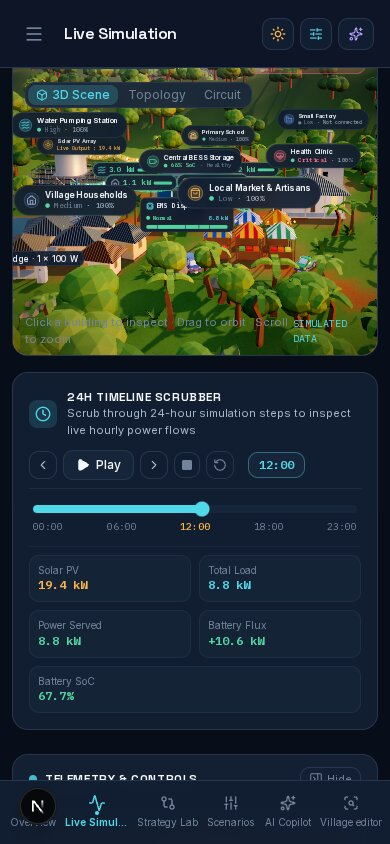

<!-- Generated by `make scenarios-publish` from the local test-scenarios/ folder. Edit the source, then re-run. -->

[← All scenarios](README.md) · theme, language, mobile, data · **32 scenarios** · written in French (UI labels from `fr.json`)

# Vérifications transverses (à faire sur chaque page)

## Données

- [ ] **T1** — Badge `DONNÉES SIMULÉES` visible sur chaque page.
- [ ] **T2** — Un même chiffre (ex. couverture critique) est identique partout : Aperçu, Simulation, Stratégies, Scénarios, Copilote — pour la même stratégie active.
- [ ] **T3** — Texte IA uniquement dans les blocs violets `EXPLICATION IA` ; les chiffres calculés ne sont jamais violets.

## Thème (bouton dans l'en-tête et dans le menu)

- [ ] **T4** — Sombre (défaut) et Clair : tout lisible, aucune zone blanche/noire codée en dur (graphiques, infobulles, 3D, badges).
- [ ] **T5** — Recharger la page garde le thème choisi, sans flash.

## Langue (EN / FR / MG)

- [ ] **T6** — Change la langue sur chaque page : aucun texte resté dans une autre langue (libellés, infobulles, messages d'erreur, noms de stratégies et priorités).
- [ ] **T7** — Lecteur d'écran / survol : les `aria-label` sont aussi traduits.

## Mobile (F12 → mode appareil)

- [ ] **T8** — 320 px et 390 px : une seule colonne, aucun défilement horizontal.
- [ ] **T9** — Barre de navigation en bas ; le contenu n'est pas caché dessous.
- [ ] **T10** — Boutons, curseurs, cases : faciles à toucher (≥ 44 px).
- [ ] **T11** — Menu latéral (bouton menu) s'ouvre et se ferme.

## Accessibilité et fluidité

- [ ] **T12** — Navigation au clavier seul (Tab, Entrée, Espace, flèches sur les curseurs) sur chaque page.
- [ ] **T13** — « Réduire les animations » activé dans l'OS → animations 3D et transitions réduites.
- [ ] **T14** — Bouger les curseurs rapidement → pas de gel de l'interface.

## Fluidité 3D (boucle de rendu)

- [ ] **T15** — `/simulation?perf=1`, Qualité : Haute, scénario « Référence 24h Nominale », « Lancer la simulation » → le compteur « appels de rendu · i/s » s'affiche, les électrons circulent et les nuages dérivent de façon fluide (animations d'ambiance limitées à 30 i/s, sans saccade visible).
- [ ] **T16** — Même page, faire défiler jusqu'à ce que la scène 3D sorte de l'écran pendant 5 s, puis revenir → la scène reprend tout de suite (électrons et nuages repartent), sans écran noir ni figé.
- [ ] **T17** — Qualité : Haute, déplacer le curseur d'heure de 12:00 à 18:00 → les ombres des maisons et des arbres suivent le soleil à chaque heure (ombres recalculées au changement d'heure, pas à chaque image).
- [ ] **T18** — Qualité : Haute, sans toucher au réglage depuis un appareil lent, scène 3D hors écran au chargement (faire défiler avant que la 3D apparaisse) → la qualité n'est pas réduite automatiquement à tort ; le test de fps se fait une fois la scène visible.
- [ ] **T19** — Onglet Réseau des outils de développement, recharger `/simulation` → l'éclairage d'environnement charge `sunset_512.hdr` (~390 Ko) et non plus `sunset_1k.hdr` (1,6 Mo) ; l'éclairage du village reste identique à l'œil.

## Maquette physique — service local (`make bridge`, sans matériel)

- [ ] **T20** — Terminal 1 : `HW_TIME_SCALE=2 make bridge` ; terminal 2 : `HW_TIME_SCALE=2 make bridge-sim` → le bridge affiche `replay · cloudy_afternoon · essential_first` puis une ligne par heure simulée (toutes les 2 s) ; le faux ESP32 affiche pour chaque heure le mode, le SoC et `duty % / disjoncteur` des 6 secteurs ; `industry 0% open` (usine non raccordée).
- [ ] **T21** — Même chose avec `BRIDGE_MODE=twin` → le bridge passe de `model offline` à `model online` dès la 2ᵉ heure. Vers 12:00, appuyer sur `c` dans le faux ESP32 (nuage) → dans les heures suivantes le SoC affiché baisse plus vite qu'en mode `replay` ; `c` à nouveau → retour au soleil.
- [ ] **T22** — Arrêter le faux ESP32 (`q`) pendant que le bridge tourne → au bout de 5 s le bridge affiche `model offline` à l'heure suivante, sans planter ; le relancer → `model online`.
- [ ] **T23** — Copier `.env.example` en `.env` sans remplir `MQTT_URL` puis `make bridge` → démarre normalement sur `mqtt://localhost:1883` (valeur vide = défaut).
- [ ] **T24** — `.env` contient `HW_TIME_SCALE=60` ; lancer `HW_TIME_SCALE=4 make bridge` → la ligne de démarrage affiche `1 h = 4 s` (la ligne de commande gagne sur `.env`). Sans préfixe → la valeur de `.env` (`1 h = 60 s`), ou `1 h = 20 s` si `.env` ne la définit pas. Une valeur changée seulement dans `.env.example` n'a aucun effet.
- [ ] **T25** — Écran ≥ 1280 px : bouton « Réduire le menu latéral » en haut du menu → menu réduit à une colonne d'icônes (nom au survol), plus de place pour la page ; « Agrandir le menu latéral » le rouvre. Recharger la page → le choix est gardé. Thème et langue restent dans l'en-tête. Thème clair et sombre.
- [ ] **T26** — Mobile 390 px et tablette (< 1280 px) : le bouton de réduction n'apparaît pas ; le menu ☰ ouvre toujours le tiroir complet (thème, langue, statut).
- [ ] **T27** — En-tête à 1024 px et 1280 px (revue PR #39) : sur `/overview`, mode « Manuel » → l'en-tête montre un petit bouton de mode (menu « Mode de dispatch ») et le bouton menu ☰ reste cliquable (avant : le sélecteur à 3 boutons recouvrait ☰). Le sélecteur à 3 boutons n'apparaît qu'à partir de 1536 px. En « IA autonome » : bouton « Reprendre la main » dans l'en-tête dès 768 px, badge « IA AUX COMMANDES » à partir de 1280 px ; sous 768 px seule la barre au-dessus de `MobileNav` l'affiche (pas de doublon).
- [ ] **T28** — Graphiques dans un onglet caché (régression) : `/village`, sélectionner un appareil, rester sur le sous-onglet 3D → la console du navigateur (et le terminal `make dev`, lignes `[browser]`) n'affiche plus « The width(0) and height(0) of chart should be greater than 0 » ; passer sur l'onglet de charge → la courbe d'usage s'affiche normalement. Idem /strategies, /overview, copilote.
- [ ] **T29** — Docker Compose sans clé (pas de `.env` à la racine) : `docker compose up -d --build` (ou `make docker-up`) → `docker compose ps` affiche `healthy` ; http://localhost:3000/overview s'ouvre avec le label « SIMULATED DATA » ; sur `/strategies`, scénario « Stress Essentiel (-60%) » → la comparaison des stratégies s'affiche ; le copilote répond en mode hors ligne (mock). `docker compose down` → arrêt propre.
- [ ] **T31** — Docker Compose avec `.env` (`LLM_PROVIDER=meta`, `PORT=3001`) : `docker compose up -d` → l'app reste sur http://localhost:3000 et le copilote utilise Meta. `HOST_PORT=8080 docker compose up -d` → l'app répond sur http://localhost:8080.
- [ ] **T30** — Benchmark : `make bench` → « Tests 2 passed » et `benchmarks/engine.json` réécrit (8 scénarios, latence `simulate` / `compare3`, couverture du dispensaire par stratégie). Le dispensaire sous « Stress Essentiel (-60%) » (`essential_stress`) : 71.9 (proportional) < 75.5 (essential_first). `make bench RUNS=20` → plus rapide, `runsPerMeasure: 20`.
- [ ] **T32** — Contour encré et thème : « Éditeur du village » → générer un modèle 3D, puis basculer le thème (en-tête) sombre ↔ clair sans recharger → le trait du modèle passe de clair à sombre aussitôt ; dans « Simulation » (qualité « Haute »), le contour des bâtiments proches reste sombre dans les deux thèmes.
