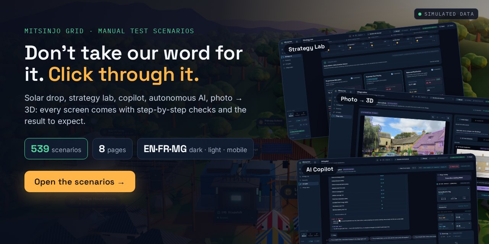
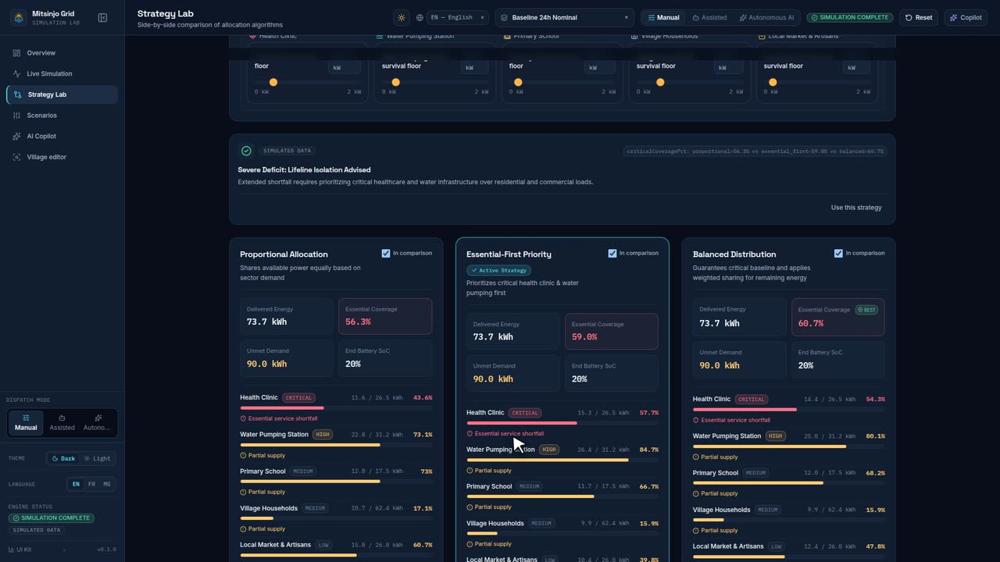
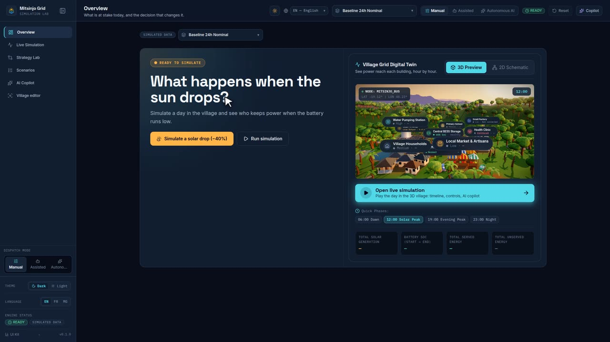
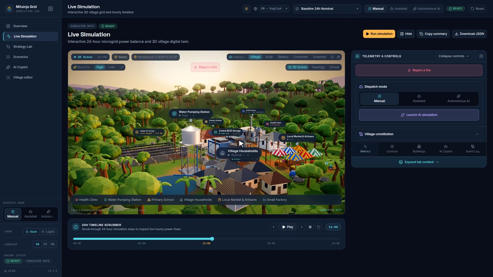
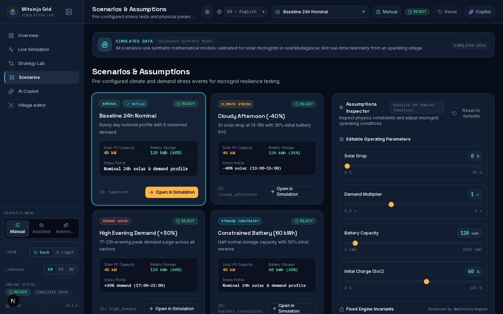
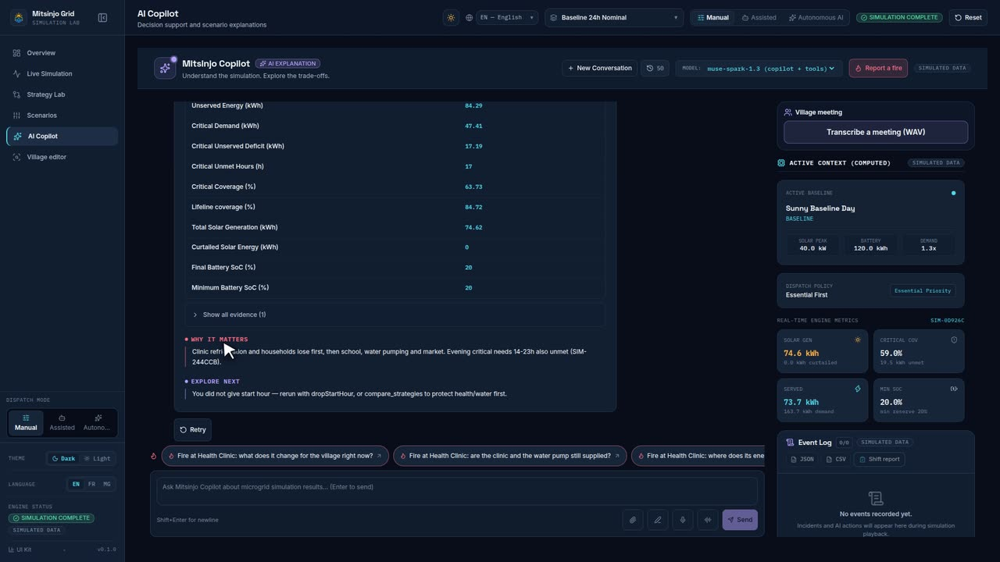
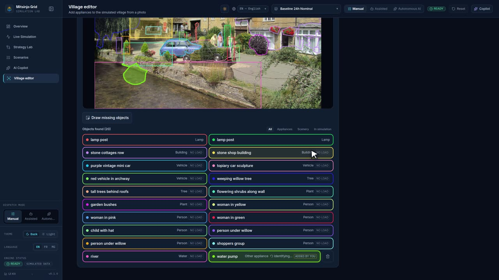
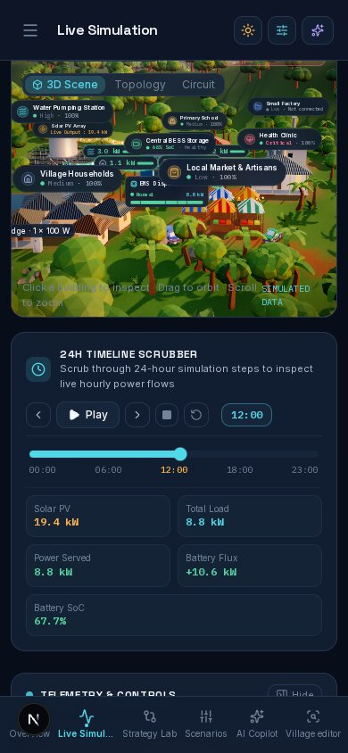

<!-- Generated by `make scenarios-publish` from the local test-scenarios/ folder. Edit the source, then re-run. -->

# Manual test scenarios



**539 step-by-step checks** to try every screen yourself, each one written as
`action → expected result`. They are the checklists used while building Mitsinjo Grid; every visible change
added or updated its scenario. Scenarios are in French and use the French UI labels
(switch the app to **FR** in the header). All data is **simulated**.

## Run the app

```bash
make dev-mock   # app + offline copilot (deterministic answers), no key needed
make dev        # same with the live Meta models (key in .env)
```

## Pages

| Page                                | Where                                        | Preview                                                                                                 | Scenarios |
| ----------------------------------- | -------------------------------------------- | ------------------------------------------------------------------------------------------------------- | --------- |
| [Demo path](00-parcours-demo.md)    | solar drop → strategies → copilot → evidence |      | 18        |
| [Overview](01-apercu.md)            | `/overview`                                  |              | 17        |
| [Live Simulation](02-simulation.md) | `/simulation`                                |                                    | 118       |
| [Strategy Lab](03-strategies.md)    | `/strategies`                                |           | 38        |
| [Scenarios](04-scenarios.md)        | `/scenarios`                                 |             | 18        |
| [AI Copilot](05-copilote.md)        | `/copilot` + header panel                    |  | 113       |
| [Village editor](06-village.md)     | `/village`                                   |  | 185       |
| [Cross-page](99-transverse.md)      | theme, language, mobile, data                |                                            | 32        |

## Golden rule (règle d'or)

La plupart des réglages **ne changent rien sans déficit d'énergie** : avec assez de soleil, toutes les
stratégies servent 100 %. Pour voir un effet, choisis un scénario en déficit :

| Scénario (sélecteur d'en-tête)   | Ce qu'il stresse                                        |
| -------------------------------- | ------------------------------------------------------- |
| Référence 24h Nominale           | Rien — tout doit être servi (contrôle)                  |
| Après-midi Nuageux (-40%)        | Scénario de démo : chute solaire 13–15 h, batterie 35 % |
| Forte Demande Soir (+30%)        | Demande du soir 17–22 h                                 |
| Batterie Restreinte (60 kWh)     | Stockage réduit, réserve de départ 30 %                 |
| Stress Essentiel (-60%)          | Déficit sévère 11–15 h, batterie 25 % — le plus dur     |
| Anomalie de comptage synthétique | Écart de compteur sur le marché → alerte à vérifier     |

Priorités par défaut : Santé = critique · Eau = haute · École et Ménages = moyenne · Marché = faible.
